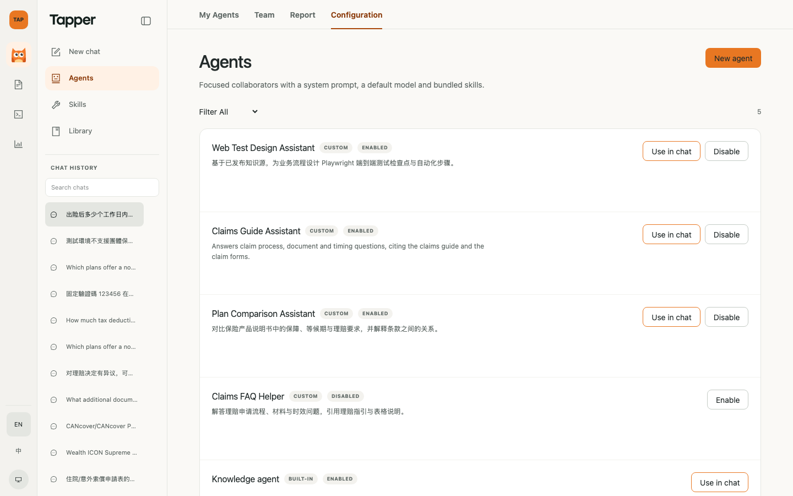
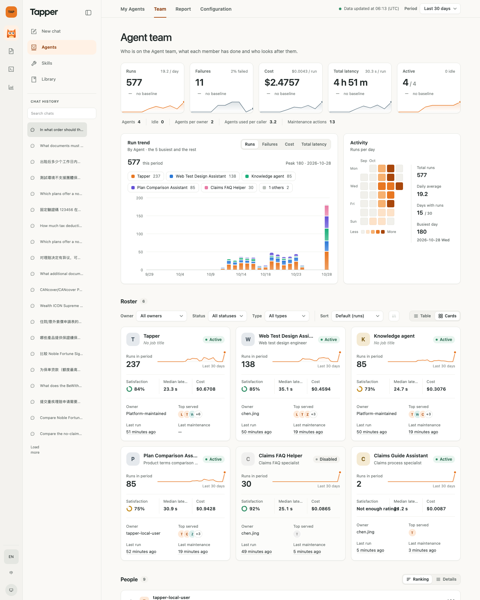
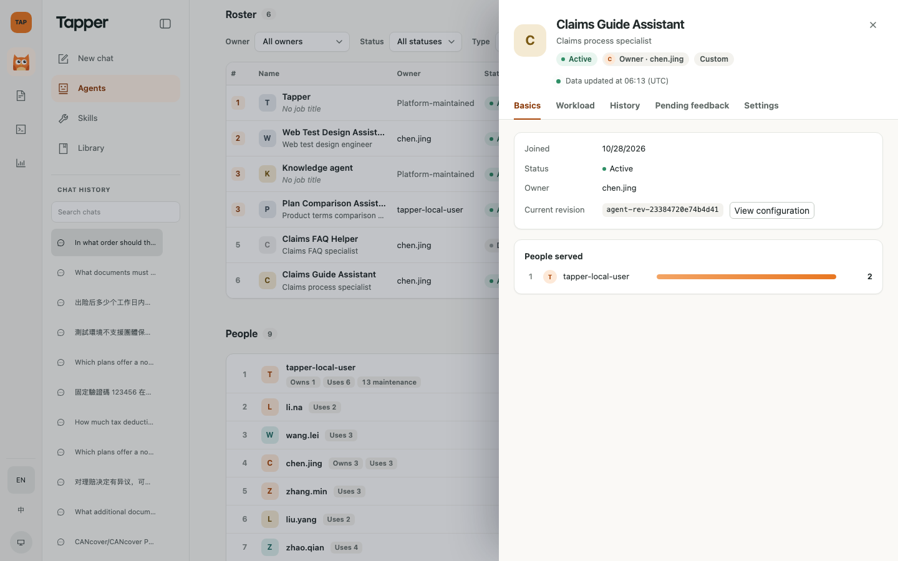

# Agent 团队视图业务流程演示

创建日期：2026-10-28（当日两轮更新）。归属[产品路线图](../superpowers/plans/2026-10-01-product-roadmap.md) V2.1。接续 [Agent 团队视图业务验证交接](2026-10-27-agent-team-business-validation-handoff.md)；口径以 [Agent 团队视图设计](../superpowers/specs/2026-10-22-agent-team-view-design.md)为准。

本文记录 2026-10-28 的工作：对 V2.1 实现做一次完整审查并修复问题；按"分析平台风、浅色"重做 Agents 页面板；产品外壳改为 TAP 品牌与完整模块导航；演示库改为只用香港公开语料并重建验证数据；最后在本地演示环境用真实模型跑通完整业务流程。所有截图均来自 `make demo-dev`（`127.0.0.1:5173`）的真实页面，默认英文界面，1440 宽视口，左上角为 TAP 品牌，侧栏列出 Tapper、Test Management、Low Code Automation、Test Insights。

## 1. 业务流程演示

演示角色：理赔团队负责人（演示身份 `tapper-local-user`）。目标：用一个新的理赔答疑 Agent 替换旧的，让它服务一段时间，处理一条差评，把它交给同事，最后向管理层出一份周报。

### 1.1 新建 Agent，停用旧助手

在 Agents → Configuration 新建 `Claims Guide Assistant`，描述与系统提示词限定它只依据理赔指引与理赔表格作答。

同一页停用被替换的 `Claims FAQ Helper`，停用会写入一条"停用"维护动作。

切到 Team，新成员立即出现在排行表，状态 Idle（还没有运行），负责人默认是创建人。

打开档案的 Settings 填写岗位 "Claims process specialist"，保存后有成功提示。

### 1.2 用这个 Agent 对话并评价

新建对话，选择 3 个理赔来源（理赔指引、重疾理赔表、住院／意外理赔表）和 `Claims Guide Assistant`，提问 "What documents must be submitted with a critical illness claim, and how is the claim benefit paid out?"。真实模型（qwen-plus）返回带引用的回答，对第一轮点 Not helpful。

第二轮追问 "In what order should the two parts of the hospital and accident claim form be completed, and who fills in each part?"。

### 1.3 团队面板看到产出

Team 页顶部是主指标卡（运行、失败、成本、总耗时、活跃）与变化徽章、按 Agent 堆叠的运行趋势、运行热力日历；下面是排行表、人员排行与组织架构图。

新成员的行显示周期内运行 2 次、服务 1 人、满意度 "Not enough ratings"（评分不足 10 条）。

档案的 Basics 与 Workload 页给出入职日期、负责人、服务对象排行、指标卡、趋势与调用量。

### 1.4 处理差评，履历留痕

Pending feedback 页列出那条差评（评价人、时间），填写处理说明后 Mark as resolved，待处理数归零；History 页出现 "Feedback resolved" 与说明。

### 1.5 My Agents

My Agents 把等我处理的反馈置顶，下面是我负责的 Agent 与为我服务的 Agent。

### 1.6 排行表排序与组织架构图

排行表按运行次数排序；人员排行列出每个人的调用量与负责、使用、维护数量。组织架构图按负责人分组，选中一个人后用虚线显示为其服务的 Agent。

### 1.7 周报：10-18 至 10-24，对比上一周

Report 选自定义周期 2026-10-18 至 2026-10-24，自动对比 2026-10-11 至 2026-10-17。本周期运行 227 次（上一周期 170，+34%），总耗时 1 小时 59 分（+40%），成本 US$1.065（+73%），维护动作 2 次。花名册显示 "Ran this period / No runs this period"，停用的 `Claims FAQ Helper` 显示 Disabled。

Export PDF 走浏览器打印（A4 横向）；Export CSV 得到含 `roster.csv`、`people.csv`、`trend.csv` 的 zip（UTF-8 BOM，趋势文件首行注明粒度）。

### 1.8 转交负责人

在 Settings 把 `Claims Guide Assistant` 转交给 `chen.jing`，页面显示当前负责人与成功提示；History 新增 "Owner transferred"。

## 2. 审查结论

三位审查员分别覆盖后端指标计算与 Langfuse 适配器、后端存储／接口／导出／同步标签、前端，另有一次真实页面走查。没有 Critical 问题；下表是已修复的 Important 问题，其余 Minor 问题见第 3 节。

| 层 | 问题 | 处理 |
| --- | --- | --- |
| 后端 | 上一周期按日期形状猜预设：近 7 天、近 30 天、自定义若从 1 号开始，会被当成本月或整月对比 | `GET agent-team/report` 新增 `preset` 参数，前端随周期选择器传入；缺省才按形状推断 |
| 后端 | "中位耗时"实际是按 `outcome:` 分组后按运行数加权的平均，拒答占比高时偏差约 2 倍 | 每个 Agent 单独发一次按 `agent:` 标签过滤、不分组的 p50 查询，并发执行 |
| 后端 | 汇报页本周期与上一周期各用一个 10 秒期限，Langfuse 挂起时最长 18 秒且状态不一致 | 两个周期共享一个期限并发加载 |
| 后端 | Langfuse 不可用时 `servedAvg` 返回 0 而不是空 | 返回 `null`，契约改为可空 |
| 后端 | CSV 导出未防公式注入（Agent 名称、岗位可由用户填写） | 以 `=`、`+`、`-`、`@`、制表符、回车开头的文本单元格加前导单引号 |
| 前端 | 运行数据不可用时档案工作量图、服务对象、我的 Agent、汇报趋势显示 0 或"无"而非"运行数据暂不可用" | 按 `runtimeStatus` 渲染不可用标记 |
| 前端 | 时长格式会出现 "1 m 60 s" "59 m 60 s" | 先取整到秒再拆分；单位改为中英文案 |
| 前端 | 保存岗位、转交负责人没有成功提示，设置页不显示当前负责人 | 加成功提示与当前负责人 |

## 3. 其余修复与界面重做

后端：极端日期（如 `9999-12-31`）返回 500 改为 400 `period_invalid`；冷缓存时统计、近 30 天、趋势、最近运行改为并发加载，并对同一键的并发请求去重，期限耗尽导致的超时不再负缓存 30 秒；Tapper 默认有待处理反馈时即使近期无运行也进入花名册；Skill 升级分类不再依赖绑定顺序；`trend.csv` 的粒度与不可用标记合写在首行，并新增 `bucket_end`；履历游标拒绝类型错误的字段；迁移 0036 回滚时删除外键自动创建的索引；处理"不是待处理状态"的反馈不再写维护事件，处理说明去掉首尾空白，`tapper_default` 的处理时间改用注入时钟。

前端：默认视图不再重复请求花名册；"运行数据同步中"按运行状态标注；趋势读数与纵轴单位统一；从"待我处理的反馈"打开档案直接落到待处理反馈页并显示反馈时间；导出 CSV 改为带加载与错误提示的请求；自定义周期在开始晚于结束时不再发请求；汇报页切换周期时显示刷新提示；筛选出错时保留筛选器；标签页支持方向键；小额成本不再显示为 US$0.00；Tapper 默认成员的名称按界面语言显示（英文 "Tapper"）。

界面重做（分析平台风、浅色，参考 PostHog、Vercel Analytics、LangSmith、Linear 与 GitHub 贡献日历）：主指标卡带与上一周期的变化徽章和迷你趋势，数字首次加载时计数动画（遵循减少动效偏好）；按 Agent 堆叠的运行趋势，可切换指标、开关图例、十字线读数；运行热力日历；花名册默认为排行表（名次、占比条、满意度环、服务对象头像组、迷你趋势、相对时间），卡片视图保留；人员默认排行条；组织架构图按负责人分组、紧凑芯片；档案改为指标卡 + 趋势 + 服务对象排行 + 带图标的维护时间线；汇报页加变化着色、趋势网格线与热力日历；骨架屏加载；打印 A4 横向、不小于 9px。

产品外壳：左上角品牌为 TAP（Tapper 只是 TAP 的一部分），产品导航列出 Tapper、Test Management、Low Code Automation、Test Insights；后两者在本应用内进入时提示在 TAP 工作区中打开。默认语言为英文。

## 4. 验证记录（2026-10-28）

| 项 | 结果 |
| --- | --- |
| 后端单元、契约、架构测试 | 664 通过 |
| 后端 Ruff、格式检查、mypy | 通过（mypy 304 个源文件无问题） |
| 契约导出与前端契约检查 | 通过；`contracts/openapi/api.json` 与生成的 `schema.ts` 更新了 `servedAvg` 可空、`preset` 参数、`resolvedAt`／`resolvedBy` 可空 |
| 隔离 MySQL 集成测试（`TAP_RUN_MYSQL_INTEGRATION=1`，`test_agent_team_store`、`test_agent_team_migration`、`test_agent_team_export`、`test_ai_asset_catalog`） | 44 通过（含新增的 0036 回滚再升级用例） |
| 前端 Vitest 全量 | 第一轮 983 个用例中 982 通过（`TapperWorkspace.chatControls.test.tsx` 1 个用例在全量并行时失败、单独运行通过、与本功能无关）；面板重做与外壳改动后 1013 个用例全部通过 |
| 前端 ESLint、Prettier、tsc、架构检查 | 通过 |
| 真实页面流程（第 1 节） | 通过，浏览器无控制台错误、无 4xx/5xx 请求 |
| `make check` | 第一轮通过；第二轮见 4.1 |
| `make demo-e2e` | 第一轮通过；第二轮见 4.1 |
| 数据重建核对（`~/tap-synthetic-2026-10-28/verify.py`） | 252 项全部一致 |

### 4.1 第二轮门禁（面板重做、外壳改动、数据重建之后）

- `make check`：通过。
- `make demo-e2e`：通过（浏览器旅程含 agent-team 旅程，隔离栈后端校验 32 项通过）。
- 前端 Vitest 全量 1013 个用例通过；外壳改动把"只显示 TAP AI 模块"的 3 处旧断言改为完整的 TAP 模块列表，并新增非 AI 模块的占位提示用例。

## 5. 演示数据与清理

- 新增 Agent `Claims Guide Assistant`（`agent-0081d59bd2a54fbc`），负责人已转交 `chen.jing`，岗位 "Claims process specialist"。
- `Claims FAQ Helper`（`agent-698bbbd066a44725`，10-27 演示创建、10-28 改为英文名）已停用，产生一条"停用"维护动作。
- 2026-10-28 的 2 轮真实运行（会话标题以 "What documents must be submitted" 与 "In what order should the two parts" 开头），1 条已处理的差评，维护事件 3 条（停用、处理差评、转交负责人）。
- 这些数据不在交接文档第 2 节的核对清单内（核对在演示之前完成）；10-11 至 10-24 两周的数字不受影响。
- 清理：在 Configuration 中停用 `Claims Guide Assistant`，经接口删除上述 2 个会话（`DELETE /api/v1/projects/tapper-demo/conversations/{id}`，带 `Origin` 头）；评分按 spec 2.3 保留。

## 6. 已知限制

- 运行数据缓存 5 分钟，不同查询的缓存时间可能不同：新 Agent 刚运行后的几分钟内，行里可能已显示运行次数但"最近运行"仍为"—"，"数据更新于"显示的是最早一项的时间；5 分钟后自动一致。截图在缓存刷新后重拍。
- 近 30 天的变化徽章在重建后的数据上显示 "— no baseline"：上一个 30 天没有数据。
- 演示身份固定，组织架构图与人员表里的其他人员来自仿真数据。
- 汇报页抬头仍显示项目 ID，人员仍显示 `actor_id`（V4 接入身份前没有显示名）。
