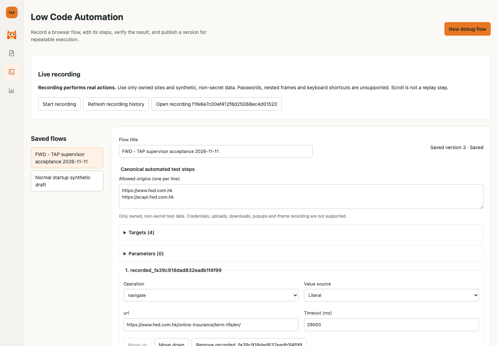

# TAP 内 LCA 产品集成验收（2026-11-11）

## 实际用户路径

从正常 TAP `/?module=low-code` 进入，保留 TAP 产品侧栏，创建真实 SQL 草稿，录制 FWD 导航，在编辑器补充年龄点击与两个报价断言，保存并切换到 Test Insights 后返回，刷新重开保存的流程，再显式独立回放。全部 5 个规范步骤通过。没有向保险公司提交投保或真实个人资料。

最终浏览器验收使用真实 `scripts/run-tapper-dev.sh` 正常启动的完整隔离实例，包含标准 TAP app、TAP AI 同源授权网关、现有 BrowserWorker/LocalBrowserRuntime；不是自定义应用 harness。测试身份和数据库为隔离合成环境，**不是企业 SSO 或生产部署验收**。桌面和 390px 移动视口验看，修复长录制 ID 按钮裁切；页面重新加载后读取服务器保存的 v3。

[移动视口](assets/2026-11-11-lca-product-integration/mobile.png)

## 发布与独立回放

- 将真实通过的 v2 发布，再把草稿导航超时从 30 秒改为 29 秒并保存为 v3。
- 发布版本：`2a8786bcfc14420ab3e2fcdb8ebc02a1`，验证运行：`b2a498e734ad40b58729126a71ea5af2`。
- 发布版本新运行：`7e8c01494f0b4388b18bd19173fdb5bd`，classification=`published`，snapshot version=`2`。
- 冻结定义摘要：`2530b8b2d6702bb9f09191d53c0ccb56b1d572e00c86e9cde3e3dfb57de56bcd`，与发布版本摘要相同。
- 执行状态：`passed`，5/5 规范步骤通过；新的页面得到当时 FWD Standard HK$10.62/月。
- 请求计数验证保存、发布、查看版本不启动浏览器执行，仅显式 Confirm published replay 触发一次新执行。
- 发布参数表单读取不可变版本自己的定义；不使用后来草稿的参数模式。

## 已运行门禁

- TAP Web 全量：315 测试通过，含发布未知结果重试、并发读取和列表刷新回归。
- `make test`：通过，后端核心461、前端核心83、Insights后端70、Insights前端9。
- 后端视频证据漏 MIME 映射导致500，已新增先失败后通过的回归并修复，7项API契约测试通过。保留DB/对象重启正常supervisor后，同一AIA及FWD运行的视频下载均HTTP200、video/webm，内容SHA256与receipt一致。
- 后端 LCA 127、gateway/授权33、MySQL 8.4.6 的0011升降级/7表/重连持久化及有数据禁止降级通过。
- 真实标准 app 完整 FWD 录制/编辑/回放通过；不可变发布版本回放通过。
- `make check`：通过，包含格式、类型、架构边界、OpenAPI、构建和后端465通过/47跳过。
- 正常 supervisor 同源持久化、FWD全链路及发布冻结版本回放通过；9项supervisor回归通过。
- `TAP_RUN_LCA_RECORDING_UI=1` 已在正常 TAP 路由运行自有站真实 Chromium 录制/编辑/冻结回放集成测试，1通过。
- AIA 在正常产品中导入既有已录制12步定义，UI编辑超时、保存v2、刷新重开、显式独立回放12/12通过（运行 `88e4c70f23d341b48cc508d1e36fe46c`）。本轮不是重新录制AIA全流程。

## 明确保留的范围

本轮重新验收 FWD 完整产品链路和 AIA 已录制资产的编辑/保存/独立回放。FWD实时下拉录制限制仍在，已支持的录制加编辑器补齐路径保留。发布资产维持项目和owner私有，未实现跨用户共享、Test Plan绑定、定时套件或生产SSO部署；不能称整个LCA/AA项目完成。
