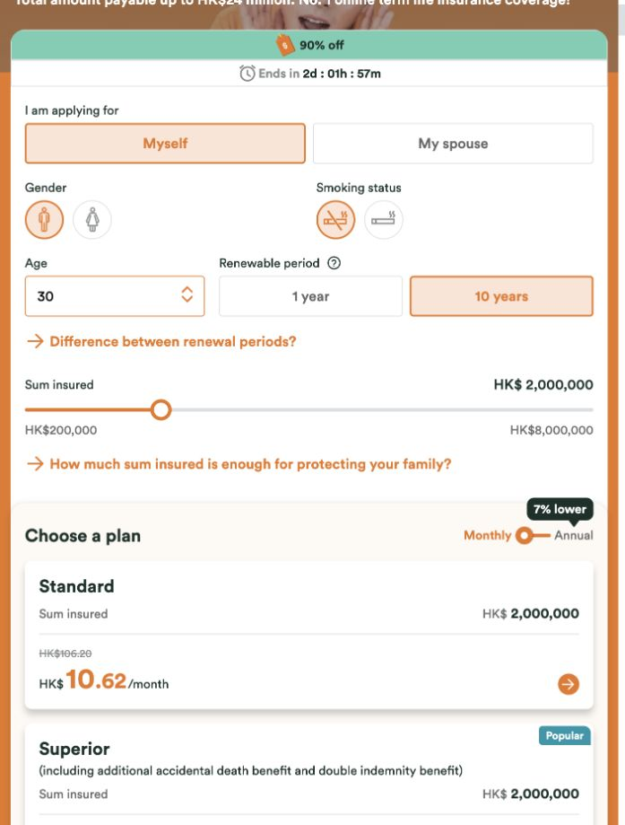
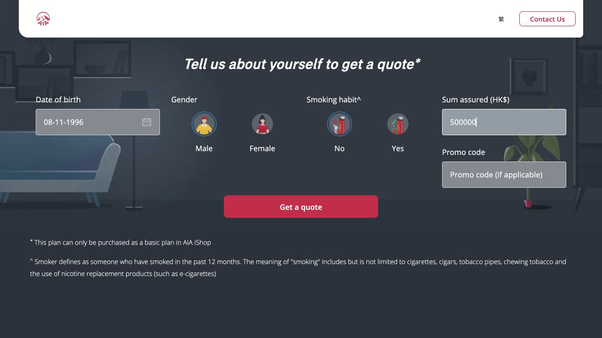
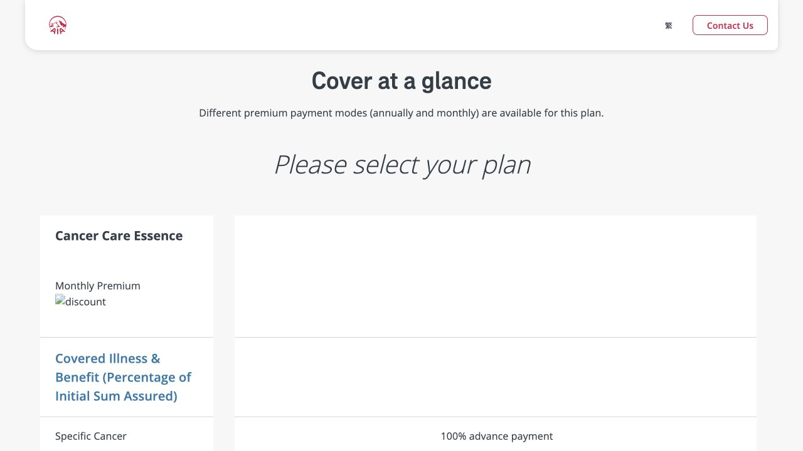

# Codex 浏览器工具记录（脱敏）

仅导出工具调用及返回的页面事实。时间为 Asia/Shanghai。失败、超时及不确定结果均保留；删减范围逐项声明。

[对照报告](../../2026-11-09-codex-browser-reference.md) | [结构化记录](tool-calls.jsonl)

## 01 · 21:46:37 · 打开 FWD 产品列表，开始 Codex 对照操作

工具：`mcp__cua_repl.js`；回执：`call_81624abf421641c49cb00b872a4c530b`。

```javascript
var fwdTab = await cua.createBrowserTab("iab", "https://www.fwd.com.hk/online-insurance/en/", {visible:true});
```

```text
Wall time: 30.0383 seconds
Output:
```

```text
js execution timed out; kernel reset, rerun your request
```

## 02 · 21:47:12 · 核对浏览器标签页状态，避免超时后重复操作

工具：`mcp__cua_repl.js`；回执：`call_97a2f73765454971bfeefe45221f4dbc`。

```javascript
await cua.getState();
```

```text
Wall time: 0.4149 seconds
Output:
```

删减说明：工具能力文档及执行政策不导出；操作代码与网站观察另行保留。 私人应用/标签页可访问性内容不导出。此处曾绑定到用户的 Netflix 窗口，随后停止原生 Chrome 操作。

## 03 · 21:47:18 · 接管已创建的空白标签页

工具：`mcp__cua_repl.js`；回执：`call_822a14c6013646b59c392eed748037db`。

```javascript
var fwdTab = await cua.getTab("1", {browser:"1"});
```

```text
Wall time: 0.2418 seconds
Output:
```

```text
Browser tab: 1, Title: "about:blank", URL: "about:blank".
0 AXWebArea about:blank

The focused UI element is 0 AXWebArea about:blank
```

删减说明：工具能力文档及执行政策不导出；操作代码与网站观察另行保留。

## 04 · 21:47:35 · 从原始产品列表入口观察可操作元素

工具：`mcp__cua_repl.js`；回执：`call_f2ae39acfe234f2894ce38f06cf48b62`。

```javascript
await fwdTab.goto("https://www.fwd.com.hk/online-insurance/en/"); await fwdTab.getAXState();
```

```text
Wall time: 65.4142 seconds
Output:
```

```text
js execution timed out; kernel reset, rerun your request
```

## 05 · 21:48:48 · 确认超时后的实际页面状态

工具：`mcp__cua_repl.js`；回执：`call_276d0cf3baf845cc99d4d4ca1527318f`。

```javascript
var fwdTab = await cua.getTab("1", {browser:"1"});
```

```text
Wall time: 65.6847 seconds
Output:
```

```text
js execution timed out; kernel reset, rerun your request
```

## 06 · 21:50:11 · 读取当前内置浏览器的故障排查接口

工具：`mcp__cua_repl.js`；回执：`call_fe537a59ecb74be997ca6c2301da0cb9`。

```javascript
var browser = await cua.getBrowser({id:"1"});
```

```text
Wall time: 0.3570 seconds
Output:
```

删减说明：工具能力文档及执行政策不导出；操作代码与网站观察另行保留。

## 07 · 21:50:17 · 读取故障恢复规则并核对标签页实际地址

工具：`mcp__cua_repl.js`；回执：`call_bf24ce09c16e4581823dd6bc86f76e3e`。

```javascript
nodeRepl.write(await agent.documentation.get("browser-troubleshooting")); nodeRepl.write(await browser.tabs.list());
```

```text
Wall time: 0.0115 seconds
Output:
```

删减说明：故障排查能力文档省略。

## 08 · 21:50:24 · 改用 DOM 快照读取已打开的 FWD 页面

工具：`mcp__cua_repl.js`；回执：`call_50278bac37d144d5b83e832920e5f305`。

```javascript
var fwdTab = await browser.tabs.get("1"); nodeRepl.write(await fwdTab.playwright.domSnapshot());
```

```text
Wall time: 30.0115 seconds
Output:
```

```text
js execution timed out; kernel reset, rerun your request
```

## 09 · 21:51:01 · 从应用界面查看内置浏览器是否正常显示

工具：`mcp__cua_repl.js`；回执：`call_62916db2f2f045ab8744a78ad661cafa`。

```javascript
var codexApp = await cua.getApp("com.openai.codex");
```

```text
Wall time: 0.3898 seconds
Output:
```

```text
Computer Use is not allowed to use the app 'com.openai.codex' for safety reasons.
```

删减说明：工具能力文档及执行政策不导出；操作代码与网站观察另行保留。

## 10 · 21:51:17 · 使用 Codex 的 Chrome 控制通道建立独立对照会话

工具：`mcp__cua_repl.js`；回执：`call_a478357c4eeb44718c2dfe0d8f107794`。

```javascript
var fwdTab = await cua.createBrowserTab("chrome", "https://www.fwd.com.hk/online-insurance/en/", {sessionName:"🔎 Tapper 对照记录"});
```

```text
Wall time: 0.0624 seconds
Output:
```

```text
Browser is not available: chrome
```

## 11 · 21:51:22 · 检查可用的 Chrome 原生辅助功能通道

工具：`mcp__cua_repl.js`；回执：`call_1c293023b0ee44d3aa733777f0373e7f`。

```javascript
var chromeApp = await cua.getApp("com.google.Chrome");
```

```text
Wall time: 16.8050 seconds
Output:
```

删减说明：私人应用/标签页可访问性内容不导出。此处曾绑定到用户的 Netflix 窗口，随后停止原生 Chrome 操作。

## 12 · 21:51:46 · 在独立 Chrome 窗口打开 FWD 原始入口

工具：`mcp__cua_repl.js`；回执：`call_2f00fd9f0f3949b193987e889b62fa08`。

```javascript
await chromeApp.pressKey("super+n"); await chromeApp.pressKey("super+l"); await chromeApp.typeText("https://www.fwd.com.hk/online-insurance/en/"); await chromeApp.pressKey("Return"); await chromeApp.getAXState();
```

```text
Wall time: 23.0378 seconds
Output:
```

```text
原生 Chrome 操作因用户切换/使用应用被中断；具体执行到哪一步无法由回执确认。
```

## 13 · 21:52:18 · 重新读取独立窗口状态后再操作

工具：`mcp__cua_repl.js`；回执：`call_2e9878bb6dcf4d0faeccde647c9b79c9`。

```javascript
await chromeApp.getAXState();
```

```text
Wall time: 0.1856 seconds
Output:
```

```text
原生 Chrome 操作因用户切换/使用应用被中断；具体执行到哪一步无法由回执确认。
```

## 14 · 21:52:32 · 尝试内置浏览器的截图通道，避免干扰正在使用的 Chrome

工具：`mcp__cua_repl.js`；回执：`call_4742d3633c3e4a03be9560c5ee28c452`。

```javascript
var browser = await cua.getBrowser({id:"1"}); var fwdTab = await browser.tabs.get("1"); await nodeRepl.emitImage(await fwdTab.screenshot({fullPage:false}));
```

```text
Wall time: 34.5892 seconds
Output:
```

```text
js execution timed out; kernel reset, rerun your request
```

## 15 · 21:53:21 · 用 AIA 页面区分单页故障与浏览器通道故障

工具：`mcp__cua_repl.js`；回执：`call_e0fa3a5e949d4d58811d00f3b640bab2`。

```javascript
var aiaTab = await cua.createBrowserTab("iab", "https://www.aia.com.hk/en/products/health/cancer-care-essence", {visible:true});
```

```text
Wall time: 34.2762 seconds
Output:
```

```text
js execution timed out; kernel reset, rerun your request
```

## 16 · 21:57:24 · 读取 FWD 标签页及弹窗关闭控件

工具：`mcp__cua_repl.js`；回执：`call_00711ed694a0405e9068d344340ad8a9`。

```javascript
var fwdTab = await cua.getTab({url:"https://www.fwd.com.hk/online-insurance/en/"}, {browser:"1"});
```

```text
Wall time: 24.3193 seconds
Output:
```

```text
js execution timed out; kernel reset, rerun your request
```

## 17 · 21:58:18 · 连接已选定的内置浏览器

工具：`mcp__cua_repl.js`；回执：`call_ad4a95e90f1c4013a85f73e0811abbe2`。

```javascript
var browser = await cua.getBrowser({id:"1"});
```

```text
Wall time: 0.3980 seconds
Output:
```

删减说明：工具能力文档及执行政策不导出；操作代码与网站观察另行保留。

## 18 · 21:58:27 · 单独取得 FWD 标签页句柄，避免自动读取整页

工具：`mcp__cua_repl.js`；回执：`call_3a2e01e3d93c4776b3e06e072401467a`。

```javascript
nodeRepl.write(await browser.tabs.list()); var fwdTab = await browser.tabs.get("1"); nodeRepl.write("FWD tab handle ready");
```

```text
Wall time: 12.0167 seconds
Output:
```

```text
[
  {
    id: '1',
    providerTabId: 'browser-use:e18acd00-5489-4c30-8693-1b063c16c9b1',
    title: 'FWD Online | HK’s Largest Online Insurance Platform',
    url: 'https://www.fwd.com.hk/online-insurance/en/'
  },
  {
    id: '2',
    providerTabId: 'browser-use:8a679894-34c0-4354-a10f-1972824a2c3c',
    title: 'about:blank',
    url: 'about:blank'
  }
]FWD tab handle ready
```

## 19 · 21:58:47 · 只读取可见按钮，定位弹窗右上角关闭按钮

工具：`mcp__cua_repl.js`；回执：`call_0b8c0e6ad1974b0da5ecaba023265331`。

```javascript
nodeRepl.write(await fwdTab.playwright.evaluate(() => [...document.querySelectorAll('button,[role="button"]')].filter(el => el.getClientRects().length).map(el => ({tag:el.tagName,id:el.id,label:el.getAttribute('aria-label'),title:el.getAttribute('title'),text:(el.innerText || '').slice(0,100)})), undefined, {timeoutMs:5000}));
```

```text
Wall time: 15.0347 seconds
Output:
```

```text
[
  {
    id: '',
    label: 'Toggle drawer menu',
    tag: 'BUTTON',
    text: '',
    title: null
  },
  {
    id: 'tabs::R153im::trigger-0',
    label: null,
    tag: 'BUTTON',
    text: 'Life',
    title: null
  },
  {
    id: 'tabs::R153im::trigger-1',
    label: null,
    tag: 'BUTTON',
    text: 'Critical Illness',
    title: null
  },
  {
    id: 'tabs::R153im::trigger-2',
    label: null,
    tag: 'BUTTON',
    text: 'Popular\nSavings',
    title: null
  },
  {
    id: 'tabs::R153im::trigger-3',
    label: null,
    tag: 'BUTTON',
    text: 'Essent
Combo',
    title: null
  },
  {
    id: 'tabs::R153im::trigger-4',
    label: null,
    tag: 'BUTTON',
    text: 'Popular\nVHIS',
    title: null
  },
  {
    id: 'tabs::R153im::trigger-5',
    label: null,
    tag: 'BUTTON',
    text: 'Medical',
    title: null
  },
  {
    id: 'tabs::R153im::trigger-6',
    label: null,
    tag: 'BUTTON',
    text: 'Accident',
    title: null
  },
  {
    id: 'tabs::R153im::trigger-7',
    label: null,
    tag: 'BUTTON',
    text: 'Travel',
    title: null
  },
  {
    id: 'tabs::R153im::trigger-8',
    label: null,
    tag: 'BUTTON',
    text: 'Home',
    title: null
  },
  {
    id: 'tabs::R153im::trigger-9',
    label: null,
    tag: 'BUTTON',
    text: 'Motor',
    title: null
  },
  { id: '', label: 'Next', tag: 'BUTTON', text: '', title: null },
  {
    id: 'tabs::Rr53im::trigger-0',
    label: null,
    tag: 'BUTTON',
    text: 'Term Life',
    title: null
  },
  {
    id: 'tabs::Rr53im::trigger-1',
    label: null,
    tag: 'BUTTON',
    text: "HK's No.1 High Interest Rate#",
    title: null
  },
  { id: '', label: null, tag: 'BUTTON', text: '', title: null },
  { id: '', label: null, tag: 'BUTTON', text: '', title: null },
  { id: '', label: null, tag: 'BUTTON', text: '', title: null },
  { id: '', label: null, tag: 'BUTTON', text: '', title: null },
  { id: '', label: null, tag: 'BUTTON', text: '', title: null },
  { id: '', label: null, tag: 'BUTTON', text: '', title: null },
  { id: '', label: null, tag: 'BUTTON', text: '', title: null },
  { id: '', label: null, tag: 'BUTTON', text: '', title: null },
  { id: '', label: null, tag: 'BUTTON', text: '', title: null },
  { id: '', label: null, tag: 'BUTTON', text: '', title: null },
  { id: '', label: null, tag: 'BUTTON', text: '', title: null },
  { id: '', label: null, tag: 'BUTTON', text: '', title: null },
  { id: '', label: null, tag: 'BUTTON', text: '', title: null },
  { id: '', label: null, tag: 'BUTTON', text: '', title: null },
  {
    id: '',
    label: null,
    tag: 'BUTTON',
    text: 'What documents do I need for online application?',
    title: null
  },
  {
    id: '',
    label: null,
    tag: 'BUTTON',
    text: 'What will be the consequence if I incorrectly declared my health condition or medical record during ',
    title: null
  },
  {
    id: '',
    label: null,
    tag: 'BUTTON',
    text: 'I am unsure about my health conditions during application, what should I do?',
    title: null
  },
  {
    id: '',
    label: null,
    tag: 'BUTTON',
    text: 'How do I file a claim?',
    title: null
  },
  {
    id: '',
    label: null,
    tag: 'BUTTON',
    text: 'How do I know if my application is successful?',
    title: null
  },
  {
    id: '',
    label: null,
    tag: 'BUTTON',
    text: 'How do I check my policy document?',
    title: null
  },
  {
    id: 'collapsible::R33im::trigger',
    label: null,
    tag: 'BUTTON',
    text: '*Remarks',
    title: null
  },
  { id: '', label: null, tag: 'BUTTON', text: '繁', title: null },
  {
    id: '',
    label: null,
    tag: 'BUTTON',
    text: 'Visit your local FWD site\nHong Kong',
    title: null
  },
  {
    id: '',
    label: 'Close dialog',
    tag: 'BUTTON',
    text: '',
    title: null
  }
]
```

## 20 · 21:59:11 · 点击已识别的 Close dialog，并核对弹窗已移除

工具：`mcp__cua_repl.js`；回执：`call_5be74493a80c46e3aff9d7eef5a5d868`。

```javascript
await fwdTab.playwright.getByRole("button", {name:"Close dialog",exact:true}).click({timeoutMs:5000}); nodeRepl.write(await fwdTab.playwright.getByRole("button", {name:"Close dialog",exact:true}).count()); nodeRepl.write(await fwdTab.playwright.getByRole("link", {name:"Product details & Quote",exact:true}).count());
```

```text
Wall time: 20.0104 seconds
Output:
```

```text
js execution timed out; kernel reset, rerun your request
```

## 21 · 21:59:41 · 恢复浏览器连接以确认刚才点击的结果

工具：`mcp__cua_repl.js`；回执：`call_e31466e5b6084ef09700d91bcc22729d`。

```javascript
var browser = await cua.getBrowser({id:"1"});
```

```text
Wall time: 0.3644 seconds
Output:
```

删减说明：工具能力文档及执行政策不导出；操作代码与网站观察另行保留。

## 22 · 21:59:50 · 核对弹窗是否关闭，并读取实际产品详情入口

工具：`mcp__cua_repl.js`；回执：`call_4ca2c5b0ed1a4860b63cb07b403d1286`。

```javascript
var fwdTab = await browser.tabs.get("1"); nodeRepl.write(await fwdTab.playwright.evaluate(() => ({closeButtons:[...document.querySelectorAll('button[aria-label="Close dialog"]')].map(el=>({visible:!!el.getClientRects().length})), links:[...document.querySelectorAll('a')].filter(el=>el.innerText.includes('Product details')).map(el=>({text:el.innerText,href:el.getAttribute('href')}))}), undefined, {timeoutMs:5000}));
```

```text
Wall time: 34.5531 seconds
Output:
```

```text
{
  closeButtons: [ { visible: false }, { visible: true } ],
  links: [
    {
      href: '/online-insurance/term-life/en/',
      text: 'Product details & Quote'
    },
    {
      href: '/online-insurance/savings-and-term-life/en/',
      text: 'Product details & Quote'
    },
    {
      href: '/online-insurance/savings-and-term-critical-illness/en/',
      text: 'Product details & Quote'
    },
    {
      href: '/online-insurance/term-critical-illness/en/',
      text: 'Product details & Quote'
    },
    {
      href: '/online-insurance/savings-and-term-critical-illness/en/',
      text: 'Product details & Quote'
    },
    {
      href: '/online-insurance/savings-and-term-life/en/',
      text: 'Product details & Quote'
    },
    {
      href: '/online-insurance/fast-fortune-short-term-savings-plan/en/',
      text: 'Product details & Quote'
    },
    {
      href: '/online-insurance/savings-and-term-critical-illness/en/',
      text: 'Product details & Quote'
    },
    {
      href: '/online-insurance/savings-and-term-life/en/',
      text: 'Product details & Quote'
    },
    {
      href: '/online-insurance/medical-and-critical-illness/en/',
      text: 'Product details & Quote'
    },
    {
      href: '/online-insurance/myguard-all-in-1/en/',
      text: 'Product details & Quote'
    },
    {
      href: '/online-insurance/vhis-vprime-medical-plan/en/',
      text: 'Product details & Quote'
    },
    {
      href: '/online-insurance/vhis-vfamily-medical-plan/en/',
      text: 'Product details & Quote'
    },
    {
      href: '/online-insurance/vhis-vcare-medical-plan/en/',
      text: 'Product details & Quote'
    },
    {
      href: '/online-insurance/ebeyond-medical-employee-benefit/en/',
      text: 'Product details & Quote'
    },
    {
      href: '/online-insurance/one-n-all-medical/en/',
      text: 'Product details & Quote'
    },
    {
      href: '/online-insurance/gbassure-outpatient-plan/en/',
      text: 'Product details & Quote'
    },
    {
      href: '/online-insurance/healthy-plus/en/',
      text: 'Product details & Quote'
    },
    {
      href: '/online-insurance/mymillion-medical/en/',
      text: 'Product details & Quote'
    },
    {
      href: '/online-insurance/cancer-cansurance/en/',
      text: 'Product details & Quote'
    },
    {
      href: '/online-insurance/mysafe-accident-protection-plan/en/',
      text: 'Product details & Quote'
    }
  ]
}
```

## 23 · 22:00:35 · 点击当前可见的弹窗关闭按钮

工具：`mcp__cua_repl.js`；回执：`call_acbaae4bd04345f5b041a500bdc51644`。

```javascript
await fwdTab.playwright.locator('button[aria-label="Close dialog"]').filter({visible:true}).click({timeoutMs:5000}); nodeRepl.write("visible Close dialog click completed");
```

```text
Wall time: 0.4573 seconds
Output:
```

```text
visible Close dialog click completed
```

## 24 · 22:00:44 · 确认弹窗关闭，并确认 MyTerm Plus 的产品入口

工具：`mcp__cua_repl.js`；回执：`call_d8c268e150614446a4ce6422afb53eaf`。

```javascript
nodeRepl.write(await fwdTab.playwright.evaluate(() => ({visibleCloseButtons:[...document.querySelectorAll('button[aria-label="Close dialog"]')].filter(el=>el.getClientRects().length).length, productLinks:[...document.querySelectorAll('a[href="/online-insurance/term-life/en/"]')].filter(el=>el.getClientRects().length).map(el=>({text:el.innerText,context:el.parentElement.innerText.slice(0,700)}))})));
```

```text
Wall time: 3.0956 seconds
Output:
```

```text
{
  productLinks: [
    {
      context: 'HK$\n11.52\n/month\nHK$115.20\nProduct details & Quote',
      text: 'Product details & Quote'
    }
  ],
  visibleCloseButtons: 0
}
```

## 25 · 22:00:56 · 进入 MyTerm Plus，读取当前表单与报价条件

工具：`mcp__cua_repl.js`；回执：`call_e5e83e830bfa46bab7d20f8dcb4fce66`。

```javascript
await fwdTab.playwright.locator('a[href="/online-insurance/term-life/en/"]').filter({visible:true}).click({timeoutMs:10000}); nodeRepl.write(await fwdTab.playwright.domSnapshot());
```

```text
Wall time: 3.5746 seconds
Output:
```

```text
- banner:
  - button "Toggle drawer menu"
  - link "FWD Logo":
    - /url: /online-insurance/en/
    - img "FWD Logo"
  - link "Get a quote":
    - /url: "#QuoteWidgetContainer"
    - generic: Get a quote
  - link "Need help?":
    - /url: "#Contactus"
    - generic: Need help?
- heading "Best Deal 2026" [level=1]
- heading "MyTerm Plus Term Life Insurance Plan" [level=2]
- heading "Total amount payable up to HK$24 million. No. 1 online term life insurance coverage!" [level=2]
- paragraph: I am applying for
- generic "RadioButtonGroup":
  - radiogroup:
    - radio "Myself" [checked]
    - radio "My spouse"
- paragraph: Gender
- generic "RadioButtonGroup":
  - radiogroup:
    - radio [checked]
    - radio
- paragraph: Smoking status
- generic "RadioButtonGroup":
  - radiogroup:
    - radio [checked]
    - radio
- generic "Combobox":
  - generic: Age
  - combobox: "25"
  - button "Toggle suggestions":
- paragraph:
  - text: Renewable period
- generic "RadioButtonGroup":
  - radiogroup:
    - radio "1 year"
    - radio "10 years" [checked]
- link "Difference between renewal periods?":
  - /url: "#Flexiblerenewableperiod.10yearsrenewableperiodallowsyoutoplanaheadonyourexpenses"
  - text: Difference between renewal periods?
- generic: Sum insured
- generic: HK$
- generic: 2,000,000
- slider
- generic: HK$200,000
- generic: HK$8,000,000
- link "How much sum insured is enough for protecting your family?":
  - /url: "#Howmuchsuminsuredisenoughforprotectingyourfamily?"
  - text: How much sum insured is enough for protecting your family?
- paragraph: Choose a plan
- generic "ToggleSwitch":
  - generic: Monthly
  - button
  - generic: 7% lower
  - generic: Annual
- link "Standard Sum insured HK$ 0.00 HK$ /month":
  - /url: /online-insurance/term-life/en/contact/
  - generic: Standard
  - generic: Sum insured
  - generic: HK$
  - generic: "0.00"
  - generic: HK$
  - generic: /month
- link "Popular Superior (including additional accidental death benefit and double indemnity benefit) Sum insured HK$ 0.00 HK$ /month":
  - /url: /online-insurance/term-life/en/contact/
  - generic: Popular
  - generic: Superior
  - generic: (including additional accidental death benefit and double indemnity benefit)
  - generic: Sum insured
  - generic: HK$
  - generic: "0.00"
  - generic: HK$
  - generic: /month
- link "Compare the plans":
  - /url: "#Planlevelscomparison"
  - text: Compare the plans
- button "Want to know more?":
  - text: Want to know more?
```

## 26 · 22:01:12 · 读取可见输入控件的只读状态、选中值和真实属性

工具：`mcp__cua_repl.js`；回执：`call_c57b1e0043bd41f5a9834c8c8cbd30d0`。

```javascript
nodeRepl.write(await fwdTab.playwright.evaluate(() => [...document.querySelectorAll('input,[role="slider"]')].filter(el=>el.getClientRects().length).map(el=>({tag:el.tagName,id:el.id,name:el.getAttribute('name'),type:el.getAttribute('type'),role:el.getAttribute('role'),value:el.value,checked:el.checked,readonly:el.readOnly,ariaNow:el.getAttribute('aria-valuenow'),label:el.getAttribute('aria-label'),html:el.outerHTML.slice(0,1800),parent:el.parentElement.innerText.slice(0,150)}))));
```

```text
Wall time: 1.1007 seconds
Output:
```

```text
[
  {
    ariaNow: null,
    checked: false,
    html: '<input data-scope="combobox" data-part="input" dir="ltr" autocomplete="off" autocorrect="off" autocapitalize="none" spellcheck="false" readonly="" id="combobox::R639cv93im::input" type="text" role="combobox" aria-autocomplete="list" aria-controls="combobox::R639cv93im::content" aria-expanded="false" data-state="closed" class="w-full border-0 bg-transparent focus-visible:outline-0 focus-visible:outlinestyle-none not-data-search:cursor-pointer whitespace-nowrap overflow-hidden text-overflow-ellipsis lh-[0px] placeholder:transition-colors placeholder:color-grey-dark py-12 pl-14 pr-8 h-46" data-filled="" data-has-label="" data-label-mode="static" data-size="md" data-variant="outline" value="25">',
    id: 'combobox::R639cv93im::input',
    label: null,
    name: null,
    parent: '',
    readonly: true,
    role: 'combobox',
    tag: 'INPUT',
    type: 'text',
    value: '25'
  },
  {
    ariaNow: '2000000',
    checked: false,
    html: '<div class="rc-slider-handle" style="left:23.076923076923077%;transform:translateX(-50%)" tabindex="0" role="slider" aria-valuemin="200000" aria-valuemax="8000000" aria-valuenow="2000000" aria-disabled="false" aria-orientation="horizontal"></div>',
    id: '',
    label: null,
    name: null,
    parent: '',
    readonly: false,
    role: 'slider',
    tag: 'DIV',
    type: null,
    value: ''
  }
]
```

## 27 · 22:01:22 · 展开只读年龄下拉，观察实际可选年龄

工具：`mcp__cua_repl.js`；回执：`call_9005796fcb3d4d748c0502d9b2e9d7da`。

```javascript
await fwdTab.playwright.getByRole('button',{name:'Toggle suggestions',exact:true}).click(); nodeRepl.write(await fwdTab.playwright.domSnapshot());
```

```text
Wall time: 0.6190 seconds
Output:
```

```text
- banner:
  - button "Toggle drawer menu"
  - link "FWD Logo":
    - /url: /online-insurance/en/
    - img "FWD Logo"
  - link "Get a quote":
    - /url: "#QuoteWidgetContainer"
    - generic: Get a quote
  - link "Need help?":
    - /url: "#Contactus"
    - generic: Need help?
- heading "Best Deal 2026" [level=1]
- heading "MyTerm Plus Term Life Insurance Plan" [level=2]
- heading "Total amount payable up to HK$24 million. No. 1 online term life insurance coverage!" [level=2]
- generic: 90% off
- timer "Countdown":
  - generic: Ends in
  - text: "2d : 01h : 58m"
- paragraph: I am applying for
- generic "RadioButtonGroup":
  - radiogroup:
    - radio "Myself" [checked]
    - radio "My spouse"
- paragraph: Gender
- generic "RadioButtonGroup":
  - radiogroup:
    - radio [checked]
    - radio
- paragraph: Smoking status
- generic "RadioButtonGroup":
  - radiogroup:
    - radio [checked]
    - radio
- generic "Combobox":
  - generic: Age
  - combobox [expanded] [active]: "25"
  - button "Toggle suggestions" [expanded]:
- paragraph:
  - text: Renewable period
- generic "RadioButtonGroup":
  - radiogroup:
    - radio "1 year"
    - radio "10 years" [checked]
- link "Difference between renewal periods?":
  - /url: "#Flexiblerenewableperiod.10yearsrenewableperiodallowsyoutoplanaheadonyourexpenses"
  - text: Difference between renewal periods?
- generic: Sum insured
- generic: HK$
- generic: 2,000,000
- slider
- generic: HK$200,000
- generic: HK$8,000,000
- link "How much sum insured is enough for protecting your family?":
  - /url: "#Howmuchsuminsuredisenoughforprotectingyourfamily?"
  - text: How much sum insured is enough for protecting your family?
- paragraph: Choose a plan
- generic "ToggleSwitch":
  - generic: Monthly
  - button
  - generic: 7% lower
  - generic: Annual
- link "Standard Sum insured HK$ 2,000,000 HK$97.20 HK$ 9.72 /month":
  - /url: /online-insurance/term-life/en/contact/
  - generic: Standard
  - generic: Sum insured
  - generic: HK$
  - generic: 2,000,000
  - generic: HK$97.20
  - generic: HK$
  - generic: "9.72"
  - generic: /month
- link "Popular Superior (including additional accidental death benefit and double indemnity benefit) Sum insured HK$ 2,000,000 HK$115.20 HK$ 11.52 /month":
  - /url: /online-insurance/term-life/en/contact/
  - generic: Popular
  - generic: Superior
  - generic: (including additional accidental death benefit and double indemnity benefit)
  - generic: Sum insured
  - generic: HK$
  - generic: 2,000,000
  - generic: HK$115.20
  - generic: HK$
  - generic: "11.52"
  - generic: /month
- link "Compare the plans":
  - /url: "#Planlevelscomparison"
  - text: Compare the plans
- button "Want to know more?":
  - text: Want to know more?
- list:
  - generic: 90% off first-year premium.
  - generic: 2 free body checkups for successful applications (worth HK$2,240).
  - generic: Extra premium coupon up to HK$500.
- paragraph: Promo code GOODGA applied.
- button "Explore Best Deals":
  - text: Explore Best Deals
- paragraph:
  - text: All premiums are calculated on standard rates and this quote is for reference only. The
  - link "premium levy":
    - /url: https://www.ia.org.hk/en/aboutus/role/financial_arrangements.html#1
  - text: ", which we’re obliged to collect for the Insurance Authority, is payable in addition to the actual premium to be paid."
- paragraph: Before proceeding, please confirm you understand this product’s features and that it fits your need(s) and affordability.
- button "Why Do I Need MyTerm Plus?":
  - text: Why Do I Need MyTerm Plus?
- paragraph: Limited-Time Premium Double Deal up to HK$500
- paragraph:
  - text: From now until November 30, 2026, buy a designated plan online with designated
  - strong: after-discount premium,
  - text: then enter the premium coupon code [EXTRA500]
  - strong: at checkout
  - text: to instantly save up to HK$500!✨ . The coupon can be used for up to 4 times per person! Limited quantity; first come first served, while stocks last!
- button:
  - paragraph: "📢 How to save more:"
- button:
  - paragraph: Designated Eligible Products
- button:
  - paragraph: Illustration
- button:
  - paragraph: Terms and Conditions
- button:
  - paragraph: Important Note
- button "Read more"
- heading "Why Do I Need MyTerm Plus?" [level=2]
- paragraph: MyTerm Plus is a pure term life insurance. When misfortune occurs and you can no longer be with your family in person, MyTerm Plus will provide them with a lump sum of financial support, as if it’s the last "gift" you leave to your loved ones.
- generic: Have you ever…
- heading "given your family any memorable gift?" [level=3]
- paragraph:
  - text: Bought
  - strong: my parents
  - text: a massager with my first salary after entering the workforce to repay for raising me
- paragraph:
  - text: Bought
  - strong: my other half
  - text: the most-wanted watch on the wedding anniversary to make him/her happy
- paragraph:
  - text: Took
  - strong: my children
  - text: on a trip to Japan, to the theme park they like, and eat their favorite ramen and sushi when they excelled in the exams
- heading "A different kind of “gift”" [level=3]
- paragraph: Do you still remember the look of pure happiness on their faces when they received the gifts you prepared? However, what if an unexpected emergency happens, will you still be able to provide them this “happiness”?
- paragraph: MyTerm Plus is a different kind of “gift”. In the future, when you can no longer be there in person for your loved ones, it will not only alleviate their financial burden, but also support them to continue on their own life journey.
- generic: In the future...
- heading "How can MyTerm Plus help cover for my whole family?" [level=3]
- generic: Parents
- paragraph:
  - text: To safeguard against the lost of household support from children, and help
  - strong: your parents
  - text: continue enjoying the retirement
- generic: Other half
- paragraph:
  - text: To protect against the risk of mortgage default, and help
  - strong: your other half
  - text: continuing paying for your home
- generic: Children
- paragraph:
  - text: To minimize impact of
  - strong: your children’s
  - text: education plans, allowing them to pursue their dreams as they wish
- paragraph:
  - strong:
    - text: FWD can help you! Life coverage of up to HK$24 million
    - superscript: "1"
- heading "What’s special about MyTerm Plus?" [level=2]
- link "Zero saving element, high CP value 1":
  - /url: "#Zerosavingelement,relativelycheaperpremium"
  - generic: Zero saving element, high CP value
  - generic: "1"
- link "Renew every 10 years to save more in the long run 2":
  - /url: "#Flexiblerenewableperiod.10yearsrenewableperiodallowsyoutoplanaheadonyourexpenses"
  - generic: Renew every 10 years to save more in the long run
  - generic: "2"
- link "Total amount payable up to 300% of the total sum insured 3":
  - /url: "#Totalamountpayable=300%oftotalsuminsured"
  - generic: Total amount payable up to 300% of the total sum insured
  - generic: "3"
- link "Uplifting the sum insured without underwriting 4":
  - /url: "#Upliftofsuminsuredateasewithoutunderwritingforthedesignatedimportantmilestones"
  - generic: Uplifting the sum insured without underwriting
  - generic: "4"
- link "1 year premium wavier for unemployment 5":
  - /url: "#Uninterruptedcoverageduringunemployment"
  - generic: 1 year premium wavier for unemployment
  - generic: "5"
- generic: "1"
- heading "Zero saving element, relatively cheaper premium" [level=3]
- paragraph: "High CP value: Same premium, higher protection! Extensive coverage with just a small amount of money!"
- generic: John (30 years old, married and non-smoker)
- paragraph: is considering to apply for pure term life insurance or life insurance with savings element
- generic: Premium payment term/ Renewal period
- generic: 10 years
- generic: Beneficiary
- generic: Amy (John’s wife)
- img "the sum insured of term life insurance is 72 times higher than life insurance with saving elements"
- paragraph: The above comparison is based on the assumptions of the same coverage and policy cost at the standard premium rates at policy application.
- paragraph:
  - strong: Same premium for more coverage.
- paragraph:
  - strong: MyTerm Plus prepares a bigger “gift” for your beloved family members!
- generic: "2"
- heading "Flexible renewable period. 10 years renewable period allows you to plan ahead on your expenses" [level=3]
- paragraph:
  - text: "Yearly renewable: enjoy comparatively lower premiums at application;"
  - text: "10 years renewable: avoid the risk of premium increases and plan ahead for the long-term expenses."
- img "average monthly premium difference between yearly renewable and 10 years renewable"
- generic: "3"
- heading "Total amount payable = 300% of total sum insured" [level=3]
- paragraph:
  - text: The total amount payable of the same type of term life insurance in the market is 100% of the total sum insured. MyTerm Plus (Superior) can offer life + accidental benefits up to a total amount payable of HK$ 24 million
  - superscript: "1"
  - text: (=300% of total sum insured)!
- generic: "4"
- heading "Uplift of sum insured at ease without underwriting for the designated important milestones" [level=3]
- paragraph: For each important milestone in life, you deserve an extra “gift”!
- paragraph:
  - text: At the designated important milestone in life, you can uplift the sum insured at ease without underwriting
  - superscript: "10"
  - text: ", so you can protect your family more!"
- img "term life insurance is possible to uplift sum insured at ease without underwriting for the designated important milestones"
- generic: "5"
- heading "Uninterrupted coverage during unemployment" [level=3]
- paragraph: If a worker becomes unemployed, he/she may not be able to pay the premium temporarily, and it may lead to lapse in coverage.
- paragraph: MyTerm Plus can help you! 1 year premium wavier for unemployment!
- img "term life insurance can help 1 year premium wavier for unemployment"
- heading "Do you still think that MyTerm Plus is not for you?" [level=3]
- paragraph:
  - strong: That’s if you are….
- heading "Super rich" [level=4]
- paragraph: No need to worry for any expenses!
- heading "Selfish people" [level=4]
- paragraph: Do not care about your family expenses!
- paragraph:
  - strong: If you are not one of the above, MyTerm Plus can help you! Just a small amount of premium can cover your family’s expenses in the future!
- heading "How To Compare Term Life Insurance?" [level=2]
- paragraph: An example of HK$8 million sum insured
- table:
  - rowgroup:
    - row "Comparison items FWD MyTerm Plus Superior version8 B Company Company B Company H":
      - columnheader "Comparison items":
        - strong: Comparison items
      - columnheader "FWD MyTerm Plus Superior version8":
        - strong: FWD MyTerm Plus
        - text: Superior version
        - superscript: "8"
      - columnheader "B Company":
        - strong: B Company
      - columnheader "Company B":
        - strong: Company B
      - columnheader "Company H":
        - strong: Company H
  - rowgroup:
    - row "Max. sum insured without medical examination (Age Next Birthday) HK$8million⁹ (19-51) HK$8million (19-46) HK$5.5 million (19-56) HK$7 million (19-50)":
      - cell "Max. sum insured without medical examination (Age Next Birthday)":
        - strong:
          - text: Max. sum insured without medical examination
          - text: (Age Next Birthday)
      - cell "HK$8million⁹ (19-51)":
        - strong:
          - text: HK$
          - emphasis: "8"
          - text: million⁹
        - text: (19-51)
      - cell "HK$8million (19-46)":
        - strong:
          - text: HK$
          - emphasis: "8"
          - text: million
        - text: (19-46)
      - cell "HK$5.5 million (19-56)":
        - strong:
          - text: HK$
          - emphasis: "5.5"
          - generic: million
        - text: (19-56)
      - cell "HK$7 million (19-50)":
        - strong:
          - text: HK$
          - emphasis: "7"
          - generic: million
        - text: (19-50)
    - row "Comparison of total amount payable":
      - columnheader "Comparison of total amount payable"
      - columnheader
  - rowgroup:
    - row "Max. total amount payable (applicable to the max. sum insured without medical examination) HK$24million¹ 300% of total sum insured HK$8million 100% of total sum insured HK$5.5 million 100% of total sum insured HK$7 million 100% of total sum insured":
      - columnheader "Max. total amount payable (applicable to the max. sum insured without medical examination)":
        - strong:
          - text: Max. total amount payable
          - text: (applicable to the max. sum insured without medical examination)
      - columnheader "HK$24million¹ 300% of total sum insured":
        - strong:
          - text: HK$
          - emphasis: "24"
          - text: million¹
        - text: 300% of total sum insured
      - columnheader "HK$8million 100% of total sum insured":
        - strong:
          - text: HK$
          - emphasis: "8"
          - text: million
        - text: 100% of total sum insured
      - columnheader "HK$5.5 million 100% of total sum insured":
        - strong:
          - text: HK$
          - emphasis: "5.5"
          - generic: million
        - text: 100% of total sum insured
      - columnheader "HK$7 million 100% of total sum insured":
        - strong:
          - text: HK$
          - emphasis: "7"
          - generic: million
        - text: 100% of total sum insured
    - row "Scenario 1 Insured passes away due to sickness HK$8million Death Benefit":
      - cell "Scenario 1 Insured passes away due to sickness":
        - generic: Scenario 1
        - strong: Insured passes away due to sickness
      - cell "HK$8million Death Benefit":
        - strong:
          - text: HK$
          - emphasis: "8"
          - text: million
        - generic: Death Benefit
      - cell
      - cell
      - cell
    - row "Scenario 2 Insured passes away due to an accident HK$8million x2 Death Benefit Additional accidental death benefit HK$8million Only 100% of total sum insured payout under any scenario HK$5.5 million Only 100% of total sum insured payout under any scenario HK$7 million Only 100% of total sum insured payout under any scenario":
      - cell "Scenario 2 Insured passes away due to an accident":
        - generic: Scenario 2
        - strong: Insured passes away due to an accident
      - cell "HK$8million x2 Death Benefit Additional accidental death benefit":
        - strong:
          - text: HK$
          - emphasis: "8"
          - text: million
          - emphasis: x2
        - generic: Death Benefit
        - generic: Additional accidental death benefit
      - cell "HK$8million Only 100% of total sum insured payout under any scenario":
        - strong:
          - text: HK$
          - emphasis: "8"
          - text: million
        - text: Only 100% of total sum insured payout under any scenario
      - cell "HK$5.5 million Only 100% of total sum insured payout under any scenario":
        - strong:
          - text: HK$
          - emphasis: "5.5"
          - generic: million
        - text: Only 100% of total sum insured payout under any scenario
      - cell "HK$7 million Only 100% of total sum insured payout under any scenario":
        - strong:
          - text: HK$
          - emphasis: "7"
          - generic: million
        - text: Only 100% of total sum insured payout under any scenario
    - row "Scenario 3 Insured passes away due to an earthquake during travelling HK$8million x3 Death Benefit Additional accidental death benefit Double indemnity benefit":
      - cell "Scenario 3 Insured passes away due to an earthquake during travelling":
        - generic: Scenario 3
        - strong: Insured passes away due to an earthquake during travelling
      - cell "HK$8million x3 Death Benefit Additional accidental death benefit Double indemnity benefit":
        - strong:
          - text: HK$
          - emphasis: "8"
          - text: million
          - emphasis: x3
        - generic: Death Benefit
        - generic: Additional accidental death benefit
        - generic: Double indemnity benefit
      - cell
      - cell
      - cell
- heading "1. Sum assured" [level=3]
- paragraph: When comparing term life insurance plans, the first step is to assess whether the sum assured is sufficient to meet your family's actual needs in the event of your death. This typically involves estimating ongoing financial obligations such as mortgage repayments, daily living expenses, children's education costs, support for parents and other outstanding debts, so your family has enough funds to maintain their standard of living after your passing. The higher the sum assured, the greater the level of financial support your loved ones can receive.
- paragraph: FWD MyTerm Plus lets you choose the suitable level of cover based on your personal needs, helping you build tailored financial protection for your family. Under the Superior plan, the total amount payable can be up to 300% of the total sum assured, with a maximum benefit of HK$24 million1, providing comprehensive life protection.
- heading "2. Coverage term" [level=3]
- paragraph: When comparing term life insurance options, you should consider your current family situation and financial goals, then select an appropriate coverage term. If the term is too short, protection may end before your mortgage or other major financial commitments are fully paid off, leaving your family to shoulder the remaining obligations on their own in the event of your death. On the other hand, choosing an overly long term may increase your premium burden unnecessarily.
- paragraph: FWD MyTerm Plus offers flexible renewal options, with yearly or 10-year renewable periods available, so you can plan your protection around different life stages and key financial milestones such as home purchase, starting a family or funding your children's education.
- heading "3. Scope of protection" [level=3]
- paragraph: It is important to check whether the policy covers death due to natural causes, accidental death, and whether there are any additional optional benefits. You should also read through the exclusions and eligibility conditions carefully to ensure the protection aligns with your expectations. A clear understanding of the coverage scope enables you to better assess whether the product truly fits your needs or not.
- paragraph: In addition to providing death and accidental death benefits typical of term life insurance, FWD MyTerm Plus also offers 1-year premium waiver for unemployment. If you become unemployed and are unable to pay the premiums, this feature helps you maintain your coverage without an immediate loss of protection due to a temporary loss of income.
- heading "How much sum insured is enough for protecting your family?" [level=2]
- paragraph
- heading "Assess your family's basic expenses" [level=3]
- paragraph
- paragraph: You should first review your household's basic expenses, including daily living costs, housing expenses, transportation, insurance, medical bills and other regular outgoings. This helps ensure that, in the unfortunate event of the insured's death, the life insurance benefit will be sufficient to cover these expenses and maintain your family's standard of living.
- heading "Consider future income needs" [level=3]
- paragraph: If the insured is the main income earner in the family, the sum assured should also be enough to cover the loss of income after his/her passing. This can help ensure that your family will have the financial support needed to maintain essential living standards over a certain period.
- heading "Take mortgages and other debts into account" [level=3]
- paragraph: In addition to daily expenses, you should also factor in outstanding mortgage balances, personal loans, credit card debts and other financial obligations. This helps prevent these liabilities from becoming a burden on your family after your death, reducing additional financial stress.
- heading "Reserve for children's education and upbringing costs" [level=3]
- paragraph: If you have children, the life insurance coverage amount should also reflect their future education and upbringing needs, such as tuition fees, extracurricular activities, living expenses and other developmental costs. Adequate protection can help your children continue their studies and growth even if the family faces an unexpected loss.
- heading "Evaluate responsibilities to support parents" [level=3]
- paragraph: Many people also share responsibility for supporting their parents in addition to their spouse and children. Expenses for parents' living and medical needs should therefore be included when determining the sum assured. This helps ensure that financial support for your parents can continue, making your family protection more complete and comprehensive even if the worst happens.
- generic: David
- paragraph: is planning to buy more life protection for himself, but he does not know how much coverage is enough
- generic: Attained age
- generic: Age 40
- generic: Expected age for retirement
- text: Age 65
- text: (25 years more from now)
- generic: Monthly income
- generic: HK$40k
- table:
  - rowgroup:
    - row "Amount required for protection":
      - columnheader "Amount required for protection"
  - rowgroup:
    - row "Annual income HK$480k (Monthly income x 12 months)":
      - cell "Annual income"
      - cell "HK$480k (Monthly income x 12 months)":
        - text: HK$480k
        - text: (Monthly income x 12 months)
    - row "Working period until the expected age for retirement x 25 years":
      - cell "Working period until the expected age for retirement"
      - cell "x 25 years"
  - rowgroup:
    - row "Total HK$12 million":
      - cell "Total"
      - cell "HK$12 million":
        - strong: HK$12 million
- paragraph:
  - strong:
    - text: FWD can help you! Life coverage of up to HK$24 million
    - superscript: "1"
- heading "Choose your ideal plan option" [level=2]
- heading "Economy Standard" [level=3]:
  - generic: Economy
  - text: Standard
- paragraph
- generic: Death benefit
- paragraph
- text: Advanced death benefit
- superscript: "11"
- paragraph
- text: Additional accidental death benefit
- superscript: "12"
- paragraph
- generic: Double indemnity benefit
- paragraph
- text: Life Celebration Booster Option
- superscript: "13"
- paragraph
- text: Unemployment premium waiver benefit
- superscript: "14"
- paragraph
- text: Conversion privilege
- superscript: "15"
- paragraph
- text: FWD Care - Second medical opinion service
- superscript: "16"
- generic: Monthly Premium
- generic: as low as
- paragraph:
  - superscript: HK$
  - text: "9.72"
- link "Quote now":
  - /url: "#Top"
- heading "High CP value Superior" [level=3]:
  - generic: High CP value
  - text: Superior
- paragraph
- generic: Death benefit
- paragraph
- text: Advanced death benefit
- superscript: "11"
- paragraph
- text: Additional accidental death benefit
- superscript: "12"
- paragraph
- generic: Double indemnity benefit
- paragraph
- text: Life Celebration Booster Option
- superscript: "13"
- paragraph
- text: Unemployment premium waiver benefit
- superscript: "14"
- paragraph
- text: Conversion privilege
- superscript: "15"
- paragraph
- text: FWD Care - Second medical opinion service
- superscript: "16"
- generic: Monthly Premium
- generic: as low as
- paragraph:
  - superscript: HK$
  - text: "11.52"
- link "Quote now":
  - /url: "#top"
- button
- button
- paragraph: The premium is calculated on standard rates and is based on the monthly premium for a non-smoking male aged 18 with coverage of HK$200,000 at a renewal term of 1 year. All premiums (exclude levy collected by the Insurance Authority and non-guaranteed) are rounded to the nearest whole number and the actual premium amount varies from person to person and is for reference only.
- heading "Term Life Insurance vs Whole Life Insurance" [level=2]
- table:
  - rowgroup:
    - row "Item of comparison Term Life Insurance (FWD MyTerm Plus) Whole Life Insurance":
      - columnheader "Item of comparison"
      - columnheader "Term Life Insurance (FWD MyTerm Plus)":
        - text: Term Life Insurance
        - text: (FWD MyTerm Plus)
      - columnheader "Whole Life Insurance"
  - rowgroup:
    - row "Coverage period Provides protection for a fixed term, with flexibility to choose the coverage period according to your needs Usually extends for the whole of life":
      - cell "Coverage period"
      - cell "Provides protection for a fixed term, with flexibility to choose the coverage period according to your needs"
      - cell "Usually extends for the whole of life"
    - row "Premiums More cost-effective, generally offering a higher sum assured for the same premium. Typically higher as it combines whole‑life protection with savings or cash value features, resulting in a greater long‑term premium commitment":
      - cell "Premiums"
      - cell "More cost-effective, generally offering a higher sum assured for the same premium."
      - cell "Typically higher as it combines whole‑life protection with savings or cash value features, resulting in a greater long‑term premium commitment"
    - row "Key focus Designed to provide a high level of protection during specific life stages, with options to enhance accidental death and additional benefits where needed Focuses on long-term legacy planning and lifelong protection":
      - cell "Key focus"
      - cell "Designed to provide a high level of protection during specific life stages, with options to enhance accidental death and additional benefits where needed"
      - cell "Focuses on long-term legacy planning and lifelong protection"
    - row "Flexibility Higher, allowing you to adjust your protection needs according to different life stages Lower, usually geared towards long-term planning":
      - cell "Flexibility"
      - cell "Higher, allowing you to adjust your protection needs according to different life stages"
      - cell "Lower, usually geared towards long-term planning"
    - row "Suitable for Individuals who require a higher sum assured and place emphasis on cost-effectiveness Individuals who value lifelong protection, wealth transfer or savings features":
      - cell "Suitable for"
      - cell "Individuals who require a higher sum assured and place emphasis on cost-effectiveness"
      - cell "Individuals who value lifelong protection, wealth transfer or savings features"
    - row "Overall cost-effectiveness More cost‑effective, especially for those looking to secure higher coverage with relatively lower premiums Premiums are usually higher and overall value depends on long-term holding needs":
      - cell "Overall cost-effectiveness"
      - cell "More cost‑effective, especially for those looking to secure higher coverage with relatively lower premiums"
      - cell "Premiums are usually higher and overall value depends on long-term holding needs"
    - row "Product positioning Aims to provide more comprehensive financial support for your family during the periods when protection matters most Aims to offer protection for life and support long-term financial planning":
      - cell "Product positioning"
      - cell "Aims to provide more comprehensive financial support for your family during the periods when protection matters most"
      - cell "Aims to offer protection for life and support long-term financial planning"
- heading "How good is FWD Online?" [level=3]
- paragraph: FWD Online HK's Largest Online Insurance Platform
- heading "FWD Online - A one-stop insurance platform" [level=3]
- generic: As little as 1 health question
- generic: As fast as 5 minute application
- generic: Get covered in as quickly as 30 minutes
- generic: 35 second claims
- heading "MyTerm Plus at-a-glance" [level=2]
- generic: Plan Option
- paragraph: Basic Plan
- generic: Issue age (age next birthday)
- paragraph: 19 – 66
- generic: Premium Payment Term
- paragraph:
  - text: To insured’s age
  - superscript: "17"
  - text: "100"
- generic: Benefit Term
- paragraph:
  - text: Guaranteed renewable up to insured’s age
  - superscript: "17"
  - text: "100"
- text: Renewable period
- superscript: "5"
- paragraph: yearly / 10 years
- generic: Premium Structure
- list:
  - text: Premium is varied by factors including but not limited to insured’s age
  - superscript: "17"
  - text: ", gender, smoking habit, usual residency, occupation, health factors and renewable period"
  - superscript: "5"
  - text: For 10 years renewable period, the premium rate
  - superscript: "18"
  - text: is guaranteed and will not be increased based on the age
  - superscript: "17"
  - text: of the insured within each of the renewable period
  - superscript: "5"
  - text: MyTerm Plus will be renewed at the end of each renewable period
  - superscript: "5"
  - text: . The premium rates upon renewal are not guaranteed and will be determined at our sole discretion based on factors including but not limited to the age
  - superscript: "17"
  - text: of the insured at the time of renewal, claims experience and policy persistency from all policies under this product
- generic: Currency
- paragraph: HK$
- generic: Minimum sum insured
- paragraph: HK$200,000
- generic: Maximum sum insured (per MyTerm series per insured)
- table:
  - rowgroup:
    - row "Issue age17 Maximum sum insured":
      - columnheader "Issue age17":
        - text: Issue age
        - superscript: "17"
      - columnheader "Maximum sum insured"
  - rowgroup:
    - row "19 -51 HK$8,000,000":
      - cell "19 -51"
      - cell "HK$8,000,000"
    - row "52 – 66 HK$3,500,000":
      - cell "52 – 66"
      - cell "HK$3,500,000"
- generic: Premium Payment Mode
- paragraph: This platform offers Monthly / Annual premium payment mode
- paragraph: Policy holder can contact FWD Customer Service to amend premium payment mode after policy is effective
- button "Benefit Schedule":
  - heading "Benefit Schedule" [level=3]
- button "Remarks":
  - heading "Remarks" [level=3]
- button "Key product risks":
  - heading "Key product risks" [level=3]
- button "Exclusions":
  - heading "Exclusions" [level=3]
- button "Important Notes":
  - heading "Important Notes" [level=3]
- paragraph: MyTerm Plus is underwritten by FWD Life Insurance Company (Bermuda) Limited (incorporated in Bermuda with limited liability) ("FWD Life/ FWD/We"). This eCommerce Platform is operated by FWD Financial Limited ("FWD Financial"). FWD Financial is an appointed and licensed insurance agency of FWD Life.
- paragraph: The product information in this website is for reference only and does not contain the full terms and conditions, key product risks and full list of exclusions of the policy. For the details of benefits and key product risks, please refer to the product brochure; and for exact terms and conditions and the full list of exclusions, please refer to the policy provisions of the plan.
- link "Product brochure":
  - /url: https://www.fwd.com.hk/images/v3/assets/blt563fac53dd3a847c/bltbbc8f22c27f21c49/6a83a0915751aa9f5f7e3f11/FWD_MyTerm_Plus_ENG_Final.pdf
  - generic: Product brochure
- link "Policy provisions - Standard":
  - /url: https://www.fwd.com.hk/images/v3/assets/blt563fac53dd3a847c/blta315f78a82223be8/6a83a1340f118a585f2da35c/MyTerm_Plus_Standard_Provision_Eng_Final_Clean_Watermark_(combined).pdf
  - generic: Policy provisions - Standard
- link "Policy provisions - Superior":
  - /url: https://www.fwd.com.hk/images/v3/assets/blt563fac53dd3a847c/blt329f9281190b9a6c/6a83a3bcb966e1819e641b46/MyTerm_Plus_Superior_Provision_Eng_Final_Clean_Watermark_(combined).pdf
  - generic: Policy provisions - Superior
- button "Promotion Terms & Conditions":
  - generic: Promotion Terms & Conditions
- paragraph: "Please make sure you are eligible for this product before applying:"
- paragraph:
  - text: • I (and the Insured person if applicable) am a permanent HKID card holder with a Hong Kong residential address.
  - text: • Currently in Hong Kong at the time of making this application.
  - text: • I will not or have no intention to live or work outside Hong Kong or home country over 183 days in the coming 12 months.
  - text: • I am not a holder of the People’s Republic of China Resident Identity Card.
- paragraph: "Note: Online applicants will be requested to visit FWD Insurance Solutions Centres under the following circumstances: 1) Collection of policy documents upon issuance of policy; 2) Cancellation of policy during the cooling-off period; 3) Change of beneficiary; or 4) Full surrender. Under specific circumstances, we may request online applicants to visit FWD Insurance Solutions Centres for identity verification."
- heading "Not exactly what you need?" [level=3]
- paragraph: If you are looking for a product that offers broader benefit coverage and higher benefit limits. Please contact us for more information.
- button "Leave a message":
  - text: Leave a message
- heading "Want to know more" [level=2]
- button "About Life Insurance"
- button "Application Process"
- button "About the Product"
- button "Policy Services"
- generic: "01"
- heading "What is life insurance?" [level=3]
- paragraph: Life insurance is mainly divided into term life insurance and whole life insurance. It's important, as beneficiary could receive death benefit during the benefit term upon the death of the insured, which provide protection to your loved ones.
- generic: "02"
- heading "Why is it important to buy life insurance?" [level=3]
- paragraph: The advantage of buying life insurance is to provide a financial support to family members or beneficiaries to ease their burden upon death of an insured. Get covered instantly in just a few steps on FWD's website.
- generic: "03"
- heading "I exercise, have a balanced diet, and have no health issues. Why do I still need to buy insurance?" [level=3]
- paragraph: As the saying goes, accidents and unexpected events can happen, and not everything can be predicted. As you currently have a healthy body, you can obtain the necessary protection with lower premiums. When the unfortunate events occur, your loved ones may suddenly find themselves without support, and they may have to bear the financial burden of mortgage payments, funeral expenses, and more. Is that something you would want them to face?
- button "If I already buy a whole life insurance plan, do I still need to buy term life insurance?":
  - heading "If I already buy a whole life insurance plan, do I still need to buy term life insurance?" [level=3]
- button "How much life insurance cover do i need?":
  - heading "How much life insurance cover do i need?" [level=3]
- button "When should I get life insurance?":
  - heading "When should I get life insurance?" [level=3]
- heading "Need help?" [level=2]
- paragraph: Let us help you.
- link "Chat with us on WhatsApp Get your answer right away":
  - /url: https://wa.me/85231800658?text=%E4%BD%A0%E5%A5%BDFWD%21%20%E6%88%91%E6%83%B3%E6%9F%A5%E8%A9%A2%E8%87%AA%E4%B8%BB%E4%BF%9D%28%E5%8D%87%E7%B4%9A%E7%89%88%29%E5%AE%9A%E6%9C%9F%E4%BF%9D%E9%9A%9C%E8%A8%88%E5%8A%83%E5%98%85%E8%B3%87%E8%A8%8A%E3%80%82
  - paragraph: Chat with us on WhatsApp
  - paragraph: Get your answer right away
- link "Call us on 3123 0658 10:00am-6:30pm (Mon-Fri)":
  - /url: tel:31800658
  - paragraph: Call us on 3123 0658
  - paragraph: 10:00am-6:30pm (Mon-Fri)
- paragraph: Leave a message
- paragraph: We will get back to you shortly.
- contentinfo:
  - link:
    - /url: https://www.fwd.com.hk/online-insurance/
  - link "3180 0658":
    - /url: tel:31800658
  - link "Products":
    - /url: /en/products
  - link "Buy Online":
    - /url: /online-insurance/en/
  - link "Claims":
    - /url: /en/claims/
  - link "Support":
    - /url: /en/support/
  - link "About us":
    - /url: https://www.fwd.com.hk/en/about-us/
  - link "Press":
    - /url: https://www.fwd.com.hk/en/press/
  - link "facebook":
    - /url: https://www.facebook.com/FWD.HK.MO/
  - link "youtube":
    - /url: https://www.youtube.com/FWDHK
  - button "繁":
    - text: 繁
  - button "Visit your local FWD site Hong Kong":
    - generic: Visit your local FWD site
    - strong: Hong Kong
  - paragraph: This website (fwd.com.hk/online-insurance) is operated by FWD Financial Limited, an appointed and licensed insurance agent of FWD Life Insurance Company (Bermuda) Limited and Bolttech Insurance (Hong Kong) Company Limited.
  - paragraph: All product materials in this website are intended to be distributed in the Hong Kong Special Administrative Region (“Hong Kong”) only and shall not be construed as an offer to sell, a solicitation to buy or the provision of any insurance products of FWD outside Hong Kong.
  - paragraph:
    - text: By continuing to browse our website, you give consent for the usage of
    - link "Cookies":
      - /url: https://www.fwd.com.hk/en/use-of-cookies/
    - text: to improve your experience.
  - separator
  - link "Sitemap":
    - /url: /en/sitemap/
  - generic: "|"
  - link "Online security":
    - /url: /en/online-security/
  - generic: "|"
  - link "Disclaimer":
    - /url: /en/disclaimer/
  - generic: "|"
  - link "Insurance levy":
    - /url: /en/insurance-levy/
  - generic: "|"
  - link "Common reporting standard":
    - /url: /en/common-reporting-standard/
  - generic: "|"
  - link "Important notice":
    - /url: /en/important-notice/
  - generic: "|"
  - link "Use of cookies":
    - /url: /en/use-of-cookies/
  - generic: "|"
  - link "Personal data protection policy and practices":
    - /url: /en/privacy-policy/
  - generic: ©Copyright 2026 FWD Financial Limited. All rights reserved
- generic: Male, 25 years old, Non-smoker
- button "Update quote":
  - generic: Update quote
- generic: HK$ 115.20
- generic: HK$
- generic: "11.52"
- generic: /month
- button "Buy Now"
- alert
- listbox "Age":
  - option "18":
    - generic: "18"
  - option "19":
    - generic: "19"
  - option "20":
    - generic: "20"
  - option "21":
    - generic: "21"
  - option "22":
    - generic: "22"
  - option "23":
    - generic: "23"
  - option "24":
    - generic: "24"
  - option "25" [selected]:
    - generic: "25"
  - option "26":
    - generic: "26"
  - option "27":
    - generic: "27"
  - option "28":
    - generic: "28"
  - option "29":
    - generic: "29"
  - option "30":
    - generic: "30"
  - option "31":
    - generic: "31"
  - option "32":
    - generic: "32"
  - option "33":
    - generic: "33"
  - option "34":
    - generic: "34"
  - option "35":
    - generic: "35"
  - option "36":
    - generic: "36"
  - option "37":
    - generic: "37"
  - option "38":
    - generic: "38"
  - option "39":
    - generic: "39"
  - option "40":
    - generic: "40"
  - option "41":
    - generic: "41"
  - option "42":
    - generic: "42"
  - option "43":
    - generic: "43"
  - option "44":
    - generic: "44"
  - option "45":
    - generic: "45"
  - option "46":
    - generic: "46"
  - option "47":
    - generic: "47"
  - option "48":
    - generic: "48"
  - option "49":
    - generic: "49"
  - option "50":
    - generic: "50"
  - option "51":
    - generic: "51"
  - option "52":
    - generic: "52"
  - option "53":
    - generic: "53"
  - option "54":
    - generic: "54"
  - option "55":
    - generic: "55"
  - option "56":
    - generic: "56"
  - option "57":
    - generic: "57"
  - option "58":
    - generic: "58"
  - option "59":
    - generic: "59"
  - option "60":
    - generic: "60"
  - option "61":
    - generic: "61"
  - option "62":
    - generic: "62"
  - option "63":
    - generic: "63"
  - option "64":
    - generic: "64"
  - option "65":
    - generic: "65"
- alert: 25, selected
```

## 28 · 22:01:36 · 选择精确年龄 30，并读取选中条件和当前报价卡片

工具：`mcp__cua_repl.js`；回执：`call_5e4a75247d1f440f8fd11d5354f0f713`。

```javascript
await fwdTab.playwright.getByRole('option',{name:'30',exact:true}).click(); nodeRepl.write(await fwdTab.playwright.evaluate(() => ({age:document.querySelector('input[role="combobox"]')?.value,selectedRadios:[...document.querySelectorAll('input[type="radio"],[role="radio"]')].filter(el=>el.checked || el.getAttribute('aria-checked')==='true').map(el=>({name:el.getAttribute('name'),value:el.value,label:el.getAttribute('aria-label'),text:el.closest('label')?.innerText,html:el.outerHTML.slice(0,900)})),sumInsured:document.querySelector('[role="slider"]')?.getAttribute('aria-valuenow'),quoteCards:[...document.querySelectorAll('a[href="/online-insurance/term-life/en/contact/"]')].map(el=>el.innerText),summary:[...document.querySelectorAll('body *')].filter(el=>el.children.length===0&&/years old/.test(el.textContent)).map(el=>el.textContent)})));
```

```text
Wall time: 1.6439 seconds
Output:
```

```text
{
  age: '30',
  quoteCards: [
    'Standard\nSum insured\nHK$\n2,000,000\nHK$97.20\nHK$\n/month',
    'Popular\n' +
      'Superior​\n' +
      '(including additional accidental death benefit and double indemnity benefit)\n' +
      'Sum insured\n' +
      'HK$\n' +
      '2,000,000\n' +
      'HK$115.20\n' +
      'HK$\n' +
      '/month'
  ],
  selectedRadios: [
    {
      html: '<button data-scope="toggle-group" data-part="item" id="toggle-group::Roj9cv93im::MYSELF" type="button" data-ownedby="toggle-group::Roj9cv93im:" tabindex="-1" role="radio" aria-checked="true" data-orientation="horizontal" dir="ltr" data-state="on" data-value="MYSELF" class="d-flex justify-center align-center group pos-relative lh-24 enabled:cursor-pointer transition-colors weight-medium data-state=on:enabled:weight-bold color-grey-darker hover:enabled:color-primary data-state=on:enabled:color-primary bg-white hover:enabled:bg-primary-alpha-20 data-state=on:enabled:bg-primary-alpha-20 outline-1 -outlineoffset-1 outlinestyle-solid outlinecolor-grey hover:enabled:outline-2 hover:enabled:-outlineoffset-2 hover:enabled:outlinecolor-primary data-state=on:enabled:outline-2 data-state=on:enabled:-outlineoffset-2 data-state=on:enabled:outlinecolor-primary disabled:bg-grey-lighter round-4 grow-1 p-',
      label: null,
      name: null,
      value: ''
    },
    {
      html: '<button data-scope="toggle-group" data-part="item" id="toggle-group::Rp39cv93im::GENDER_M" type="button" data-ownedby="toggle-group::Rp39cv93im:" tabindex="-1" role="radio" aria-checked="true" data-orientation="horizontal" dir="ltr" data-state="on" data-value="GENDER_M" class="d-flex justify-center align-center group pos-relative lh-24 enabled:cursor-pointer transition-colors weight-medium data-state=on:enabled:weight-bold color-grey-darker hover:enabled:color-primary data-state=on:enabled:color-primary bg-white hover:enabled:bg-primary-alpha-20 data-state=on:enabled:bg-primary-alpha-20 outline-1 -outlineoffset-1 outlinestyle-solid outlinecolor-grey hover:enabled:outline-2 hover:enabled:-outlineoffset-2 hover:enabled:outlinecolor-primary data-state=on:enabled:outline-2 data-state=on:enabled:-outlineoffset-2 data-state=on:enabled:outlinecolor-primary disabled:bg-grey-lighter aspect-square',
      label: null,
      name: null,
      value: ''
    },
    {
      html: '<button data-scope="toggle-group" data-part="item" id="toggle-group::Rpj9cv93im::SMOKER_STATUS_FALSE" type="button" data-ownedby="toggle-group::Rpj9cv93im:" tabindex="-1" role="radio" aria-checked="true" data-orientation="horizontal" dir="ltr" data-state="on" data-value="SMOKER_STATUS_FALSE" class="d-flex justify-center align-center group pos-relative lh-24 enabled:cursor-pointer transition-colors weight-medium data-state=on:enabled:weight-bold color-grey-darker hover:enabled:color-primary data-state=on:enabled:color-primary bg-white hover:enabled:bg-primary-alpha-20 data-state=on:enabled:bg-primary-alpha-20 outline-1 -outlineoffset-1 outlinestyle-solid outlinecolor-grey hover:enabled:outline-2 hover:enabled:-outlineoffset-2 hover:enabled:outlinecolor-primary data-state=on:enabled:outline-2 data-state=on:enabled:-outlineoffset-2 data-state=on:enabled:outlinecolor-primary disabled:bg-grey',
      label: null,
      name: null,
      value: ''
    },
    {
      html: '<button data-scope="toggle-group" data-part="item" id="toggle-group::R1aj9cv93im::10" type="button" data-ownedby="toggle-group::R1aj9cv93im:" tabindex="-1" role="radio" aria-checked="true" data-orientation="horizontal" dir="ltr" data-state="on" data-value="10" class="d-flex justify-center align-center group pos-relative lh-24 enabled:cursor-pointer transition-colors weight-medium data-state=on:enabled:weight-bold color-grey-darker hover:enabled:color-primary data-state=on:enabled:color-primary bg-white hover:enabled:bg-primary-alpha-20 data-state=on:enabled:bg-primary-alpha-20 outline-1 -outlineoffset-1 outlinestyle-solid outlinecolor-grey hover:enabled:outline-2 hover:enabled:-outlineoffset-2 hover:enabled:outlinecolor-primary data-state=on:enabled:outline-2 data-state=on:enabled:-outlineoffset-2 data-state=on:enabled:outlinecolor-primary disabled:bg-grey-lighter round-4 grow-1 p-11" da',
      label: null,
      name: null,
      value: ''
    }
  ],
  sumInsured: '2000000',
  summary: '[已移除：宽范围读取误采集了非可见页面脚本，未用于决策；下一步改为可见 DOM 范围。]'
}
```

删减说明：移除误采集的非可见脚本字段；保留原工具代码以暴露该观察错误。

## 29 · 22:01:50 · 等待报价更新后，按可见 DOM 读取最终条件和 Standard 月费

工具：`mcp__cua_repl.js`；回执：`call_6ee513ac57b3434e94910512717eb9a5`。

```javascript
nodeRepl.write(await fwdTab.playwright.evaluate(() => ({url:location.href,age:document.querySelector('input[role="combobox"]')?.value,selected:[...document.querySelectorAll('[role="radio"][aria-checked="true"]')].map(el=>({value:el.getAttribute('data-value'),text:el.innerText})),sumInsured:document.querySelector('[role="slider"]')?.getAttribute('aria-valuenow'),standard:[...document.querySelectorAll('a[href="/online-insurance/term-life/en/contact/"]')].filter(el=>el.innerText.startsWith('Standard')).map(el=>el.innerText),summary:[...document.querySelectorAll('div,span,p')].filter(el=>el.getClientRects().length&&el.children.length===0&&/Male, \d+ years old/.test(el.innerText)).map(el=>el.innerText),promo:[...document.querySelectorAll('p')].filter(el=>el.getClientRects().length&&/Promo code.*applied/.test(el.innerText)).map(el=>el.innerText)}))); await fwdTab.markDeliverable();
```

```text
Wall time: 1.1050 seconds
Output:
```

```text
{
  age: '30',
  promo: [ 'Promo code GOODGA applied.' ],
  selected: [
    { text: 'Myself', value: 'MYSELF' },
    { text: '', value: 'GENDER_M' },
    { text: '', value: 'SMOKER_STATUS_FALSE' },
    { text: '10 years', value: '10' }
  ],
  standard: [
    'Standard\nSum insured\nHK$\n2,000,000\nHK$106.20\nHK$\n10.62\n/month'
  ],
  sumInsured: '2000000',
  summary: [ 'Male, 30 years old, Non-smoker' ],
  url: 'https://www.fwd.com.hk/online-insurance/term-life/en/'
}
```

## 30 · 22:01:59 · 保存 FWD 本次报价的可视证据

工具：`mcp__cua_repl.js`；回执：`call_1657fc8564e242168b098915e31629bc`。

```javascript
await nodeRepl.emitImage(await fwdTab.screenshot({fullPage:false}));
```

```text
Wall time: 0.1148 seconds
Output:
```



## 31 · 22:02:10 · 继续 AIA 原始产品入口，观察 Buy Now 的目标

工具：`mcp__cua_repl.js`；回执：`call_247256227e064816b8dfaff2fe231b16`。

```javascript
var aiaTab = await browser.tabs.get("2"); await aiaTab.goto('https://www.aia.com.hk/en/products/health/cancer-care-essence'); nodeRepl.write(await aiaTab.playwright.domSnapshot());
```

```text
Wall time: 5.0294 seconds
Output:
```

```text
- banner:
  - link:
    - /url: /en.html
  - list:
    - generic: Products
    - text: "|"
    - generic: Health & Wellness
    - generic: Help & Support
    - generic: Promotions & Programmes
    - generic: About AIA
  - button "search icon":
    - img "search icon"
  - navigation:
    - list:
      - link "繁":
        - /url: /zh-hk/products/health/cancer-care-essence
  - button "Log in"
  - link "Buy Online":
    - /url: /en/buy-online
    - button "Buy Online"
  - link "Contact Us":
    - /url: /en/help-and-support/contact-us
    - button "Contact Us"
  - text: "|"
- main:
  - img "Cancer Care Essence"
  - heading "Cancer Care Essence" [level=1]:
    - generic: Cancer Care Essence
  - paragraph: Stand by you through difficult times
  - list:
    - listitem: Overview
    - listitem: Featured benefits
    - listitem: Compare similar products
    - generic: Get in touch
  - img "icon health"
  - heading "Product Overview" [level=1]
  - generic: Specific cancer cover with life protection, giving you support through critical times
  - generic: Benefit term Up to age 80
  - generic: Issue age Age 18 to 60
  - heading "Download product brochure & other information" [level=4]
  - img "icon download"
  - link "Brochure":
    - /url: /content/dam/hk/en/pdf/product-brochure/individuals/cancer-care-essence/CancerCareEssence_en.pdf
  - img "icon download"
  - link "Standard premium schedule":
    - /url: /content/dam/hk-ecom/en/pdf/premium-table/cancercareessence-basic-premium-table-en.pdf
  - img "icon download"
  - link "Policy contract":
    - /url: /content/dam/hk-ecom/en/pdf/provisions/cancercareessence-basic-contract-en.pdf
  - img "icon download"
  - link "Covered illnesses explained":
    - /url: /en/products/health/critical-illness/illness
  - heading "Featured benefits" [level=2]
  - img "card icon"
  - paragraph: Guaranteed renewal until the insured's age 80
  - paragraph: Renewal premiums will not be raised as a result of any claims the insured has made, or any changes in the insured's health condition
  - img "card icon"
  - paragraph: Specific targeted cancer protection
  - paragraph:
    - text: Specific cancer protection for 4 common cancers, including lung, colon and rectum, breast and prostate cancer
    - superscript: "1"
  - img "card icon"
  - paragraph: Cover for Specific Cancer
  - paragraph:
    - text: 100% of the Initial Sum Assured will be payable for specific cancers
    - superscript: "2"
  - img "card icon"
  - paragraph: Cover for Specific Carcinoma-in-situ or Early Stage Malignancy
  - paragraph:
    - text: 20% of the Initial Sum Assured will be payable in advance for specific Carcinoma-in-situ or Early Stage Malignancy
    - superscript: "2"
  - generic: The content of this website does not contain the full terms of the product and the full terms can be found in the policy contract. You have the right to request a sample of policy contract before committing to the purchase. Please note the relevant product risks. This product can be purchased as a basic plan.
  - heading "Buy online" [level=1]
  - generic: For HKID card holders who are aged 18 or above, you can buy this product in Hong Kong via our online platform AIA iShop. See how much you'll pay.
  - button "Buy Now"
  - heading "Compare similar products" [level=2]
  - tabpanel "Slide 1 of 6":
    - 'link "On Your Side Insurance Plan 2 / On Your Side Insurance Plan 2 – First Gift Critical Illness Protection vitality icon AIA Vitality highlight icon Popular highlight icon New Premium Payment Period: 10 / 18 / 25 Years 115 covered illnesses in total Compare"':
      - /url: /en/products/health/on-your-side-insurance-plan-2
      - heading "On Your Side Insurance Plan 2 / On Your Side Insurance Plan 2 – First Gift" [level=1]
      - generic: Critical Illness Protection
      - img "vitality icon"
      - generic: AIA Vitality
      - img "highlight icon"
      - generic: Popular
      - img "highlight icon"
      - generic: New
      - list:
        - listitem: "Premium Payment Period: 10 / 18 / 25 Years"
        - listitem: 115 covered illnesses in total
      - button "Compare":
        - text: Compare
  - tabpanel "Slide 2 of 6":
    - 'link "Essence – On Your Side Insurance Plan Critical Illness Protection vitality icon AIA Vitality highlight icon Popular highlight icon New Premium Payment Period: 10 / 18 / 25 Years 58 covered illnesses in total Compare"':
      - /url: /en/products/health/essence-on-your-side-insurance-plan
      - heading "Essence – On Your Side Insurance Plan" [level=1]
      - generic: Critical Illness Protection
      - img "vitality icon"
      - generic: AIA Vitality
      - img "highlight icon"
      - generic: Popular
      - img "highlight icon"
      - generic: New
      - list:
        - listitem: "Premium Payment Period: 10 / 18 / 25 Years"
        - listitem: 58 covered illnesses in total
      - button "Compare":
        - text: Compare
  - tabpanel "Slide 3 of 6":
    - 'link "EasyGuard Care Essence Critical Illness Protection highlight icon Popular Premium Payment Period: Yearly renewable to age 85 Covers cancer, heart attack and stroke Compare"':
      - /url: /en/products/health/easyguard-care-essence
      - heading "EasyGuard Care Essence" [level=1]
      - generic: Critical Illness Protection
      - img "highlight icon"
      - generic: Popular
      - list:
        - listitem: "Premium Payment Period: Yearly renewable to age 85"
        - listitem: Covers cancer, heart attack and stroke
      - button "Compare":
        - text: Compare
  - tabpanel "Slide 4 of 6":
    - 'link "Simple Care Essence Critical Illness Protection cart icon Available Online vitality icon AIA Vitality highlight icon Popular Premium Payment Period: 5 years renewable to age 80 115 covered illnesses in total Compare"':
      - /url: /en/products/health/simple-care-essence
      - heading "Simple Care Essence" [level=1]
      - generic: Critical Illness Protection
      - img "cart icon"
      - generic: Available Online
      - img "vitality icon"
      - generic: AIA Vitality
      - img "highlight icon"
      - generic: Popular
      - list:
        - listitem: "Premium Payment Period: 5 years renewable to age 80"
        - listitem: 115 covered illnesses in total
      - button "Compare":
        - text: Compare
  - tabpanel "Slide 5 of 6":
    - 'link "Smart Elite Ultra Critical Illness Insurance Plan Critical Illness Protection highlight icon Popular Premium Payment Period: 10 / 18 / 25 years 115 covered illnesses in total Compare"':
      - /url: /en/products/health/smart-elite-ultra
      - heading "Smart Elite Ultra Critical Illness Insurance Plan" [level=1]
      - generic: Critical Illness Protection
      - img "highlight icon"
      - generic: Popular
      - list:
        - listitem: "Premium Payment Period: 10 / 18 / 25 years"
        - listitem: 115 covered illnesses in total
      - button "Compare":
        - text: Compare
  - tabpanel "Slide 6 of 6":
    - 'link "Prime Care Pro Critical Illness Insurance Plan 2 Critical Illness Protection Premium Payment Period: 10 / 18 / 25 years 100 covered illnesses in total Compare"':
      - /url: /en/products/health/prime-care-pro-2
      - heading "Prime Care Pro Critical Illness Insurance Plan 2" [level=1]
      - generic: Critical Illness Protection
      - list:
        - listitem: "Premium Payment Period: 10 / 18 / 25 years"
        - listitem: 100 covered illnesses in total
      - button "Compare":
        - text: Compare
  - generic: Notes
  - list:
    - listitem: All information here is for reference only. The product information in this webpage does not contain the full terms of the product. For the details of the product features, terms and conditions, exclusions and key product risks, you may refer to the product brochure and policy contract of the relevant products. In case you want to read policy contract sample before making an application, you can obtain a copy from AIA.
    - listitem: This plan can only be purchased as a basic plan.
  - list:
    - listitem: The cancer of prostate shall be classified as T1c or above and the Early Stage Malignancy of prostate shall be classified as T1a or T1b or a lower stage according to the TNM classification.
    - listitem: The benefits paid for specific cancer and death benefit will be reduced by any advance payment for specific Carcinoma-in-situ or Early Stage Malignancy. The advance claims payments made in total for benefits under the policy cannot exceed the 100% of Initial Sum Assured. For Carcinoma-in-situ or Early Stage Malignancy, the advance payment will be payable 1 time for covered organs. For Cancer, a benefit payment will be payable 1 time for covered organs.
  - heading "Other related products" [level=3]
  - tabpanel "Slide 1 of 7":
    - link "On Your Side Insurance Plan 2 / On Your Side Insurance Plan 2 – First Gift Protection totalling up to 1,100% of your Initial Sum Assured, providing multiple critical illness benefit for designated illnesses including cancer, heart attack, stroke, Alzheimer's disease and Parkinson's disease":
      - /url: /en/products/health/on-your-side-insurance-plan-2
      - heading "On Your Side Insurance Plan 2 / On Your Side Insurance Plan 2 – First Gift" [level=4]
      - paragraph: Protection totalling up to 1,100% of your Initial Sum Assured, providing multiple critical illness benefit for designated illnesses including cancer, heart attack, stroke, Alzheimer's disease and Parkinson's disease
    - img "arrow red"
  - tabpanel "Slide 2 of 7":
    - link "Essence – On Your Side Insurance Plan Offers essential critical illness protection with additional claim for cancer, heart attack or stroke":
      - /url: /en/products/health/essence-on-your-side-insurance-plan
      - heading "Essence – On Your Side Insurance Plan" [level=4]
      - paragraph: Offers essential critical illness protection with additional claim for cancer, heart attack or stroke
    - img "arrow red"
  - tabpanel "Slide 3 of 7":
    - link "AIA Assemble Critical Illness Insurance Plan Go beyond traditional insurance plans with personalised critical illness protection":
      - /url: /en/products/health/aia-assemble
      - heading "AIA Assemble Critical Illness Insurance Plan" [level=4]
      - paragraph: Go beyond traditional insurance plans with personalised critical illness protection
    - img "arrow red"
  - tabpanel "Slide 4 of 7":
    - link "EasyGuard Care Essence Budget-friendly cover for cancer, heart attack and stroke":
      - /url: /en/products/health/easyguard-care-essence
      - heading "EasyGuard Care Essence" [level=4]
      - paragraph: Budget-friendly cover for cancer, heart attack and stroke
    - img "arrow red"
  - tabpanel "Slide 5 of 7":
    - link "Simple Care Essence Offers essential cover up to 115 illnesses, with life protection and the option to convert to a whole life plan":
      - /url: /en/products/health/simple-care-essence
      - heading "Simple Care Essence" [level=4]
      - paragraph: Offers essential cover up to 115 illnesses, with life protection and the option to convert to a whole life plan
    - img "arrow red"
  - tabpanel "Slide 6 of 7":
    - link "Smart Elite Ultra Critical Illness Insurance Plan Generous support for a range of critical illness needs, shielding you and your loved ones when times get tough":
      - /url: /en/products/health/smart-elite-ultra
      - heading "Smart Elite Ultra Critical Illness Insurance Plan" [level=4]
      - paragraph: Generous support for a range of critical illness needs, shielding you and your loved ones when times get tough
    - img "arrow red"
  - tabpanel "Slide 7 of 7":
    - link "Executive Care Pro Critical Illness Insurance Plan 2 Protection for 61 critical illnesses and specified illnesses to help ease your mind":
      - /url: /en/products/health/executive-care-pro-2
      - heading "Executive Care Pro Critical Illness Insurance Plan 2" [level=4]
      - paragraph: Protection for 61 critical illnesses and specified illnesses to help ease your mind
    - img "arrow red"
- contentinfo:
  - img "AIA Group"
  - button "Hong Kong":
    - generic: Hong Kong
  - list:
    - listitem: AIA Group
    - listitem: Australia
    - listitem: Bermuda
    - listitem: Brunei
    - listitem: Chinese Mainland
    - listitem: Cambodia
    - listitem: Indonesia
    - listitem: Malaysia
    - listitem: Myanmar
    - listitem: New Zealand
    - listitem: Philippines
    - listitem: Singapore
    - listitem: Korea
    - listitem: Sri Lanka
    - listitem: Taiwan
    - listitem: Thailand
    - listitem: Vietnam
  - paragraph: About AIA
  - list:
    - link "About Us":
      - /url: /en/about-aia/about-us
    - link "Careers":
      - /url: /en/about-aia/careers
    - link "Distribution Partners":
      - /url: /en/about-aia/distribution-partners
    - link:
      - /url: /en/about-aia/sustainability
  - paragraph: Products For Individuals
  - list:
    - link "Health":
      - /url: /en/products/health
    - link "Life":
      - /url: /en/products/life
    - link "Save":
      - /url: /en/products/save
    - link "Invest":
      - /url: /en/products/invest
  - paragraph: Products For Corporations
  - list:
    - link "MPF products & services":
      - /url: /en/products/mpf/mpf-products-services
    - link "Group Insurance":
      - /url: /en/products/group-insurance
    - link "ORSO":
      - /url: /en/products/orso
  - paragraph: Help & Support
  - list:
    - link "Payment Options":
      - /url: /en/help-and-support/policy-pension-and-payment-services/payment-options
    - link "AIA+":
      - /url: /en/help-and-support/aia-plus
    - link "How to file a claim":
      - /url: /en/help-and-support/how-to-file-a-claim
    - link "Contact Us":
      - /url: /en/help-and-support/contact-us
  - separator
  - tablist:
    - tab "Hong Kong" [selected]
  - tablist:
    - tab "Macau"
  - tabpanel:
    - generic: Hotlines
    - generic: Individuals
    - generic: (852) 2232-8888
    - generic: Group Insurance
    - generic: (852) 2200-6333
    - generic: MPF/ORSO/Macau Pension - Employer
    - generic: (852) 2100-1888
    - generic: MPF/ORSO/Macau Pension - Employee/Self-employed
    - generic: (852) 2200-6288
    - generic: Customer Service Centre
    - generic: Individuals
    - generic: 12/F, AIA Tower, 183 Electric Road, North Point, Hong Kong (Near Fortress Hill Station Exit A)
    - generic: Service Hour
    - generic: "Mon-Fri: 9am – 6pm; Sat, Sun & Public Holidays Closed"
    - generic: MPF/ORSO/Macau Pension
    - generic: 12/F, AIA Tower, 183 Electric Road, North Point, Hong Kong (Near Fortress Hill Station Exit A)
    - generic: Service Hour
    - generic: Mon-Fri 9:00am - 1:00pm and 2:00pm - 6:00pm Sat, Sun & Public Holidays Closed
  - link "Term of Use":
    - /url: /en/terms-of-use
  - text: "|"
  - link "Privacy Statement":
    - /url: /en/privacy-statement-main
  - text: "|"
  - link "Code of Conduct":
    - /url: https://www.aia.com/en/investor-relations/corporate-governance/code-of-conduct
  - text: "|"
  - link "Sitemap":
    - /url: /en/sitemap
  - text: "|"
  - link "Cookie Policy":
    - /url: /en/cookie-policy
  - link "social media icon":
    - /url: http://www.facebook.com/AIAHongKong
    - img "social media icon"
  - link "social media icon":
    - /url: https://www.instagram.com/AIAHongKongMacau
    - img "social media icon"
  - link "social media icon":
    - /url: https://www.threads.com/@aiahongkongmacau
    - img "social media icon"
  - link "social media icon":
    - /url: https://www.linkedin.com/company/aia-hong-kong-&-macau/
    - img "social media icon"
  - link "social media icon":
    - /url: /en/wechat
    - img "social media icon"
  - link "social media icon":
    - /url: https://www.xiaohongshu.com/user/profile/65b855e4000000000d03c4ef
    - img "social media icon"
  - link "social media icon":
    - /url: https://www.youtube.com/user/AIAHongKong
    - img "social media icon"
  - generic: © 2026 AIA International Limited (Incorporated in Bermuda with limited liability). All rights reserved. "AIA Hong Kong", "AIA Macau", "AIA", the "Company", "we", "us" or "our" as used in this webpage refers to AIA International Limited (Incorporated in Bermuda with limited liability)
```

## 32 · 22:02:22 · 进入 AIA 公开报价表单

工具：`mcp__cua_repl.js`；回执：`call_aa7fc25eeb5646e5922956a8b2b7e178`。

```javascript
await aiaTab.playwright.getByRole('button',{name:'Buy Now',exact:true}).click(); nodeRepl.write(await aiaTab.playwright.domSnapshot());
```

```text
Wall time: 1.7278 seconds
Output:
```

```text
- banner:
  - navigation:
    - link "placeholder":
      - /url: /en.html
      - img "placeholder"
    - navigation:
      - list:
        - link "繁":
          - /url: /zh-hk/products/health/cancer-care-essence/buy-online/checkout-beginning
    - button "Contact Us"
- main:
  - heading "Tell us about yourself to get a quote*" [level=3]
  - generic: Date of birth
  - textbox "Date of birth": 09-11-2008
  - paragraph: Gender
  - img "input icon"
  - generic: Male
  - img "input icon"
  - generic: Female
  - img "error icon"
  - text: Please select your gender
  - paragraph: Smoking habit^
  - img "input icon"
  - generic: "No"
  - img "input icon"
  - generic: "Yes"
  - img "error icon"
  - text: Please select your smoking habit
  - generic: Sum assured (HK$)
  - textbox "Sum assured (HK$)":
    - /placeholder: Min.:250,000 Max.:1,000,000
  - generic: Promo code
  - textbox "Promo code":
    - /placeholder: Promo code (if applicable)
  - button "Get a quote"
  - paragraph:
    - superscript: "*"
    - text: This plan can only be purchased as a basic plan in AIA iShop
  - paragraph:
    - superscript: ^
    - text: Smoker defines as someone who have smoked in the past 12 months. The meaning of "smoking" includes but is not limited to cigarettes, cigars, tobacco pipes, chewing tobacco and the use of nicotine replacement products (such as e-cigarettes)
```

## 33 · 22:02:31 · 确认日期字段只读，展开日历而非直接填写

工具：`mcp__cua_repl.js`；回执：`call_56ec62526c474a129aec932d1ae87df1`。

```javascript
nodeRepl.write(await aiaTab.playwright.getByRole('textbox',{name:'Date of birth',exact:true}).evaluate(el=>({readonly:el.readOnly,value:el.value,id:el.id}))); await aiaTab.playwright.getByRole('textbox',{name:'Date of birth',exact:true}).click(); nodeRepl.write(await aiaTab.playwright.domSnapshot());
```

```text
Wall time: 1.6239 seconds
Output:
```

```text
{ id: 'form-text-2117388040', readonly: true, value: '09-11-2008' }- banner:
  - navigation:
    - link "placeholder":
      - /url: /en.html
      - img "placeholder"
    - navigation:
      - list:
        - link "繁":
          - /url: /zh-hk/products/health/cancer-care-essence/buy-online/checkout-beginning
    - button "Contact Us"
- main:
  - heading "Tell us about yourself to get a quote*" [level=3]
  - generic: Date of birth
  - textbox "Date of birth" [active]: 09-11-2008
  - paragraph: Gender
  - img "input icon"
  - generic: Male
  - img "input icon"
  - generic: Female
  - img "error icon"
  - text: Please select your gender
  - paragraph: Smoking habit^
  - img "input icon"
  - generic: "No"
  - img "input icon"
  - generic: "Yes"
  - img "error icon"
  - text: Please select your smoking habit
  - generic: Sum assured (HK$)
  - textbox "Sum assured (HK$)":
    - /placeholder: Min.:250,000 Max.:1,000,000
  - generic: Promo code
  - textbox "Promo code":
    - /placeholder: Promo code (if applicable)
  - button "Get a quote"
  - paragraph:
    - superscript: "*"
    - text: This plan can only be purchased as a basic plan in AIA iShop
  - paragraph:
    - superscript: ^
    - text: Smoker defines as someone who have smoked in the past 12 months. The meaning of "smoking" includes but is not limited to cigarettes, cigars, tobacco pipes, chewing tobacco and the use of nicotine replacement products (such as e-cigarettes)
- generic "Prev":
  - generic: Prev
- generic "Next":
  - generic: Next
- combobox "Select month"
- combobox "Select year":
  - option "1965"
  - option "1966"
  - option "1967"
  - option "1968"
  - option "1969"
  - option "1970"
  - option "1971"
  - option "1972"
  - option "1973"
  - option "1974"
  - option "1975"
  - option "1976"
  - option "1977"
  - option "1978"
  - option "1979"
  - option "1980"
  - option "1981"
  - option "1982"
  - option "1983"
  - option "1984"
  - option "1985"
  - option "1986"
  - option "1987"
  - option "1988"
  - option "1989"
  - option "1990"
  - option "1991"
  - option "1992"
  - option "1993"
  - option "1994"
  - option "1995"
  - option "1996"
  - option "1997"
  - option "1998"
  - option "1999"
  - option "2000"
  - option "2001"
  - option "2002"
  - option "2003"
  - option "2004"
  - option "2005"
  - option "2006"
  - option "2007"
  - option "2008" [selected]
- table:
  - rowgroup:
    - row "S M T W T F S":
      - columnheader "S"
      - columnheader "M"
      - columnheader "T"
      - columnheader "W"
      - columnheader "T"
      - columnheader "F"
      - columnheader "S"
  - rowgroup:
    - row "26 27 28 29 30 31 1":
      - cell "26":
        - link "26":
          - /url: "#"
      - cell "27":
        - link "27":
          - /url: "#"
      - cell "28":
        - link "28":
          - /url: "#"
      - cell "29":
        - link "29":
          - /url: "#"
      - cell "30":
        - link "30":
          - /url: "#"
      - cell "31":
        - link "31":
          - /url: "#"
      - cell "1":
        - link "1":
          - /url: "#"
    - row "2 3 4 5 6 7 8":
      - cell "2":
        - link "2":
          - /url: "#"
      - cell "3":
        - link "3":
          - /url: "#"
      - cell "4":
        - link "4":
          - /url: "#"
      - cell "5":
        - link "5":
          - /url: "#"
      - cell "6":
        - link "6":
          - /url: "#"
      - cell "7":
        - link "7":
          - /url: "#"
      - cell "8":
        - link "8":
          - /url: "#"
    - row "9 10 11 12 13 14 15":
      - cell "9":
        - link "9":
          - /url: "#"
      - cell "10":
        - generic: "10"
      - cell "11":
        - generic: "11"
      - cell "12":
        - generic: "12"
      - cell "13":
        - generic: "13"
      - cell "14":
        - generic: "14"
      - cell "15":
        - generic: "15"
    - row "16 17 18 19 20 21 22":
      - cell "16":
        - generic: "16"
      - cell "17":
        - generic: "17"
      - cell "18":
        - generic: "18"
      - cell "19":
        - generic: "19"
      - cell "20":
        - generic: "20"
      - cell "21":
        - generic: "21"
      - cell "22":
        - generic: "22"
    - row "23 24 25 26 27 28 29":
      - cell "23":
        - generic: "23"
      - cell "24":
        - generic: "24"
      - cell "25":
        - generic: "25"
      - cell "26":
        - generic: "26"
      - cell "27":
        - generic: "27"
      - cell "28":
        - generic: "28"
      - cell "29":
        - generic: "29"
    - row "30 1 2 3 4 5 6":
      - cell "30":
        - generic: "30"
      - cell "1":
        - generic: "1"
      - cell "2":
        - generic: "2"
      - cell "3":
        - generic: "3"
      - cell "4":
        - generic: "4"
      - cell "5":
        - generic: "5"
      - cell "6":
        - generic: "6"
```

## 34 · 22:04:49 · 恢复浏览器操作文档

工具：`mcp__cua_repl.js`；回执：`call_61773731f82e4b33ab0b9ec0881b3ab4`。

```javascript
await cua.rewriteDocumentation();
```

```text
Wall time: 0.0069 seconds
Output:
```

删减说明：工具能力文档及执行政策不导出；操作代码与网站观察另行保留。

## 35 · 22:04:57 · 选择 AIA 出生年份并查看日期选项

工具：`mcp__cua_repl.js`；回执：`call_9da7659fbf5a48dbb9a58133f4eb8903`。

```javascript
await aiaTab.playwright.getByRole('combobox',{name:'Select year',exact:true}).selectOption({label:'1996'}); nodeRepl.write(await aiaTab.playwright.getByRole('combobox',{name:'Select month',exact:true}).evaluate(el=>({value:el.value,options:[...el.options].map(o=>({value:o.value,label:o.label,selected:o.selected}))}))); nodeRepl.write(await aiaTab.playwright.domSnapshot());
```

```text
Wall time: 0.3357 seconds
Output:
```

```text
{
  options: [
    { label: 'Jan', selected: false, value: '0' },
    { label: 'Feb', selected: false, value: '1' },
    { label: 'Mar', selected: false, value: '2' },
    { label: 'Apr', selected: false, value: '3' },
    { label: 'May', selected: false, value: '4' },
    { label: 'Jun', selected: false, value: '5' },
    { label: 'Jul', selected: false, value: '6' },
    { label: 'Aug', selected: false, value: '7' },
    { label: 'Sep', selected: false, value: '8' },
    { label: 'Oct', selected: false, value: '9' },
    { label: 'Nov', selected: true, value: '10' },
    { label: 'Dec', selected: false, value: '11' }
  ],
  value: '10'
}- banner:
  - navigation:
    - link "placeholder":
      - /url: /en.html
      - img "placeholder"
    - navigation:
      - list:
        - link "繁":
          - /url: /zh-hk/products/health/cancer-care-essence/buy-online/checkout-beginning
    - button "Contact Us"
- main:
  - heading "Tell us about yourself to get a quote*" [level=3]
  - generic: Date of birth
  - textbox "Date of birth" [active]: 09-11-2008
  - paragraph: Gender
  - img "input icon"
  - generic: Male
  - img "input icon"
  - generic: Female
  - img "error icon"
  - text: Please select your gender
  - paragraph: Smoking habit^
  - img "input icon"
  - generic: "No"
  - img "input icon"
  - generic: "Yes"
  - img "error icon"
  - text: Please select your smoking habit
  - generic: Sum assured (HK$)
  - textbox "Sum assured (HK$)":
    - /placeholder: Min.:250,000 Max.:1,000,000
  - generic: Promo code
  - textbox "Promo code":
    - /placeholder: Promo code (if applicable)
  - button "Get a quote"
  - paragraph:
    - superscript: "*"
    - text: This plan can only be purchased as a basic plan in AIA iShop
  - paragraph:
    - superscript: ^
    - text: Smoker defines as someone who have smoked in the past 12 months. The meaning of "smoking" includes but is not limited to cigarettes, cigars, tobacco pipes, chewing tobacco and the use of nicotine replacement products (such as e-cigarettes)
- generic "Prev":
  - generic: Prev
- generic "Next":
  - generic: Next
- combobox "Select month"
- combobox "Select year":
  - option "1965"
  - option "1966"
  - option "1967"
  - option "1968"
  - option "1969"
  - option "1970"
  - option "1971"
  - option "1972"
  - option "1973"
  - option "1974"
  - option "1975"
  - option "1976"
  - option "1977"
  - option "1978"
  - option "1979"
  - option "1980"
  - option "1981"
  - option "1982"
  - option "1983"
  - option "1984"
  - option "1985"
  - option "1986"
  - option "1987"
  - option "1988"
  - option "1989"
  - option "1990"
  - option "1991"
  - option "1992"
  - option "1993"
  - option "1994"
  - option "1995"
  - option "1996" [selected]
  - option "1997"
  - option "1998"
  - option "1999"
  - option "2000"
  - option "2001"
  - option "2002"
  - option "2003"
  - option "2004"
  - option "2005"
  - option "2006"
  - option "2007"
  - option "2008"
- table:
  - rowgroup:
    - row "S M T W T F S":
      - columnheader "S"
      - columnheader "M"
      - columnheader "T"
      - columnheader "W"
      - columnheader "T"
      - columnheader "F"
      - columnheader "S"
  - rowgroup:
    - row "27 28 29 30 31 1 2":
      - cell "27":
        - link "27":
          - /url: "#"
      - cell "28":
        - link "28":
          - /url: "#"
      - cell "29":
        - link "29":
          - /url: "#"
      - cell "30":
        - link "30":
          - /url: "#"
      - cell "31":
        - link "31":
          - /url: "#"
      - cell "1":
        - link "1":
          - /url: "#"
      - cell "2":
        - link "2":
          - /url: "#"
    - row "3 4 5 6 7 8 9":
      - cell "3":
        - link "3":
          - /url: "#"
      - cell "4":
        - link "4":
          - /url: "#"
      - cell "5":
        - link "5":
          - /url: "#"
      - cell "6":
        - link "6":
          - /url: "#"
      - cell "7":
        - link "7":
          - /url: "#"
      - cell "8":
        - link "8":
          - /url: "#"
      - cell "9":
        - link "9":
          - /url: "#"
    - row "10 11 12 13 14 15 16":
      - cell "10":
        - link "10":
          - /url: "#"
      - cell "11":
        - link "11":
          - /url: "#"
      - cell "12":
        - link "12":
          - /url: "#"
      - cell "13":
        - link "13":
          - /url: "#"
      - cell "14":
        - link "14":
          - /url: "#"
      - cell "15":
        - link "15":
          - /url: "#"
      - cell "16":
        - link "16":
          - /url: "#"
    - row "17 18 19 20 21 22 23":
      - cell "17":
        - link "17":
          - /url: "#"
      - cell "18":
        - link "18":
          - /url: "#"
      - cell "19":
        - link "19":
          - /url: "#"
      - cell "20":
        - link "20":
          - /url: "#"
      - cell "21":
        - link "21":
          - /url: "#"
      - cell "22":
        - link "22":
          - /url: "#"
      - cell "23":
        - link "23":
          - /url: "#"
    - row "24 25 26 27 28 29 30":
      - cell "24":
        - link "24":
          - /url: "#"
      - cell "25":
        - link "25":
          - /url: "#"
      - cell "26":
        - link "26":
          - /url: "#"
      - cell "27":
        - link "27":
          - /url: "#"
      - cell "28":
        - link "28":
          - /url: "#"
      - cell "29":
        - link "29":
          - /url: "#"
      - cell "30":
        - link "30":
          - /url: "#"
```

## 36 · 22:05:04 · 填写测试资料并核对选中状态

工具：`mcp__cua_repl.js`；回执：`call_327ac538db0342178f2d5eb3dcc9af31`。

```javascript
await aiaTab.playwright.getByRole('link',{name:'8',exact:true}).click(); await aiaTab.playwright.getByText('Male',{exact:true}).click(); await aiaTab.playwright.getByText('No',{exact:true}).click(); await aiaTab.playwright.getByRole('textbox',{name:'Sum assured (HK$)',exact:true}).fill('500000'); nodeRepl.write(await aiaTab.playwright.domSnapshot()); nodeRepl.write(await aiaTab.playwright.getByText('Male',{exact:true}).evaluate(el=>el.parentElement.outerHTML)); nodeRepl.write(await aiaTab.playwright.getByText('No',{exact:true}).evaluate(el=>el.parentElement.outerHTML));
```

```text
Wall time: 1.4578 seconds
Output:
```

```text
- banner:
  - navigation:
    - link "placeholder":
      - /url: /en.html
      - img "placeholder"
    - navigation:
      - list:
        - link "繁":
          - /url: /zh-hk/products/health/cancer-care-essence/buy-online/checkout-beginning
    - button "Contact Us"
- main:
  - heading "Tell us about yourself to get a quote*" [level=3]
  - generic: Date of birth
  - textbox "Date of birth": 08-11-1996
  - paragraph: Gender
  - img "input icon"
  - generic: Male
  - img "input icon"
  - generic: Female
  - img "error icon"
  - text: Please select your gender
  - paragraph: Smoking habit^
  - img "input icon"
  - generic: "No"
  - img "input icon"
  - generic: "Yes"
  - img "error icon"
  - text: Please select your smoking habit
  - generic: Sum assured (HK$)
  - textbox "Sum assured (HK$)" [active]:
    - /placeholder: Min.:250,000 Max.:1,000,000
    - text: "500000"
  - generic: Promo code
  - textbox "Promo code":
    - /placeholder: Promo code (if applicable)
  - button "Get a quote"
  - paragraph:
    - superscript: "*"
    - text: This plan can only be purchased as a basic plan in AIA iShop
  - paragraph:
    - superscript: ^
    - text: Smoker defines as someone who have smoked in the past 12 months. The meaning of "smoking" includes but is not limited to cigarettes, cigars, tobacco pipes, chewing tobacco and the use of nicotine replacement products (such as e-cigarettes)<div class="cmp-twoiconoption__input" data-optionvalue="M" data-checkedillustration="/content/dam/hk-wise/images/illustration/checkout-flow/Quo_Male_Selected%404x.png">
          <div class="cmp-twoiconoption__icons">
            
          </div>
          <div class="cmp-twoiconoption__input-label">Male</div>
        </div><div class="cmp-twoiconoption__input" data-optionvalue="N" data-checkedillustration="/content/dam/hk-wise/images/illustration/checkout-flow/Quo_NonSmoking_Selected@4x.png">
          <div class="cmp-twoiconoption__icons">
            
          </div>
          <div class="cmp-twoiconoption__input-label">No</div>
        </div>
```

## 37 · 22:05:11 · 保存填写证据并获取 AIA 报价

工具：`mcp__cua_repl.js`；回执：`call_b983664e748c4a8c9aa9b1e193fb2cda`。

```javascript
nodeRepl.write(await aiaTab.playwright.getByRole('textbox',{name:'Promo code',exact:true}).evaluate(el=>({value:el.value}))); await nodeRepl.emitImage(await aiaTab.screenshot({fullPage:false})); await aiaTab.playwright.getByRole('button',{name:'Get a quote',exact:true}).click(); nodeRepl.write(await aiaTab.playwright.domSnapshot());
```

```text
Wall time: 1.7373 seconds
Output:
```

```text
{ value: '' }- banner:
  - navigation:
    - link "placeholder":
      - /url: /en.html
      - img "placeholder"
    - navigation:
      - list:
        - link "繁":
          - /url: /zh-hk/products/health/cancer-care-essence/buy-online/checkout-beginning
    - button "Contact Us"
- main:
  - heading "Tell us about yourself to get a quote*" [level=3]
  - generic: Date of birth
  - textbox "Date of birth": 08-11-1996
  - paragraph: Gender
  - img "input icon"
  - generic: Male
  - img "input icon"
  - generic: Female
  - img "error icon"
  - text: Please select your gender
  - paragraph: Smoking habit^
  - img "input icon"
  - generic: "No"
  - img "input icon"
  - generic: "Yes"
  - img "error icon"
  - text: Please select your smoking habit
  - generic: Sum assured (HK$)
  - textbox "Sum assured (HK$)":
    - /placeholder: Min.:250,000 Max.:1,000,000
    - text: "500000"
  - generic: Promo code
  - textbox "Promo code":
    - /placeholder: Promo code (if applicable)
  - button "Get a quote" [active]
  - paragraph:
    - superscript: "*"
    - text: This plan can only be purchased as a basic plan in AIA iShop
  - paragraph:
    - superscript: ^
    - text: Smoker defines as someone who have smoked in the past 12 months. The meaning of "smoking" includes but is not limited to cigarettes, cigars, tobacco pipes, chewing tobacco and the use of nicotine replacement products (such as e-cigarettes)
- img "indicator"
```



## 38 · 22:05:19 · 查看加载结束后的报价结果

工具：`mcp__cua_repl.js`；回执：`call_38ebafb381e64d33b6b25bd6345936af`。

```javascript
nodeRepl.write(await aiaTab.playwright.domSnapshot()); nodeRepl.write({url:await aiaTab.url()});
```

```text
Wall time: 0.1695 seconds
Output:
```

```text
- banner:
  - navigation:
    - link "placeholder":
      - /url: /en.html
      - img "placeholder"
    - navigation:
      - list:
        - link "繁":
          - /url: /zh-hk/products/health/cancer-care-essence/buy-online/product-breakdown
    - button "Contact Us"
- main:
  - heading "Cover at a glance" [level=2]
  - generic: Different premium payment modes (annually and monthly) are available for this plan.
  - generic: Please select your plan
  - paragraph: Cancer Care Essence
  - paragraph
  - generic: Monthly Premium
  - img "discount"
  - generic: Covered Illness & Benefit (Percentage of Initial Sum Assured)
  - generic: Specific Cancer
  - generic: Specific Carcinoma-in-situ or Early Stage Malignancy
  - paragraph
  - paragraph: 100% advance payment
  - generic: 20% advance payment
  - generic: (subject to a maximum of HK$400,000 per life)
  - generic: "- The benefits paid for specific cancer will be reduced by any advance payment for specific Carcinoma-in-situ or specific Early Stage Malignancy. The advance claims payments made in total for benefits under the policy cannot exceed the 100% of Initial Sum Assured."
  - generic: "- For Carcinoma-in-situ or Early Stage Malignancy, the advance payment will be payable 1 time for covered organs. For Cancer, a benefit payment will be payable 1 time for covered organs."
  - generic: "Remark: The maximum sum assured that Each Insured could apply via online platform for Cancer Care Essence is HK$1,000,000 and maximum sum assured for all channels combined is HK$1,500,000 per life."
  - generic: "Benefit Term: Up to the insured's age of 80."
- img "error pop"
- generic: "Oops! Unable to perform this action. Please reload the page and try again (Code: 903)"
- img "error pop"{
  url: 'https://www.aia.com.hk/en/products/health/cancer-care-essence/buy-online/product-breakdown'
}
```

## 39 · 22:05:25 · 记录 AIA 903 错误并按提示重载一次

工具：`mcp__cua_repl.js`；回执：`call_b9d19574b8ea4878b50fc310d6243eac`。

```javascript
await nodeRepl.emitImage(await aiaTab.screenshot({fullPage:false})); await aiaTab.reload(); nodeRepl.write(await aiaTab.playwright.domSnapshot());
```

```text
Wall time: 1.9706 seconds
Output:
```

```text
- banner:
  - navigation:
    - link "placeholder":
      - /url: /en.html
      - img "placeholder"
    - navigation:
      - list:
        - link "繁":
          - /url: /zh-hk/products/health/cancer-care-essence/buy-online/product-breakdown
    - button "Contact Us"
- main:
  - heading "Cover at a glance" [level=2]
  - generic: Different premium payment modes (annually and monthly) are available for this plan.
  - generic: Please select your plan
  - paragraph: Cancer Care Essence
  - paragraph
  - generic: Monthly Premium
  - img "discount"
  - generic: Covered Illness & Benefit (Percentage of Initial Sum Assured)
  - generic: Specific Cancer
  - generic: Specific Carcinoma-in-situ or Early Stage Malignancy
  - paragraph
  - paragraph: 100% advance payment
  - generic: 20% advance payment
  - generic: (subject to a maximum of HK$400,000 per life)
  - generic: "- The benefits paid for specific cancer will be reduced by any advance payment for specific Carcinoma-in-situ or specific Early Stage Malignancy. The advance claims payments made in total for benefits under the policy cannot exceed the 100% of Initial Sum Assured."
  - generic: "- For Carcinoma-in-situ or Early Stage Malignancy, the advance payment will be payable 1 time for covered organs. For Cancer, a benefit payment will be payable 1 time for covered organs."
  - generic: "Remark: The maximum sum assured that Each Insured could apply via online platform for Cancer Care Essence is HK$1,000,000 and maximum sum assured for all channels combined is HK$1,500,000 per life."
  - generic: "Benefit Term: Up to the insured's age of 80."
- img "indicator"
```



## 40 · 22:05:39 · 确认 AIA 重载后的页面状态

工具：`mcp__cua_repl.js`；回执：`call_9548fa24c641481485bbe80ff33579ff`。

```javascript
nodeRepl.write(await aiaTab.playwright.domSnapshot());
```

```text
Wall time: 0.0998 seconds
Output:
```

```text
- banner:
  - navigation:
    - link "placeholder":
      - /url: /en.html
      - img "placeholder"
    - navigation:
      - list:
        - link "繁":
          - /url: /zh-hk/products/health/cancer-care-essence/buy-online/product-breakdown
    - button "Contact Us"
- main:
  - heading "Cover at a glance" [level=2]
  - generic: Different premium payment modes (annually and monthly) are available for this plan.
  - generic: Please select your plan
  - paragraph: Cancer Care Essence
  - paragraph
  - generic: Monthly Premium
  - img "discount"
  - generic: Covered Illness & Benefit (Percentage of Initial Sum Assured)
  - generic: Specific Cancer
  - generic: Specific Carcinoma-in-situ or Early Stage Malignancy
  - paragraph
  - paragraph: 100% advance payment
  - generic: 20% advance payment
  - generic: (subject to a maximum of HK$400,000 per life)
  - generic: "- The benefits paid for specific cancer will be reduced by any advance payment for specific Carcinoma-in-situ or specific Early Stage Malignancy. The advance claims payments made in total for benefits under the policy cannot exceed the 100% of Initial Sum Assured."
  - generic: "- For Carcinoma-in-situ or Early Stage Malignancy, the advance payment will be payable 1 time for covered organs. For Cancer, a benefit payment will be payable 1 time for covered organs."
  - generic: "Remark: The maximum sum assured that Each Insured could apply via online platform for Cancer Care Essence is HK$1,000,000 and maximum sum assured for all channels combined is HK$1,500,000 per life."
  - generic: "Benefit Term: Up to the insured's age of 80."
```

## 41 · 22:05:48 · 返回表单检查报价失败后的输入状态

工具：`mcp__cua_repl.js`；回执：`call_c0b2c499beaa45d486ee9f0a637483f8`。

```javascript
await aiaTab.back(); nodeRepl.write(await aiaTab.playwright.domSnapshot());
```

```text
Wall time: 0.6714 seconds
Output:
```

```text
- banner:
  - navigation:
    - link "placeholder":
      - /url: /en.html
      - img "placeholder"
    - navigation:
      - list:
        - link "繁":
          - /url: /zh-hk/products/health/cancer-care-essence/buy-online/checkout-beginning
    - button "Contact Us"
- main:
  - heading "Tell us about yourself to get a quote*" [level=3]
  - generic: Date of birth
  - textbox "Date of birth": 09-11-2008
  - paragraph: Gender
  - img "input icon"
  - generic: Male
  - img "input icon"
  - generic: Female
  - img "error icon"
  - text: Please select your gender
  - paragraph: Smoking habit^
  - img "input icon"
  - generic: "No"
  - img "input icon"
  - generic: "Yes"
  - img "error icon"
  - text: Please select your smoking habit
  - generic: Sum assured (HK$)
  - textbox "Sum assured (HK$)":
    - /placeholder: Min.:250,000 Max.:1,000,000
    - text: "500000"
  - generic: Promo code
  - textbox "Promo code":
    - /placeholder: Promo code (if applicable)
  - button "Get a quote"
  - paragraph:
    - superscript: "*"
    - text: This plan can only be purchased as a basic plan in AIA iShop
  - paragraph:
    - superscript: ^
    - text: Smoker defines as someone who have smoked in the past 12 months. The meaning of "smoking" includes but is not limited to cigarettes, cigars, tobacco pipes, chewing tobacco and the use of nicotine replacement products (such as e-cigarettes)
```

## 42 · 22:05:58 · 检查重试时重新打开的日期选择器

工具：`mcp__cua_repl.js`；回执：`call_b2c8697642464cf69a89f1a567e68efa`。

```javascript
await aiaTab.playwright.getByRole('textbox',{name:'Date of birth',exact:true}).click(); nodeRepl.write(await aiaTab.playwright.domSnapshot());
```

```text
Wall time: 0.5496 seconds
Output:
```

```text
- banner:
  - navigation:
    - link "placeholder":
      - /url: /en.html
      - img "placeholder"
    - navigation:
      - list:
        - link "繁":
          - /url: /zh-hk/products/health/cancer-care-essence/buy-online/checkout-beginning
    - button "Contact Us"
- main:
  - heading "Tell us about yourself to get a quote*" [level=3]
  - generic: Date of birth
  - textbox "Date of birth" [active]: 09-11-2008
  - paragraph: Gender
  - img "input icon"
  - generic: Male
  - img "input icon"
  - generic: Female
  - img "error icon"
  - text: Please select your gender
  - paragraph: Smoking habit^
  - img "input icon"
  - generic: "No"
  - img "input icon"
  - generic: "Yes"
  - img "error icon"
  - text: Please select your smoking habit
  - generic: Sum assured (HK$)
  - textbox "Sum assured (HK$)":
    - /placeholder: Min.:250,000 Max.:1,000,000
    - text: "500000"
  - generic: Promo code
  - textbox "Promo code":
    - /placeholder: Promo code (if applicable)
  - button "Get a quote"
  - paragraph:
    - superscript: "*"
    - text: This plan can only be purchased as a basic plan in AIA iShop
  - paragraph:
    - superscript: ^
    - text: Smoker defines as someone who have smoked in the past 12 months. The meaning of "smoking" includes but is not limited to cigarettes, cigars, tobacco pipes, chewing tobacco and the use of nicotine replacement products (such as e-cigarettes)
- generic "Prev":
  - generic: Prev
- generic "Next":
  - generic: Next
- combobox "Select month"
- combobox "Select year":
  - option "1965"
  - option "1966"
  - option "1967"
  - option "1968"
  - option "1969"
  - option "1970"
  - option "1971"
  - option "1972"
  - option "1973"
  - option "1974"
  - option "1975"
  - option "1976"
  - option "1977"
  - option "1978"
  - option "1979"
  - option "1980"
  - option "1981"
  - option "1982"
  - option "1983"
  - option "1984"
  - option "1985"
  - option "1986"
  - option "1987"
  - option "1988"
  - option "1989"
  - option "1990"
  - option "1991"
  - option "1992"
  - option "1993"
  - option "1994"
  - option "1995"
  - option "1996"
  - option "1997"
  - option "1998"
  - option "1999"
  - option "2000"
  - option "2001"
  - option "2002"
  - option "2003"
  - option "2004"
  - option "2005"
  - option "2006"
  - option "2007"
  - option "2008" [selected]
- table:
  - rowgroup:
    - row "S M T W T F S":
      - columnheader "S"
      - columnheader "M"
      - columnheader "T"
      - columnheader "W"
      - columnheader "T"
      - columnheader "F"
      - columnheader "S"
  - rowgroup:
    - row "26 27 28 29 30 31 1":
      - cell "26":
        - link "26":
          - /url: "#"
      - cell "27":
        - link "27":
          - /url: "#"
      - cell "28":
        - link "28":
          - /url: "#"
      - cell "29":
        - link "29":
          - /url: "#"
      - cell "30":
        - link "30":
          - /url: "#"
      - cell "31":
        - link "31":
          - /url: "#"
      - cell "1":
        - link "1":
          - /url: "#"
    - row "2 3 4 5 6 7 8":
      - cell "2":
        - link "2":
          - /url: "#"
      - cell "3":
        - link "3":
          - /url: "#"
      - cell "4":
        - link "4":
          - /url: "#"
      - cell "5":
        - link "5":
          - /url: "#"
      - cell "6":
        - link "6":
          - /url: "#"
      - cell "7":
        - link "7":
          - /url: "#"
      - cell "8":
        - link "8":
          - /url: "#"
    - row "9 10 11 12 13 14 15":
      - cell "9":
        - link "9":
          - /url: "#"
      - cell "10":
        - generic: "10"
      - cell "11":
        - generic: "11"
      - cell "12":
        - generic: "12"
      - cell "13":
        - generic: "13"
      - cell "14":
        - generic: "14"
      - cell "15":
        - generic: "15"
    - row "16 17 18 19 20 21 22":
      - cell "16":
        - generic: "16"
      - cell "17":
        - generic: "17"
      - cell "18":
        - generic: "18"
      - cell "19":
        - generic: "19"
      - cell "20":
        - generic: "20"
      - cell "21":
        - generic: "21"
      - cell "22":
        - generic: "22"
    - row "23 24 25 26 27 28 29":
      - cell "23":
        - generic: "23"
      - cell "24":
        - generic: "24"
      - cell "25":
        - generic: "25"
      - cell "26":
        - generic: "26"
      - cell "27":
        - generic: "27"
      - cell "28":
        - generic: "28"
      - cell "29":
        - generic: "29"
    - row "30 1 2 3 4 5 6":
      - cell "30":
        - generic: "30"
      - cell "1":
        - generic: "1"
      - cell "2":
        - generic: "2"
      - cell "3":
        - generic: "3"
      - cell "4":
        - generic: "4"
      - cell "5":
        - generic: "5"
      - cell "6":
        - generic: "6"
```

## 43 · 22:06:05 · 确认重试日期的月份与唯一日期项

工具：`mcp__cua_repl.js`；回执：`call_69ce650e0aa24276a1ec2bc0f6e55499`。

```javascript
await aiaTab.playwright.getByRole('combobox',{name:'Select year',exact:true}).selectOption({label:'1996'}); nodeRepl.write(await aiaTab.playwright.getByRole('combobox',{name:'Select month',exact:true}).evaluate(el=>({value:el.value,label:el.options[el.selectedIndex].text}))); nodeRepl.write(await aiaTab.playwright.getByRole('link',{name:'8',exact:true}).count());
```

```text
Wall time: 3.2496 seconds
Output:
```

```text
Timed out after 3000ms evaluating selector internal:role=combobox[name="Select month"s]: Playwright selector deadline exceeded
```

## 44 · 22:06:12 · 查看年份操作超时后的真实页面

工具：`mcp__cua_repl.js`；回执：`call_1c79619293ee4452983b229812b1cad0`。

```javascript
nodeRepl.write(await aiaTab.playwright.domSnapshot());
```

```text
Wall time: 0.1723 seconds
Output:
```

```text
- banner:
  - navigation:
    - link "placeholder":
      - /url: /en.html
      - img "placeholder"
    - navigation:
      - list:
        - link "繁":
          - /url: /zh-hk/products/health/cancer-care-essence/buy-online/checkout-beginning
    - button "Contact Us"
- main:
  - heading "Tell us about yourself to get a quote*" [level=3]
  - generic: Date of birth
  - textbox "Date of birth" [active]: 09-11-2008
  - paragraph: Gender
  - img "input icon"
  - generic: Male
  - img "input icon"
  - generic: Female
  - img "error icon"
  - text: Please select your gender
  - paragraph: Smoking habit^
  - img "input icon"
  - generic: "No"
  - img "input icon"
  - generic: "Yes"
  - img "error icon"
  - text: Please select your smoking habit
  - generic: Sum assured (HK$)
  - textbox "Sum assured (HK$)":
    - /placeholder: Min.:250,000 Max.:1,000,000
    - text: "500000"
  - generic: Promo code
  - textbox "Promo code":
    - /placeholder: Promo code (if applicable)
  - button "Get a quote"
  - paragraph:
    - superscript: "*"
    - text: This plan can only be purchased as a basic plan in AIA iShop
  - paragraph:
    - superscript: ^
    - text: Smoker defines as someone who have smoked in the past 12 months. The meaning of "smoking" includes but is not limited to cigarettes, cigars, tobacco pipes, chewing tobacco and the use of nicotine replacement products (such as e-cigarettes)
- generic "Prev":
  - generic: Prev
- generic "Next":
  - generic: Next
- combobox "Select month"
- combobox "Select year":
  - option "1965"
  - option "1966"
  - option "1967"
  - option "1968"
  - option "1969"
  - option "1970"
  - option "1971"
  - option "1972"
  - option "1973"
  - option "1974"
  - option "1975"
  - option "1976"
  - option "1977"
  - option "1978"
  - option "1979"
  - option "1980"
  - option "1981"
  - option "1982"
  - option "1983"
  - option "1984"
  - option "1985"
  - option "1986"
  - option "1987"
  - option "1988"
  - option "1989"
  - option "1990"
  - option "1991"
  - option "1992"
  - option "1993"
  - option "1994"
  - option "1995"
  - option "1996" [selected]
  - option "1997"
  - option "1998"
  - option "1999"
  - option "2000"
  - option "2001"
  - option "2002"
  - option "2003"
  - option "2004"
  - option "2005"
  - option "2006"
  - option "2007"
  - option "2008"
- table:
  - rowgroup:
    - row "S M T W T F S":
      - columnheader "S"
      - columnheader "M"
      - columnheader "T"
      - columnheader "W"
      - columnheader "T"
      - columnheader "F"
      - columnheader "S"
  - rowgroup:
    - row "27 28 29 30 31 1 2":
      - cell "27":
        - link "27":
          - /url: "#"
      - cell "28":
        - link "28":
          - /url: "#"
      - cell "29":
        - link "29":
          - /url: "#"
      - cell "30":
        - link "30":
          - /url: "#"
      - cell "31":
        - link "31":
          - /url: "#"
      - cell "1":
        - link "1":
          - /url: "#"
      - cell "2":
        - link "2":
          - /url: "#"
    - row "3 4 5 6 7 8 9":
      - cell "3":
        - link "3":
          - /url: "#"
      - cell "4":
        - link "4":
          - /url: "#"
      - cell "5":
        - link "5":
          - /url: "#"
      - cell "6":
        - link "6":
          - /url: "#"
      - cell "7":
        - link "7":
          - /url: "#"
      - cell "8":
        - link "8":
          - /url: "#"
      - cell "9":
        - link "9":
          - /url: "#"
    - row "10 11 12 13 14 15 16":
      - cell "10":
        - link "10":
          - /url: "#"
      - cell "11":
        - link "11":
          - /url: "#"
      - cell "12":
        - link "12":
          - /url: "#"
      - cell "13":
        - link "13":
          - /url: "#"
      - cell "14":
        - link "14":
          - /url: "#"
      - cell "15":
        - link "15":
          - /url: "#"
      - cell "16":
        - link "16":
          - /url: "#"
    - row "17 18 19 20 21 22 23":
      - cell "17":
        - link "17":
          - /url: "#"
      - cell "18":
        - link "18":
          - /url: "#"
      - cell "19":
        - link "19":
          - /url: "#"
      - cell "20":
        - link "20":
          - /url: "#"
      - cell "21":
        - link "21":
          - /url: "#"
      - cell "22":
        - link "22":
          - /url: "#"
      - cell "23":
        - link "23":
          - /url: "#"
    - row "24 25 26 27 28 29 30":
      - cell "24":
        - link "24":
          - /url: "#"
      - cell "25":
        - link "25":
          - /url: "#"
      - cell "26":
        - link "26":
          - /url: "#"
      - cell "27":
        - link "27":
          - /url: "#"
      - cell "28":
        - link "28":
          - /url: "#"
      - cell "29":
        - link "29":
          - /url: "#"
      - cell "30":
        - link "30":
          - /url: "#"
```

## 45 · 22:06:21 · 重新选择资料并回读每个输入值

工具：`mcp__cua_repl.js`；回执：`call_cdd942ecdb9149639435b0babca7e2b1`。

```javascript
await aiaTab.playwright.getByRole('link',{name:'8',exact:true}).click(); await aiaTab.playwright.getByText('Male',{exact:true}).click(); await aiaTab.playwright.getByText('No',{exact:true}).click(); nodeRepl.write(await aiaTab.playwright.getByRole('textbox').evaluateAll(els=>els.map(el=>({label:el.getAttribute('placeholder')||el.id,value:el.value})))); nodeRepl.write(await aiaTab.playwright.getByText('Male',{exact:true}).evaluate(el=>el.parentElement.outerHTML)); nodeRepl.write(await aiaTab.playwright.getByText('No',{exact:true}).evaluate(el=>el.parentElement.outerHTML));
```

```text
Wall time: 6.8900 seconds
Output:
```

```text
[
  { label: 'form-text-2117388040', value: '08-11-1996' },
  { label: 'Min.:250,000 Max.:1,000,000', value: '500000' },
  { label: 'Promo code (if applicable)', value: '' }
]<div class="cmp-twoiconoption__input" data-optionvalue="M" data-checkedillustration="/content/dam/hk-wise/images/illustration/checkout-flow/Quo_Male_Selected%404x.png">
          <div class="cmp-twoiconoption__icons">
            
          </div>
          <div class="cmp-twoiconoption__input-label">Male</div>
        </div><div class="cmp-twoiconoption__input" data-optionvalue="N" data-checkedillustration="/content/dam/hk-wise/images/illustration/checkout-flow/Quo_NonSmoking_Selected@4x.png">
          <div class="cmp-twoiconoption__icons">
            
          </div>
          <div class="cmp-twoiconoption__input-label">No</div>
        </div>
```

## 46 · 22:06:35 · 重新请求 AIA 报价

工具：`mcp__cua_repl.js`；回执：`call_42d1531ea7474e12a36788b1cf0c6933`。

```javascript
await aiaTab.playwright.getByRole('button',{name:'Get a quote',exact:true}).click(); nodeRepl.write(await aiaTab.playwright.domSnapshot());
```

```text
Wall time: 0.4683 seconds
Output:
```

```text
- banner:
  - navigation:
    - link "placeholder":
      - /url: /en.html
      - img "placeholder"
    - navigation:
      - list:
        - link "繁":
          - /url: /zh-hk/products/health/cancer-care-essence/buy-online/checkout-beginning
    - button "Contact Us"
- main:
  - heading "Tell us about yourself to get a quote*" [level=3]
  - generic: Date of birth
  - textbox "Date of birth": 08-11-1996
  - paragraph: Gender
  - img "input icon"
  - generic: Male
  - img "input icon"
  - generic: Female
  - img "error icon"
  - text: Please select your gender
  - paragraph: Smoking habit^
  - img "input icon"
  - generic: "No"
  - img "input icon"
  - generic: "Yes"
  - img "error icon"
  - text: Please select your smoking habit
  - generic: Sum assured (HK$)
  - textbox "Sum assured (HK$)":
    - /placeholder: Min.:250,000 Max.:1,000,000
    - text: "500000"
  - generic: Promo code
  - textbox "Promo code":
    - /placeholder: Promo code (if applicable)
  - button "Get a quote" [active]
  - paragraph:
    - superscript: "*"
    - text: This plan can only be purchased as a basic plan in AIA iShop
  - paragraph:
    - superscript: ^
    - text: Smoker defines as someone who have smoked in the past 12 months. The meaning of "smoking" includes but is not limited to cigarettes, cigars, tobacco pipes, chewing tobacco and the use of nicotine replacement products (such as e-cigarettes)
- img "indicator"
```

## 47 · 22:06:48 · 记录最终报价状态并保留两个结果页

工具：`mcp__cua_repl.js`；回执：`call_452741e9755c4382a05392de950472b5`。

```javascript
nodeRepl.write(await aiaTab.playwright.domSnapshot()); await aiaTab.markDeliverable(); await fwdTab.markDeliverable();
```

```text
Wall time: 1.1875 seconds
Output:
```

```text
- banner:
  - navigation:
    - link "placeholder":
      - /url: /en.html
      - img "placeholder"
    - navigation:
      - list:
        - link "繁":
          - /url: /zh-hk/products/health/cancer-care-essence/buy-online/product-breakdown
    - button "Contact Us"
- main:
  - heading "Cover at a glance" [level=2]
  - generic: Different premium payment modes (annually and monthly) are available for this plan.
  - generic: Please select your plan
  - paragraph: Cancer Care Essence
  - paragraph
  - generic: Monthly Premium
  - img "discount"
  - generic: Covered Illness & Benefit (Percentage of Initial Sum Assured)
  - generic: Specific Cancer
  - generic: Specific Carcinoma-in-situ or Early Stage Malignancy
  - paragraph
  - paragraph: 100% advance payment
  - generic: 20% advance payment
  - generic: (subject to a maximum of HK$400,000 per life)
  - generic: "- The benefits paid for specific cancer will be reduced by any advance payment for specific Carcinoma-in-situ or specific Early Stage Malignancy. The advance claims payments made in total for benefits under the policy cannot exceed the 100% of Initial Sum Assured."
  - generic: "- For Carcinoma-in-situ or Early Stage Malignancy, the advance payment will be payable 1 time for covered organs. For Cancer, a benefit payment will be payable 1 time for covered organs."
  - generic: "Remark: The maximum sum assured that Each Insured could apply via online platform for Cancer Care Essence is HK$1,000,000 and maximum sum assured for all channels combined is HK$1,500,000 per life."
  - generic: "Benefit Term: Up to the insured's age of 80."
```
