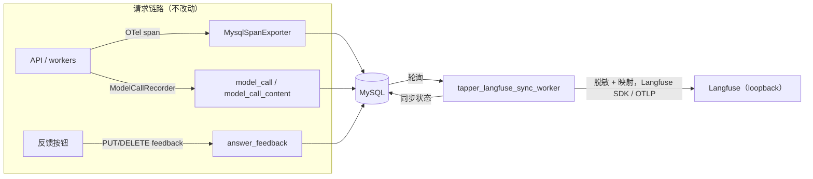

# Langfuse 运营可观测性设计

日期：2026-10-14。V1 能力 5（可观测性）的增量，见 [V1 总纲](../plans/2026-09-29-v1-roadmap.md)。在已完成的[可观测性设计](2026-09-30-observability-design.md)之上新增运营看板与用户反馈，并修订其“不部署 Langfuse”与 Phoenix 相关决策。

## 背景与定位

- 现状：OTel 埋点写入 MySQL（`trace_span`、`model_call`、`model_call_content`），产品内每条回答有调用链面板；可选 OTLP 导出到 Phoenix。缺少跨会话的运营级汇总（成本趋势、延迟分布、按模型/项目/用户统计、满意度），也没有用户反馈。
- 数据权威：MySQL 是**业务数据**（会话、回答、引用、反馈）的权威来源。大模型链路数据不属于业务数据，但同样不得丢失。
- 链路数据双存：MySQL 保留全部链路数据（产品面板继续读取，并作为持久缓冲与重建来源）；Langfuse 是运营展示副本，可从 MySQL 完整重建。
- Tapper LangGraph 化路线（图重构、角色与意图、护栏、工具调用与长任务、可信知识）属于 V2，另行设计；本设计不改动 LangGraph 与聊天主链路。

## 目标

1. 运营人员在 Langfuse 内置看板中查看成本、延迟、用量、错误与满意度，并能按会话、用户、项目、模型筛选和下钻到单条 trace。
2. 每个会话 Turn 与后台任务在 Langfuse 中有一条 trace，包含 span 树与模型调用（generation：模型、token、成本、脱敏后的输入输出）。
3. 用户可对 Tapper 回答点赞/点踩并附可选评论；反馈落 MySQL，并同步为 Langfuse score。
4. Langfuse 不可用期间产生的链路数据与反馈，在其恢复后全部补齐。
5. 发往 Langfuse 的文本一律先脱敏。

## 非目标

- 告警；Langfuse Prompt Management、Datasets、LLM-as-judge 评测；自定义看板。
- 在请求链路中使用 Langfuse SDK 埋点或 LangGraph CallbackHandler（V2 路线再评估）。
- 从 Langfuse 回写 MySQL。
- 共享环境部署、登录与权限、SSO（需单独安全设计）；本期仅 loopback。
- 拒答、失败回答的反馈；反馈原因分类标签。
- 身份体系改动；基于 NER 的自由文本脱敏。

## 1. 架构与数据流



同步 worker 只读业务与链路表，只写自己的游标表和失败表；业务进程不感知 Langfuse。

## 2. 数据模型（新迁移，编号接续现有序列）

### `answer_feedback`

| 列 | 说明 |
| --- | --- |
| `feedback_id` CHAR(36) | 主键 |
| `project_id`、`conversation_id`、`turn_id`、`actor_id` | 唯一键 `(turn_id, actor_id)`；索引 `(project_id, updated_at)` |
| `trace_id` CHAR(32) NULL | 冗余自 `chat_turn.traceparent`，便于同步 |
| `rating` VARCHAR(8) NULL | `up` / `down`；撤销时置 NULL（软删除，以便同步撤销） |
| `comment` VARCHAR(500) NULL | 仅 `down` 时可填 |
| `created_at`、`updated_at` DATETIME(6) | |

### `trace_span.recorded_at`（新增列）

`DATETIME(6)`，默认 `CURRENT_TIMESTAMP(6)`，索引 `ix_trace_span_recorded_at`。表示 span 写入 MySQL 的时间，用作增量同步游标；历史行迁移时回填为 `started_at`。

### `langfuse_sync_cursor`

| 列 | 说明 |
| --- | --- |
| `name` VARCHAR(32) | 主键：`trace` / `feedback` |
| `position` DATETIME(6) | 已扫描到的 `trace_span.recorded_at` / `answer_feedback.updated_at` |

### `langfuse_sync_failure`

| 列 | 说明 |
| --- | --- |
| `kind` | `trace` / `feedback` |
| `subject_id` | `trace_id` 或 `feedback_id`；主键 `(kind, subject_id)` |
| `failure_count`、`last_error`（截断至 1000 字符）、`last_failed_at` | |

成功重试后删除对应行。

### 保留

沿用原设计：MySQL 链路数据永久保留，不做自动清理。同步游标与失败表很小，无需清理。

## 3. 同步 worker

新进程入口 `tap/entrypoints/tapper_langfuse_sync_worker.py`，按固定间隔轮询（默认 5 秒）：

1. **选取 trace**：`cutoff = now - TAP_LANGFUSE_SYNC_SETTLE_SECONDS`（默认 60）。按 `recorded_at` 升序扫描 `(cursor, cutoff]` 内的 span，取其 `trace_id`（每批最多 200 个），处理后把游标推进到本批最大 `recorded_at`。Turn 重新执行写入的新 span 会被再次扫到，整条 trace 重推。另取 `langfuse_sync_failure` 中的 trace 重试。
2. **读取**：该 trace 的全部 `trace_span`、关联 `model_call` 与 `model_call_content`、所属 `chat_turn` 的 `chat_id`（即 conversation_id）。
3. **映射**：
   - trace 名为根 span 名；`chat_id` → session，`actor_id` → user，`project_id`、`service_name`、环境 → tags/metadata；`tap.redaction_version` 写入 metadata。
   - span 保持原 trace/span id、父子关系与起止时间。
   - 模型调用 span → generation：`model`（实际上游模型，缺失时用请求模型）、input/output（脱敏后的 `request_json` / `response_text`）、`usage_details`（input/output tokens）、`cost_details`（`cost_usd`）、失败时 level=ERROR 与 `error_code`；推理摘要放 metadata。
4. **推送**：通过 Langfuse Python SDK 作为客户端推送，指定原 id 与历史时间戳；SDK 不支持的部分退回 Langfuse 的 OTLP 端点。Langfuse 按 id 覆盖，重推幂等。
5. **反馈**：按 `answer_feedback.updated_at` 游标扫描（同样只扫 `cutoff` 之前的行），推送 score：名称 `user_feedback`，`up` = 1、`down` = 0，comment 为脱敏后的评论，score id 由 `turn_id` + `actor_id` 确定性生成；`rating` 为 NULL 时删除该 score。若 Langfuse 拒绝尚未入库 trace 的 score，记入失败表下一轮重试。
6. **状态**：失败写入 `langfuse_sync_failure`，下一轮重试，无次数上限，从不丢弃；游标照常推进，失败项不阻塞后续数据。

行为约束：

- 未配置 `LANGFUSE_HOST` 时空转（只打一条启动日志），配置后自动补推全部历史。
- worker 自身异常不影响业务；单条失败不阻塞其他条目。
- 把游标重置为最早时间即可整体重推，用于 ClickHouse 数据丢失或脱敏规则升级。

## 4. 脱敏

新模块 `tap/modules/ai/application/export_redaction.py`，只在同步 worker 中调用；凭据正则从 `knowledge/adapters/pattern_redaction.py` 抽到 `tap/platform/redaction_patterns.py` 供两处共用；MySQL 中的原文不改。

- **凭据**：复用 `PatternEgressRedactor` 的规则（私钥块、`password=`/`token=` 类赋值、密钥值）。与其“可疑即整段拒绝”不同，导出脱敏只替换命中片段，整段无法安全处理时才把该字段替换为 `[REDACTION_FAILED]`。
- **个人信息**（正则 + 校验位，宁多勿漏）：

  | 类型 | 替换 |
  | --- | --- |
  | 邮箱 | `[EMAIL]` |
  | 手机号（中国内地 11 位、香港 8 位，含或不含区号） | `[PHONE]` |
  | 身份证号（内地 18 位含校验位、香港身份证格式） | `[ID_NUMBER]` |
  | 银行卡号（13–19 位，Luhn 校验） | `[CARD_NUMBER]` |
  | 自定义规则（配置文件，如保单号格式） | `[CUSTOM:<name>]` |

- **范围**：模型调用请求、返回、推理摘要；反馈评论；用户问题；span 属性中的全部字符串值。
- **大小**：单字段超过 32 KB 截断并追加 `[TRUNCATED n chars]`。
- **失败**：脱敏失败只替换该字段，元数据照常同步。
- **版本**：规则带版本号（`tap.redaction_version`）；升级后可重推覆盖。
- 自定义规则文件路径由 `TAP_TRACE_REDACTION_RULES` 指定，仓库只提供空示例，不写任何具体机构的号码格式。
- 局限：正则无法覆盖自由文本中的人名、地址等；进入共享环境前由安全设计复核。

## 5. 用户反馈

### 交互

先改 `apps/web` `/prototype`（`TapProductPrototype` 中 Tapper 回答），再改 `apps/tap-ai-frontend`，二者一致：

- 已完成的 Tapper 回答操作区、调用链入口旁新增 👍 / 👎。
- 👍：立即提交并高亮，再点撤销。
- 👎：提交后展开可选评论框（最多 500 字），可跳过。
- 可在 👍/👎 间切换，以最后一次为准；刷新后恢复。
- 生成中、失败、拒答的回答不显示。

### API

- `PUT /api/v1/projects/{project_id}/conversations/{conversation_id}/turns/{turn_id}/feedback`，body `{rating: "up" | "down", comment?: string}`，幂等写入或修改。
- `DELETE` 同路径：撤销。
- 回答/会话查询的 Turn 摘要新增 `myFeedback`（`rating`、`comment`，可空），前端不单独请求。
- 复用现有项目范围授权；只允许对有权限项目中已完成的 Turn 提交。
- 契约经 `make contracts` 生成；反馈只写 MySQL，请求链路不调用 Langfuse。

`actor_id` 取现有匿名/验证身份；demo 中“用户”维度意义有限，接入真实身份后自然生效。

## 6. 部署与配置

### Compose

- 删除 `phoenix` 服务、`phoenix-data` 卷与 `observability` profile。
- 新增 profile `langfuse`，只新增三个容器：`langfuse-web`（`127.0.0.1:${LANGFUSE_PORT:-23000}`）、`langfuse-worker`、`langfuse-postgres`（alpine，约 256 MB 内存上限）。镜像固定版本，沿用现有加固写法（`cap_drop`、`no-new-privileges`、资源限制），关闭 Langfuse 遥测上报。
- 复用现有中间件：

  | 组件 | 复用方式 |
  | --- | --- |
  | ClickHouse | 复用 insights 的 `clickhouse`；新建 `langfuse` 库与仅授权该库的专用账号；Langfuse 通过 `CLICKHOUSE_DB` 指定库 |
  | Redis | 复用主 `redis`，使用独立 db 编号（如 `/1`）；现有实例无淘汰策略且开启 AOF，满足队列要求 |
  | MinIO | 复用 `tap-minio`，新建 `langfuse` bucket |

- 用 Langfuse 无界面初始化变量预建组织、项目、本地管理员与 API key；`.env.example` 只放本地示例值。

### Make

- `make langfuse-up`：确保 `insights` profile 的 ClickHouse 已启动，创建 ClickHouse 库/账号与 MinIO bucket（幂等），启动 `langfuse` profile。
- `make langfuse-down`：停止 Langfuse 容器，保留数据卷。
- `scripts/run-tapper-dev.sh` 启动 `tapper_langfuse_sync_worker`。
- `demo-check` 保持五项检查，不含 Langfuse。

### 配置（`.env.example`）

```sh
# LANGFUSE_HOST=http://127.0.0.1:23000
# LANGFUSE_PUBLIC_KEY=pk-lf-local-example
# LANGFUSE_SECRET_KEY=sk-lf-local-example
TAP_LANGFUSE_SYNC_SETTLE_SECONDS=60
TAP_LANGFUSE_ENVIRONMENT=local
# TAP_TRACE_REDACTION_RULES=deploy/local/redaction/custom-rules.example.yaml
```

删除 Phoenix 相关变量。`start_tracing` 的可选 OTLP 导出保留（不依赖 Phoenix）。

### 复用约束

1. 启用 Langfuse 即需启动 insights ClickHouse。
2. ClickHouse 2 GB 内存上限由 insights 与 Langfuse 共用；不足时调大该值。
3. insights 的重置/备份脚本与 Langfuse 只作用于各自的库或 bucket，由测试保证互不误删。
4. 共享环境是否拆分中间件由安全设计决定；拆分只需改连接串。

## 7. 测试与验收

- 后端单元：
  - 脱敏规则命中/不命中、Luhn 与身份证校验位、截断、失败替换、版本；
  - MySQL → Langfuse 映射（span 树与 id、时间戳、generation 字段、session/user/tags）；
  - 游标扫描：静默窗口内不推、重新执行后整条重推、失败项重试且不阻塞游标；
  - 确定性 score id；撤销映射为删除 score。
- 后端集成（真实 MySQL + 假 Langfuse 客户端）：
  - 选取 → 推送 → 状态更新；推送失败重试且不丢；
  - 未配置时空转，配置后补推历史；
  - 反馈 API 授权、幂等 PUT、DELETE 撤销、`myFeedback` 回显；
  - insights 与 Langfuse 的 ClickHouse 账号互相不可见（仅在相关 profile 运行时执行，否则跳过）。
- 契约：`make contracts` 后契约测试覆盖反馈接口。
- 前端 Vitest：赞、踩并展开评论、切换、撤销、刷新恢复、未完成回答不显示。
- `/prototype`：同步加入按钮，对比前后截图，核对模块导航与跨模块旅程。
- `make demo-e2e`：在现有旅程中点 👎 并填评论，刷新后状态保留、MySQL 有记录；E2E 不启动 Langfuse。
- `make check`、`make test` 通过。
- 手工验收（真实环境）：
  1. `make langfuse-up`、`make demo-dev`，完成若干轮对话与赞/踩；
  2. Langfuse 中每个 Turn 一条 trace，可按会话/用户/项目筛选；generation 有 token 与成本；输入输出已脱敏（用虚构手机号、邮箱验证）；score 带评论；
  3. 内置看板可见成本、延迟、用量、满意度；
  4. 停止 Langfuse 后继续对话，再启动，期间数据全部补齐；
  5. 产品内调用链面板不受影响。

## 8. 首个实施任务：验证

实施计划第一个任务先在本地验证并记录：

- Langfuse 自托管版本与 Python SDK 版本（固定）；
- SDK 能否指定历史时间戳与 trace/span id，否则 trace 走 OTLP、SDK 只负责 score；
- Langfuse 对 `CLICKHOUSE_DB` 非默认库、Redis 非 0 号 db、MinIO path-style 的支持；
- score 按 id 覆盖与删除的接口。

验证结论写回本 spec 再继续后续任务。

## 9. 文档

- 修订[可观测性设计](2026-09-30-observability-design.md)：删除“不部署 Langfuse”与 Phoenix 相关内容，链接本设计。
- 更新 V1 总纲能力 5（新增 Langfuse 运营看板与用户反馈的工程项）与子项目列表。
- 产品路线图 V2 新增“Tapper LangGraph 化”路线。
- 更新 `docs/architecture.md`、`docs/guides/2026-09-30-observability.md`（Langfuse 启用与使用、重推方法）、`.env.example`。

## 10. 风险

- Langfuse v3 版本升级可能改变 ClickHouse schema 或 SDK 接口：固定版本，升级前在本地重推验证。
- 共用 ClickHouse：Langfuse 查询可能挤占 insights 资源；本地数据量小，可接受。总纲写明 Test Insights/ClickHouse 不在交付路径，Langfuse 同样是可选组件，不改变这一结论。
- `model_call_content` 永久保留持续增长（原设计已知风险），本设计不加剧其写入量。
- 正则脱敏有漏网可能，共享环境前须复核。
