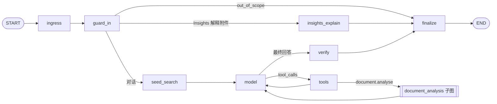

# Tapper LangGraph 编排设计

日期：2026-10-14。归属 [V1 总纲](../plans/2026-09-29-v1-roadmap.md) 能力 6“LangGraph 编排”（子项目 6），覆盖路线 ② 图重构、③ 角色定义与意图识别、④ 围栏、⑤ 工具调用与长任务编排、⑥ 可信知识。目标架构见 [ADR-029](../../decisions/2026-09-18-adr-029-langgraph-ai-interaction-task-orchestrator.md)；路线第 ① 步可观测性另见 Langfuse 运维观测设计，不在本文。

本文一份设计、分批 PR 交付（见第 9 节）。设计按行业通行做法取舍：对话助手采用单一受限 ReAct 循环，正文内联引用并流式输出，事后做依据支撑校验，外部内容按不可信数据隔离。

## 背景

- `InteractionGraph`（`modules/ai/application/interaction_graph.py`）是固定的 `classify → admit → execute` 三步图，配 MySQL checkpointer。对话回答（`fast-chat-v1`）、Insights 解释（`insights-explanation-v1`）与测试设计生成（`test-design-generation-v1`）都用它。
- 对话链路的检索、图谱关系扩展、生成、引用解析全部在一个 `execute` 节点内完成（`AuthorizedRetrieval.answer`，`modules/knowledge/application/retrieve.py`，约 440 行），失败只能整段重跑。
- 模型输出 JSON `{answer, claims}`，生成后校验每条 claim 的证据标签与段落位置，不通过则弃答。LiteLLM 适配器整段读取响应，不流式。
- 答案生成结束后才写一个 `answer.delta` 事件进 MySQL；API 的 SSE 每 100ms 重新加载整个会话事件（`interfaces/http/routes/conversations.py`）。
- `processing_attempt` 与 `max_checkpoint_attempts` 只覆盖 checkpoint 冲突；模型或检索的瞬时失败直接使 Turn 失败；worker 主循环中 `run_once` 抛异常即退出进程。
- Tapper 的身份与边界写死在 `modules/knowledge/adapters/litellm.py` 的字符串常量中。能力 4 引入 Agent（系统提示词 + Skills + 工具白名单 + 默认模型）与代码定义的工具注册表，但没有工具调用循环。
- V1 总纲记录的已知差距：运行时 `publication_authority` 为 `None`，关系证据的发布授权复检不执行；R 证据片段不过流程图发布闸门。核对代码后见 6.3。

## 目标

- 对话回答与 Insights 解释运行在新的版本化图 `tapper-chat-v2` 上，每个节点有 checkpoint，失败从断点续跑。
- 回答逐 token 流式输出，正文带内联引用；SSE 不再轮询。
- 瞬时失败退避重试，attempt 有上限，worker 单次异常不退出。
- 分层角色：不可覆盖的 Tapper 基础角色 + 能力 4 的 Agent。
- 围栏：预算、提示注入防护、敏感信息脱敏、范围外拒答。
- 单一受限 agent 循环支持多步检索、Insights 与知识联合分析；整份文档分析在超出上下文时走可恢复的长任务；高成本动作先请用户确认；用户可立即停止生成。
- 有据可依、不胡编：所有回答经统一引用校验与依据支撑校验。

## 非目标

- 测试设计生成迁入新图：继续使用旧三步图，代码不动（`test_management` 在 V1 冻结）。
- MCP 工具、执行 Skill 包内代码。
- 输出模型审查（合规或有害内容审查）、来源时效与冲突提示。
- 多 Agent 协作、子 Agent 委派。
- Insights 在 V1 只以 fake 运行时验证，不进入真实交付路径（与 V1 总纲一致）。

## 1. 图结构



| 节点 | 职责 |
| --- | --- |
| `ingress` | 固定图版本与状态 schema 版本；载入 Turn 输入、Tapper 角色版本、Agent 修订；写入预算 |
| `guard_in` | 输入脱敏；调用 planner（一次模型调用）得到首轮查询规划与 `intent`；`out_of_scope` 直接拒答；Insights 解释附件走确定性分支 |
| `seed_search` | 首轮强制检索：按 planner 规划执行 Milvus 检索与图谱关系扩展、发布授权复检，产出证据包并发出 `retrieval.hits_ready` |
| `model` | 带工具调用模型；返回 `tool_calls` 则进入 `tools`，否则其输出即最终回答（流式） |
| `tools` | 执行工具调用：范围与预算校验 → 授权 → 执行 → 结果并入证据池；发出 `task.step` |
| `insights_explain` | 现有 Insights 结构化解释，契约不变 |
| `verify` | 统一引用校验与依据支撑校验（第 6 节） |
| `finalize` | 解析引用、保存答案快照、输出脱敏，同一事务写权威终止事件 |

- 每个节点结束写 checkpoint。每次进入节点前续租并复检授权（沿用 `_guarded`）。
- `AuthorizedRetrieval.answer` 拆为“检索出证据包”与“基于证据池生成”两个方法，经 `KnowledgeAnswerGateway` 端口暴露。证据包可序列化，大小上限 512KB，超限为确定性错误，不截断。
- 图定义放在 `modules/ai/application/`；节点实现按领域放在 chat 与 knowledge 应用层；`tapper_generation_worker.py` 只负责领取 Turn、续租与运行图。
- 旧 `InteractionGraph` 保留，仅供测试设计生成使用。

## 2. 输出格式与流式

### 2.1 内联引用

- 模型输出 Markdown 正文，在句末用内联标记引用证据，如 `[E3]`、`[R1]`，沿用现有证据标签体系。不再输出 JSON。
- claim 由“含引用标记的句子”推出：句子文本、答案内位置、标记对应的 citation id。
- 澄清回复带 `answerKind: "clarification"`，不陈述事实，不要求引用。

### 2.2 数据流

```text
model 节点 ──LiteLLM SSE──▶ 合批（约 50ms 或 32 字符）
      │                       ▼
      │      Redis Stream tap:turn:{turnId}:draft   {attempt, seq, text}，MAXLEN + TTL 24h
      ▼
finalize ──同一事务──▶ MySQL 权威事件（turn.completed / turn.abstained / turn.failed / turn.canceled）
         ──────────▶ Redis 唤醒 tap:conv:{conversationId}:events（只含新 sequence）
```

- `ModelGateway` 新增流式生成接口：`stream: true` 与 `stream_options.include_usage`，token 用量、实际上游模型与现有记录口径一致。非流式接口保留。
- 工具调用轮次不流式输出文本，只发 `task.step`；最终回答轮次流式输出草稿。
- 草稿在写入 Redis 前过输出脱敏（第 4 节）。

### 2.3 SSE 与前端

- 新增 `answer.draft {attempt, seq, text}`：不占 MySQL sequence，SSE `id` 仍只指向权威事件，Last-Event-ID 语义不变。删除最后一次性写入的 `answer.delta`，前端同步改为消费 `answer.draft`。
- API 先补齐 Last-Event-ID 之后的 MySQL 事件，再以 `XREAD BLOCK` 同时等待草稿流与事件唤醒；每次唤醒回 MySQL 读权威事件。不再 100ms 轮询。
- 重连：补齐权威事件后，若 Turn 未结束，`XRANGE` 回放当前 attempt 的草稿再继续阻塞读取。
- 前端：`retrieval.hits_ready` 先给出“标签 → 来源标题与位置”，草稿中的 `[E3]` 即时渲染为带来源名的引用徽标；草稿以“生成中”样式显示；更大的 `attempt` 清空草稿；终止事件用权威答案与引用整体替换草稿；`verify` 期间显示“正在核对依据”（`stage.started {stage: "verify"}`）。
- Redis 不可用：不下发草稿，SSE 退回 1s 读 MySQL，答案照常定稿，trace 记录降级。

### 2.4 停止生成

- `POST /api/v1/projects/{projectId}/conversations/{conversationId}/turns/{turnId}/cancel`：写取消标记并发 Redis 取消信号。worker 立即取消运行中的图任务（中止模型流与工具调用），写 `turn.canceled`。
- 已输出的部分草稿保存在 `turn.canceled` 载荷中，显示为“已停止 · 未核对依据”，不进入引用体系。
- Redis 不可用时，worker 在下一个节点边界检查取消标记。

## 3. 可靠性

### 3.1 错误分类

在节点包装器中统一分类：

| 类别 | 例子 | 处理 |
| --- | --- | --- |
| 瞬时 | `ModelGatewayUnavailable`、Milvus 或 MySQL 超时、`GraphCheckpointRetryable` | 释放租约，`next_attempt_at = now + 退避`；下次领取从最后完成节点的 checkpoint 续跑 |
| 确定性 | `AuthorizationDenied`、`ModelGatewayRejected`、证据包超限、引用或支撑校验不通过 | 直接终止：`turn.failed` 或 `turn.abstained` |
| 所有权丢失 | `PermissionError`、`ConversationConflict`、会话已删除 | 静默退出，不写任何东西 |

### 3.2 租约与 attempt

- 每次领取（含租约过期回收）`processing_attempt` 加 1，上限 `max_turn_attempts`（默认 3，可配置）；超过写 `turn.failed`（`answer-unavailable`），trace 记录最后一次失败类别。
- 退避：指数，基数 2s，上限 30s，带抖动。
- 迁移：Turn 表新增 `next_attempt_at`；领取条件为“待处理或租约已过期，且 `next_attempt_at <= now`”。
- 图版本或状态 schema 不兼容的旧 checkpoint 沿用 `GraphVersionConflict`：不迁移，从头重跑一次并计入 attempt。

### 3.3 worker 主循环

- `run_once` 异常捕获后记录日志与 span，循环退避（1s 到 30s，成功后重置），只在 SIGINT 或 SIGTERM 时退出。
- 单个 Turn 异常不影响同批其他 Turn。

## 4. 角色、意图与围栏

### 4.1 角色

- Tapper 基础角色：身份、边界、引用规则等不可覆盖内容，从字符串常量改为代码中带版本号的 `TapperPersona`，版本进入 Turn 冻结与 trace。
- Agent 角色：能力 4 的 Agent 修订进入图状态，其系统提示词与 Skills 在基础角色之后组装，只能补充不能覆盖。Agent 工具白名单决定 `model` 节点可见的工具。

### 4.2 意图

- planner 输出新增 `intent`（`knowledge_qa` / `multi_step_qa` / `document_analysis` / `insights_analysis` / `clarify` / `out_of_scope`）与理由。
- `intent` 不驱动路由：是否继续调工具、是否澄清由 `model` 节点在循环中自行决定。`intent` 只用于 trace 观测、评测，以及 `out_of_scope` 的确定性拒答。
- golden set 新增意图子集，每类至少 5 条。CI 门禁用 fake 模型验证接线；真实模型准确率为 opt-in 门禁，与图谱关系门禁同一模式。

### 4.3 预算

- `ingress` 写入预算，每个节点与每次工具调用前检查，消耗写入状态与 trace。
- 对话循环默认：最多 6 轮工具调用、墙钟 3 分钟、10 次模型调用、费用上限按配置。整份文档分析子图单独计预算：墙钟 30 分钟、模型调用为分段数 + 2。
- 耗尽时：已有经过校验的部分结论则输出并注明“因预算停止”；否则 `turn.failed`（`budget-exhausted`）。不静默截断。

### 4.4 提示注入防护

- 隔离：检索片段、文档内容、工具结果一律经同一组装函数以带边界标记的数据块进入提示词，并声明为不可信数据。
- 检测：规则匹配中英文指令样式内容（“忽略以上”“你现在是”“调用工具”等）；命中的片段打标记并记入 trace，不删除。
- 硬约束：工具调用前确定性校验参数，只允许落在用户问题、Agent 白名单与当前已授权资源范围内；片段或工具结果中出现的资源 ID、项目或 URL 不能扩大检索或授权范围。

### 4.5 敏感信息脱敏

- 复用 `pattern_redaction`（证件号、手机、邮箱、密钥等）。
- 输入：用户消息在送模型前脱敏，原文按现有规则保存在 Turn 中。
- 输出：草稿进 Redis 前、定稿在 `finalize` 时脱敏，命中记入 trace。

### 4.6 范围外拒答

`intent = out_of_scope` 时直接进入 `finalize`，输出固定拒答文案，`turn.abstained`（原因码 `out-of-scope`），不检索、不调生成模型。

## 5. 工具与长任务

### 5.1 工具

扩展能力 4 的工具注册表。每个工具有类型化输入 schema、授权检查与幂等保证，结果以带 citation id 的证据并入本次运行的证据池（标签全局唯一）。

| 工具 | 实现 | 场景 |
| --- | --- | --- |
| `knowledge.search` | 复用 `seed_search` 的检索 | 多步检索 |
| `graph.relations` | 现有关系分析迁为工具 | 多步检索 |
| `document.read_section` | 读取已选文档的指定分段 | 整份文档分析（长上下文） |
| `document.analyse` | 启动整份文档分析子图 | 整份文档分析（超出上下文） |
| `insights.query` | 现有 Insights 查询 | Insights 与知识联合分析（有 Insights 报告引用时可用） |

- `model` 节点使用 LiteLLM 原生 tool calling。Agent 表单工具区改为可勾选；`knowledge.search` 默认开启。
- 关系分析迁为工具后，能力 3 不再按问题意图触发关系分析，相应验收条款在 V1 总纲中更新。
- 每次工具调用发出 `task.step {stepId, tool, status, summary}` 权威事件，前端以步骤列表展示（工具名、检索了什么、耗时、预算消耗）。

### 5.2 整份文档分析

- 已选文档总长度 ≤ 上下文预算（默认模型窗口的 60%）时，模型以 `document.read_section` 整篇读入，在循环内完成。
- 超出时，模型调用 `document.analyse`，进入 durable 子图：`segment → analyse_section × N（每段一个 checkpoint）→ reduce`，结果作为证据返回循环，再由最终回答轮次输出。发出 `task.progress {done, total}`。
- 分段数 > 20 时先请用户确认（5.3）。worker 以续租持有任务。

### 5.3 高成本动作确认

- 只用于高成本动作，V1 仅“大范围文档分析”一处。节点调用 LangGraph `interrupt()`，Turn 进入 `awaiting_input`，发出 `turn.awaiting_input {question, options}`，释放租约。
- `POST /api/v1/projects/{projectId}/conversations/{conversationId}/turns/{turnId}/resume {answer}` 写入回复；worker 重新领取后以 `Command(resume=…)` 续跑。等待超过 24 小时自动取消。
- 澄清不使用中断，见 2.1。

### 5.4 前端

在 `apps/tap-ai-frontend` 源码中直接实现：步骤与工具进度、文档分析进度、等待确认卡片、停止按钮、引用徽标与“正在核对依据”状态。

## 6. 可信知识：有据可依、不胡编

所有对话回答在 `finalize` 前经 `verify` 节点；Insights 解释沿用其现有结构化校验。

### 6.1 统一引用校验

- 内联标记必须属于本次运行的证据池，句子位置可唯一定位；不满足视为该 claim 无依据。
- 多步检索、长上下文文档分析、map-reduce 文档分析、Insights 联合分析共用同一校验。

### 6.2 依据支撑校验

- 一次模型调用（`ModelGateway`，低成本层级）：送入全部句子与其引用片段，逐句判定“支撑 / 部分支撑 / 不支撑 / 非事实性”。无引用标记的事实性句子判为不支撑。结果写入 trace。

| 结果 | 处理 |
| --- | --- |
| 全部支撑或非事实性 | 正常定稿 |
| 部分不支撑，剩余内容仍构成完整回答 | 删除不支撑的句子，末尾注明“部分内容因缺乏依据已省略” |
| 不支撑比例 > 30%（可配置）或首句结论不支撑 | 整体弃答，`turn.abstained`（`unsupported-claims`） |
| 校验调用失败 | 按瞬时错误重试；超过上限则弃答，不退化为未校验输出 |

### 6.3 已知差距核对

2026-10-14 核对代码：按 [ADR-030](../../decisions/2026-09-27-adr-030-direct-knowledge-chunk-lifecycle.md)，切片启用并索引后直接可检索，不经发布，运行时 `publication_authority = None` 是设计而非缺口，不启用。流程图图片区域仍须审阅发布：检索命中经 `_flowchart_hit_is_approved` 过滤，关系支撑经 `_flowchart_support_allowed`（`modules/ai/application/agents/relation_analysis.py`）过滤，定稿前 `authorize_completed_answer` 对每条引用做当前性复检。PR 1 只以回归测试锁定这三项行为，并修正 V1 总纲已知局限的措辞。

### 6.4 评测

golden set 新增“诱导胡编”子集：证据中没有答案、证据与常识冲突、问题含错误前提。门禁要求这些题弃答或纠正前提；真实模型门禁为 opt-in。

## 7. 契约与数据

- SSE 新增：`answer.draft`、`task.step`、`task.progress`、`turn.awaiting_input`；删除：`answer.delta`；`turn.canceled` 载荷增加部分草稿；`turn.completed` 增加 `answerKind`。
- HTTP 新增：`cancel`、`resume` 两个 Turn 接口。
- MySQL：Turn 表新增 `next_attempt_at`、取消标记、`awaiting_input` 状态与等待载荷。
- 修改后运行 `make contracts` 重新生成 OpenAPI/SSE 契约与前端类型。

## 8. 测试与验收

### 8.1 测试

- 单元：图路由（对话、Insights、范围外）；工具循环上限与预算耗尽；内联标记解析（跨 chunk、非法标签、无标记句子）；错误分类与退避；证据包序列化与大小上限；注入检测规则与工具参数范围校验；脱敏。
- 契约：新增 SSE 事件与 HTTP 接口；LiteLLM 流式响应解析（fake SSE，含 usage 与上游模型）；LiteLLM tool calling 解析。
- 集成（MySQL + Redis）：`model` 节点注入失败后下一 attempt 从 checkpoint 续跑且不重复检索；租约回收 attempt 递增与上限；worker 主循环异常后继续；Redis 不可用时降级定稿；SSE 重连补齐与草稿回放；停止生成立即生效；`interrupt` / `resume` 与 24 小时超时。
- 兼容：测试设计生成、Insights 解释、推荐问题的现有测试全部通过。
- E2E（`make demo-e2e`）：确定性模型分块输出时浏览器先见草稿与引用徽标、再被定稿替换；弃答替换草稿；多步工具调用显示步骤；停止生成显示部分草稿与“已停止”。
- 质量：内联引用格式切换前先用现有 JSON 格式跑出 golden set 基线（能力 1 的 golden set 格式与回归命令须先就绪，未就绪时由 PR 3 先补齐），切换后分数不低于该基线；意图子集与诱导胡编子集进入门禁。

### 8.2 验收

对应 V1 总纲能力 6 的勾选项：

- ②：对话回答与 Insights 解释运行在 `tapper-chat-v2` 上，trace 可见各节点 span；逐 token 下发且无轮询；瞬时失败退避后从断点续跑；attempt 有上限；worker 单次异常不退出；可立即停止生成。
- ③：Tapper 基础角色版本化并进入冻结与 trace；Agent 角色与工具白名单在图内生效；意图子集门禁通过。
- ④：预算在图内统一执行并可见；注入防护、脱敏、范围外拒答有自动化测试覆盖。
- ⑤：多步检索、Insights 联合分析（fake）、整份文档分析（长上下文与 map-reduce 两种）、高成本动作确认均有 E2E 或集成测试覆盖；关系分析以工具形式调用。
- ⑥：所有对话回答经统一引用校验与支撑校验；诱导胡编子集门禁通过；流程图闸门与引用复检有回归测试锁定。
- `make check`、`make test`、`make demo-e2e` 通过。

## 9. 交付批次

每个 PR 可独立验收，合入 `develop` 后 `make demo-e2e` 保持通过。PR 1–4 不依赖能力 4，可先行；能力 4 须在 PR 5 之前合入，其对话链路改动挂在新图上。

| PR | 内容 | 依赖 |
| --- | --- | --- |
| 1 | ② 图骨架：`tapper-chat-v2`、检索与生成拆分、Insights 分支、`verify` 承接现有 claim 校验；已知差距回归测试 | — |
| 2 | ② 可靠性：错误分类、`next_attempt_at` 迁移、attempt 上限、worker 主循环存活 | PR 1 |
| 3 | ② 流式：`ModelGateway` 流式接口、内联引用格式、Redis 草稿流、SSE 改造、前端草稿与引用徽标、停止生成；切换前后 golden set 对比 | PR 1；能力 1 golden set 回归命令 |
| 4 | ④ 围栏：预算、注入隔离与检测、脱敏、范围外拒答 | PR 1 |
| 5 | ③ 角色 + ⑤ agent 循环：`TapperPersona`、Agent 入图、planner `intent`、工具注册表扩展、tool calling 循环、`task.step`、澄清回复、关系分析迁为工具 | PR 3、PR 4、能力 4 |
| 6 | ⑥ 可信知识：依据支撑校验、诱导胡编子集（2026-10-23 移入 V2） | PR 3 |
| 7 | ⑤ 长任务：`document.read_section` / `document.analyse`、durable 子图、`interrupt` / `resume`、进度与确认卡片（2026-10-23 移入 V2） | PR 5 |

PR 2、3、4 在 PR 1 合入后可并行。V1 交付 PR 1–5；PR 6、PR 7 于 2026-10-23 移入 V2，排在 Agent 团队视图之后，见[产品路线图](../plans/2026-10-01-product-roadmap.md)。每个 PR 合入后更新 V1 总纲与产品路线图对应行；PR 1 同步更新 `docs/architecture.md` 与 AGENTS.md 中“固定三步流水线”的描述。
