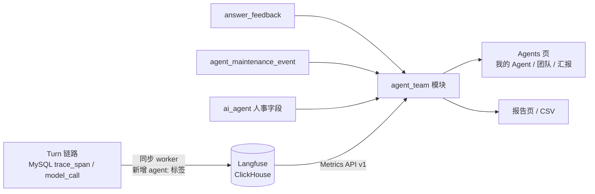

# Agent 团队视图设计

日期：2026-10-22。归属[产品路线图](../plans/2026-10-01-product-roadmap.md) V2.1。

## 背景

- AI 提效后团队规模已经收缩，管理层仍主要按人数看成本，会继续追问"还能不能再减人"。
- 实际的工作单元是"员工 + 其负责和使用的一组 Agent"。产出靠 Agent，Agent 靠人维护：改提示词、升级 Skill、处理差评、停用失效的 Agent。只看人数，这部分产出和投入都不可见。
- 现有数据：
  - Langfuse（3.225.11，ClickHouse）已有每个 Turn 的 trace：`userId`（即 `actor_id`）、延迟、成本、`ERROR` 级别，以及 `project:` 标签；但没有 Agent 标识。
  - MySQL `answer_feedback` 记录每轮的赞/踩；Turn 冻结输入记录 `agent_revision_id`（为空表示 Tapper 默认）。
  - `ai_agent`、`ai_agent_revision` 记录创建人、修订、停用与启用。
- Agents 页（能力 4）只展示配置。

## 目标

- 像展示员工一样展示 Agent 团队：每个 Agent 有岗位、入职日期、直属负责人、服务对象、工作量与履历；有"人 → Agent"的组织架构图。
- 产出与投入并列：产出是 Agent 的真实运行数据，投入是人对 Agent 的维护动作。
- 三种视角：员工（我的 Agent）、团队负责人（团队）、管理层（汇报）。
- 汇报形式：页面、可打印的报告页（浏览器导出 PDF）、CSV。

## 非目标

- 把运行数据换算成节省工时或等效人数。只展示真实运行数据。
- 统计 Tapper 之外的 Agent（IDE 助手、其他平台）。
- 跨项目汇总与按角色限制可见范围，随 V4 身份与多项目交付。
- 记录人的维护时长。投入侧只记录维护动作。
- 后端生成 PDF。

## 前置条件

- V1 能力 4（Skills/Agents）与能力 5（可观测性、Langfuse 同步）已合入 `develop`。
- V2 中最先实施；V2.2 主动框架在其之后。V2.2 系统 Agent 上线后作为团队成员加入（见 1.1）。
- 当前 Tapper Demo 为回环绑定、单一本地身份。V2.1 的数据模型和页面按多人设计，演示环境中只有一人。

## 1. 概念

### 1.1 团队与成员

- 一个 Tapper 项目即一个团队。
- 成员类型：

| 类型 | 来源 | 负责人 |
| --- | --- | --- |
| 自定义 Agent | 能力 4 创建或复制 | 有，默认创建人 |
| 内置 Agent | 种子数据（Knowledge agent） | 显示"Tapper 内置" |
| Tapper 默认 | 未选 Agent 的对话，`agent_key = tapper_default` | 显示"Tapper 内置" |
| 系统 Agent | V2.2 主动剧本，V2.2 上线后出现 | 显示"Tapper 内置" |

- 停用的 Agent 保留在名单中，状态"已停用"，历史数据不变。

### 1.2 人事档案

| 字段 | 来源 |
| --- | --- |
| 岗位 | Agent 上新增的短字段（≤ 64 字符），如"回归测试分析员"；可在档案中编辑 |
| 入职日期 | Agent 创建时间 |
| 直属负责人 | 1 人，负责质量与维护；默认创建人，可转交 |
| 服务对象 | 周期内调用过该 Agent 的人，按调用次数排序；查询时计算，不存表 |
| 工作量 | 第 2 节的运行指标 |
| 履历 | 维护动作时间线 |

组织架构图以人为节点：实线连接其负责的 Agent，虚线连接为其服务的 Agent。

### 1.3 维护动作

| `kind` | 触发 |
| --- | --- |
| `revised` | 生成新的 Agent 修订（提示词、Skills、默认模型变更） |
| `skill_upgraded` | 因绑定的 Skill 出新版本而生成 Agent 修订 |
| `disabled`、`enabled` | 状态变更 |
| `feedback_resolved` | 把一条踩或评论标记为已处理 |
| `owner_transferred` | 转交负责人 |

动作由系统在对应写操作中自动记录，不需要人工填写。

## 2. 指标口径

### 2.1 周期与粒度

- 周期：近 7 天、近 30 天、本月、上月、自定义；不限跨度。
- 按项目时区切分自然日，未配置时用 UTC，界面显示所用时区。
- 趋势粒度随跨度自动调整：≤ 92 天按天，≤ 2 年按周，更长按月。汇总数字始终是整个周期的准确合计。

### 2.2 产出侧（取自 Langfuse）

| 指标 | 口径 | 层级 |
| --- | --- | --- |
| 运行次数 | 带 `agent:` 标签的 Turn trace 数；一次提问即一次运行 | 主指标 |
| 失败次数 | 其中根 observation 为 `ERROR` 的数量 | 主指标 |
| 运行时长 | trace 延迟合计与 p50 | 主指标 |
| 模型成本 | `totalCost` 合计（USD） | 主指标 |
| 服务人数、服务对象 | 不同 `userId` 数与按次数排序的名单 | 主指标 |
| 最近运行 | 周期内最后一个 trace 的时间 | 主指标 |
| 模型调用次数 | 类型为 generation 的 observation 数 | 次要，档案与 CSV |
| 工具调用次数 | 工具 span 数；LangGraph PR 5（工具循环）合入前恒为 0 | 次要，档案与 CSV |
| 平均每次运行调用数 | （模型调用 + 工具调用）÷ 运行次数 | 次要，档案与 CSV |

汇总、排序与报告只用主指标。调用次数随 ReAct 步数、重试与实现变化，不同 Agent 之间不可比，只用于观察复杂度与成本来源。

### 2.3 满意度（取自 MySQL）

赞数 ÷（赞数 + 踩数），按 Turn 冻结的 Agent 归属。有反馈的轮次少于 10 时显示"样本不足"。

### 2.4 投入侧（取自 MySQL）

- 周期内维护动作次数，按 `kind` 分列。
- 待处理差评数。

### 2.5 按人

| 指标 | 说明 |
| --- | --- |
| 负责 Agent 数 | 当前为直属负责人的 Agent 数 |
| 负责 Agent 运行量 | 这些 Agent 周期内运行次数合计 |
| 被服务 Agent 数 | 周期内调用过的不同 Agent 数 |
| 调用次数 | 本人周期内运行次数 |
| 维护动作数 | 本人周期内维护动作合计 |

每列均可排序，个人数据对团队视图可见。

### 2.6 团队汇总

- Agent 总数（启用中的自定义与内置 Agent，不含 Tapper 默认）、活跃数（周期内至少运行 1 次）、闲置数（启用中但近 30 天无运行）。
- 人均负责 Agent 数、人均被服务 Agent 数。
- 总运行次数、总运行时长、总成本、维护动作合计。

## 3. 架构与数据流

- 运行数据只从 Langfuse Metrics API v1 查询（自托管 3.x 只提供 v1）。已在本地 3.225.11 实测：按 `tags`、`userId`、`name` 分组，`timeDimension` 按天，`count`、`sum_totalCost`、`p50_latency`，observations 视图按 `level` 计 `ERROR`，metadata 与 tags 过滤均可用。metadata 只能过滤不能分组，因此 Agent 标识写入标签。
- 满意度、维护动作与人事字段来自 MySQL，由 `agent_team` 模块合并。
- 新增后端模块 `agent_team`，通过端口 `AgentRuntimeMetrics` 访问 Langfuse；生产适配器调用 Metrics API，测试适配器返回 mock 数据。
- 查询结果按（项目、周期、查询类型）缓存 5 分钟；界面显示"数据更新于"，并说明运行数据比对话最多晚一个同步周期。
- 单次查询超过 1 000 行时按日期分段查询后合并。
- `make demo-up` 默认启动 Langfuse 与 ClickHouse（原为可选的 `make langfuse-up`）；`make demo-check` 增加 Langfuse 检查。

## 4. 数据模型（新迁移，编号接续 0035）

- `ai_agent` 增加 `job_title`（可空，≤ 64）、`owner_actor_id`（回填为 `actor_id`）、`owner_assigned_at`。三者不进入修订摘要，因为它们不影响回答。
- 新表 `agent_maintenance_event`，只追加：

| 列 | 说明 |
| --- | --- |
| `event_id` | 主键 |
| `project_id`、`agent_id`、`actor_id` | 归属与操作人 |
| `kind` | 见 1.3 |
| `revision_id`、`feedback_id` | 可空，关联对象 |
| `note` | 可空，≤ 500 字符 |
| `occurred_at` | 发生时间 |

- `answer_feedback` 增加 `resolved_at`、`resolved_by`、`resolution_note`。
- 维护事件与对应写操作（修订、停用、启用、转交、处理反馈）在同一事务内写入。
- Langfuse 同步：Turn 的 trace 增加标签 `agent:<agent_id>`，未选 Agent 时为 `agent:tapper_default`。上线时重置同步游标重推历史，使旧 trace 补上标签。

## 5. API 与契约

前缀 `/api/v1/projects/{project_id}/ai/`，契约由 `make contracts` 生成。查询参数 `from`、`to` 为日期。

| 方法与路径 | 作用 |
| --- | --- |
| `GET agent-team/summary` | 团队汇总 |
| `GET agent-team/members` | 花名册，支持按负责人、状态、类型筛选与按列排序 |
| `GET agent-team/members/{agentKey}` | Agent 档案：人事字段、工作量、服务对象、趋势 |
| `GET agent-team/members/{agentKey}/history` | 履历，游标分页 |
| `GET agent-team/people` | 人员表 |
| `GET agent-team/people/{actorId}` | 个人视图，"我的 Agent"传本人 |
| `GET agent-team/org-chart` | 组织架构图节点与边（`owns`、`serves`） |
| `GET agent-team/report` | 报告页数据，附上一周期对比 |
| `GET agent-team/export` | CSV zip：花名册、人员、趋势明细三个文件，UTF-8 BOM；跨度超过一年时明细按月并在文件中注明 |
| `PUT agents/{agentId}/profile` | 修改岗位 |
| `POST agents/{agentId}/owner` | 转交负责人 |
| `POST feedback/{feedbackId}/resolve` | 标记反馈已处理，可带说明；重复提交返回原结果 |

- 查询接口返回 `runtimeStatus`（`ok`、`unavailable`）与 `computedAt`。
- 权限：新增 `ai.agent_team.read`；三个写接口沿用 `ai.agents.write`。演示身份拥有全部权限，按角色限制随 V4。

### 5.1 错误与降级

| 情况 | 处理 |
| --- | --- |
| Langfuse 不可达或 10 秒超时 | `runtimeStatus: unavailable`，运行数据区块显示"运行数据暂不可用"；花名册、负责人、履历、满意度照常显示；不返回 500 |
| 同步积压 | 显示"数据更新于"并提示可能滞后 |
| `from` 晚于 `to` | 400 `period_invalid` |
| 转交给不存在的成员 | 400 `actor_not_found` |
| 修改内置 Agent 的人事字段 | 403 `agent_read_only` |

## 6. 前端

Agents 页顶部四个标签：**我的 Agent**、**团队**（默认）、**汇报**、**配置**。"配置"为能力 4 现有列表与表单，不改动。

### 6.1 团队

- 汇总栏：2.6 指标、周期选择器、"数据更新于"。
- 花名册：卡片视图（默认）与表格视图。卡片像员工名片：头像（名称首字）、名称、岗位、直属负责人、状态（活跃、闲置、已停用）、近 30 天运行趋势、满意度、主要服务对象（前 3 位）、最近运行、最近维护。按负责人、状态、类型筛选；表格各列可排序。
- 组织架构图：人节点实线连负责的 Agent，虚线连服务的 Agent；点击一个人高亮其关系。
- 人员表：2.5 各列，可排序。

### 6.2 Agent 档案（抽屉）

- 基本信息：岗位、入职日期、直属负责人、服务对象名单、当前修订。
- 工作量：按周期粒度的趋势，2.2 主指标与次要指标。
- 履历：维护时间线，可打开对应修订。
- 待处理反馈：可"标记已处理"并写说明。
- 设置：编辑岗位、转交负责人；"查看配置"跳到配置标签中的该 Agent。

### 6.3 我的 Agent

两块：我负责的 Agent、为我服务的 Agent。指标同团队页，"待我处理的差评"置顶。

### 6.4 汇报

- 可打印的报告页：选择周期（默认上月），固定版式展示汇总、趋势、花名册、人员表与上一周期对比。
- 导出 PDF 使用浏览器打印，提供打印样式；导出 CSV 调用 `agent-team/export`。

### 6.5 通用

- 中英文案齐全；空状态引导"新建 Agent"。
- "样本不足""运行数据同步中""运行数据暂不可用"在数字旁直接标注。
- 图表遵循仓库现有图表组件与配色；产品界面不放演示开关或实现说明。

## 7. 测试与验收

### 7.1 后端

- 单元：各指标口径（运行与调用分开计数、失败判定、满意度样本阈值、闲置判定、粒度切换边界 92 天与 2 年）；服务对象排序；维护事件与写操作同一事务；Langfuse 不可达降级；超 1 000 行分段合并；缓存命中与过期；同步写入 `agent:` 标签（含 `tapper_default`）。
- 契约：新接口与错误码；能力 4 现有契约测试不改即通过。
- 集成（隔离 MySQL 夹具，一次一个文件）：转交、处理反馈、修订进入履历；CSV zip 内容与编码。
- Langfuse 适配器：mock 数据测试查询拼装与结果解析；opt-in smoke（`TAP_RUN_LANGFUSE_SMOKE=1`）对本地真实 Langfuse 3.225.11 验证标签分组与 `ERROR` 计数，未设置时跳过。

### 7.2 前端

Vitest 覆盖四个标签、卡片与表格切换、排序筛选、组织架构图高亮、档案各分页、处理反馈、转交、报告页、导出、降级提示、中英切换。

### 7.3 E2E 与截图

- `make demo-e2e`（Metrics 用 mock）：新建 Agent 并填岗位 → 用它对话两轮并点一个踩 → 团队页出现该 Agent 卡片与服务对象 → 档案中处理该反馈，履历出现"处理差评" → 打开汇报页并导出 CSV。
- `ui:capture` 新增团队、组织架构图、Agent 档案、我的 Agent、汇报页截图。

### 7.4 业务验证

在演示环境用真实模型积累至少一周数据，生成上一周期报告，由用户确认数字与口径可直接用于管理层汇报。

### 7.5 文档与门禁

- 新增 ADR：Langfuse 从可选组件改为默认组件，团队视图运行数据以 Langfuse 为唯一查询来源。
- 更新 `docs/architecture.md`（`agent_team` 模块、同步标签、默认部署）与产品路线图 V2.1 行。
- `make check`、`make test`、`make demo-e2e` 全部通过。

## 8. 风险

- Langfuse 升级到 v4 后 v1 Metrics API 不可用，需改用 v2 并重新验证；固定 3.x 版本，升级前在本地重跑 smoke。
- Langfuse 与 ClickHouse 默认启动后本地资源占用上升：ClickHouse 2 GB 内存由 insights 与 Langfuse 共用，Docker 磁盘余量需在 `make demo-check` 中提示。
- 运行数据依赖同步 worker：同步失败或积压时数字滞后，以"数据更新于"提示，失败项沿用现有失败表补推。
- 个人数据对团队视图可见：V4 接入真实身份前需确认可见范围与员工告知要求。
