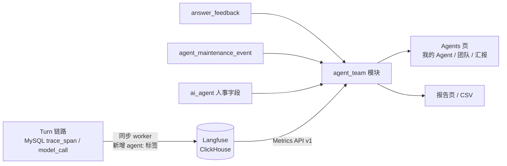

# Agent 团队视图设计

日期：2026-10-22。归属[产品路线图](../plans/2026-10-01-product-roadmap.md) V2.1。

## 背景

- AI 提效后团队规模已经收缩，管理层仍主要按人数看成本，会继续追问"还能不能再减人"。
- 实际的工作单元是"员工 + 其负责和使用的一组 Agent"。产出靠 Agent，Agent 靠人维护：改提示词、升级 Skill、处理差评、停用失效的 Agent。只看人数，这部分产出和投入都不可见。
- 现有数据：
  - Langfuse（3.225.11，ClickHouse）已有每个 Turn 的 trace：`userId`（即 `actor_id`）、延迟、成本、`ERROR` 级别，以及 `project:` 标签；但没有 Agent 标识。
  - MySQL `answer_feedback` 记录每轮的赞/踩；Turn 冻结输入记录 `agent_revision_id`（为空表示 Tapper 默认）。
  - `ai_agent`、`ai_agent_revision` 记录创建人、修订、停用与启用。
- Agents 页（能力 4）只展示配置。

## 目标

- 像展示员工一样展示 Agent 团队：每个 Agent 有岗位、入职日期、直属负责人、服务对象、工作量与履历；有"人 → Agent"的组织架构图。
- 产出与投入并列：产出是 Agent 的真实运行数据，投入是人对 Agent 的维护动作。
- 三种视角：员工（我的 Agent）、团队负责人（团队）、管理层（汇报）。
- 汇报形式：页面、可打印的报告页（浏览器导出 PDF）、CSV。

## 非目标

- 把运行数据换算成节省工时或等效人数。只展示真实运行数据。
- 统计 Tapper 之外的 Agent（IDE 助手、其他平台）。
- 跨项目汇总与按角色限制可见范围，随 V4 身份与多项目交付。
- 记录人的维护时长。投入侧只记录维护动作。
- 后端生成 PDF。

## 前置条件

- V1 能力 4（Skills/Agents）与能力 5（可观测性、Langfuse 同步）已合入 `develop`。
- V2 中最先实施；V2.2 主动框架在其之后。V2.2 系统 Agent 上线后作为团队成员加入（见 1.1）。
- 当前 Tapper Demo 为回环绑定、单一本地身份。V2.1 的数据模型和页面按多人设计，演示环境中只有一人。

## 1. 概念

### 1.1 团队与成员

- 一个 Tapper 项目即一个团队。
- 成员类型：

| 类型 | 来源 | 负责人 |
| --- | --- | --- |
| 自定义 Agent | 能力 4 创建或复制 | 有，默认创建人 |
| 内置 Agent | 种子数据（Knowledge agent） | 负责人显示"平台维护" |
| Tapper 默认 | 未选 Agent 的对话，`agent_key = tapper_default` | 负责人显示"平台维护" |
| 系统 Agent | V2.2 主动剧本，V2.2 上线后出现 | 负责人显示"平台维护" |

- 停用的 Agent 保留在名单中，状态"已停用"，历史数据不变。

### 1.2 人事档案

| 字段 | 来源 |
| --- | --- |
| 岗位 | Agent 上新增的短字段（≤ 64 字符），如"回归测试分析员"；可在档案中编辑 |
| 入职日期 | Agent 创建时间 |
| 直属负责人 | 1 人，负责质量与维护；默认创建人，可转交 |
| 服务对象 | 周期内调用过该 Agent 的人，按调用次数排序；查询时计算，不存表 |
| 工作量 | 第 2 节的运行指标 |
| 履历 | 维护动作时间线 |

组织架构图以人为节点：实线连接其负责的 Agent，虚线连接为其服务的 Agent。

### 1.3 维护动作

| `kind` | 触发 |
| --- | --- |
| `revised` | 生成新的 Agent 修订（提示词、Skills、默认模型变更） |
| `skill_upgraded` | 因绑定的 Skill 出新版本而生成 Agent 修订 |
| `disabled`、`enabled` | 状态变更 |
| `feedback_resolved` | 把一条踩或评论标记为已处理 |
| `owner_transferred` | 转交负责人 |

动作由系统在对应写操作中自动记录，不需要人工填写。

能力 4 没有"Skill 出新版本后自动生成 Agent 修订"的路径，修订都由人发起。修订时若与上一修订相比只有绑定的 Skill 修订变化，且每处变化都是同一 Skill 的新修订，记 `skill_upgraded`；其余记 `revised`。创建 Agent 不记维护动作。

### 1.4 状态

- 已停用：Agent 处于停用状态，优先于其他状态。
- 活跃：截至今天的近 30 天至少运行 1 次。
- 闲置：启用中且截至今天的近 30 天无运行。

状态与所选周期无关，用于花名册、档案与我的 Agent；汇总中的"活跃数"按所选周期计算（见 2.6）。汇报页是周期总结，不显示状态，改为显示"本期运行"或"本期未运行"（见 6.4）。

## 2. 指标口径

### 2.1 周期与粒度

- 周期：近 7 天、近 30 天、本月、上月、自定义；不限跨度。
- 按项目时区切分自然日，未配置时用 UTC，界面显示所用时区。当前没有项目时区设置，V2.1 恒为 UTC。
- 趋势粒度随跨度自动调整：≤ 92 天按天，≤ 731 天按周，更长按月。周从周一开始，月为自然月；首尾不完整的桶按周期截断，标注实际起止日期。汇总数字始终是整个周期的准确合计。

### 2.2 产出侧（取自 Langfuse）

| 指标 | 口径 | 层级 |
| --- | --- | --- |
| 运行次数 | 带 `agent:` 标签的 Turn trace 数；一次提问即一次运行 | 主指标 |
| 失败次数 | 其中 `outcome:failed` 的数量 | 主指标 |
| 运行时长 | trace 延迟合计与 p50 | 主指标 |
| 模型成本 | `totalCost` 合计（USD） | 主指标 |
| 服务人数、服务对象 | 不同 `userId` 数与按次数排序的名单 | 主指标 |
| 最近运行 | 最后一个 Turn trace 的时间，不限周期 | 主指标 |
| 模型调用次数 | 类型为 generation 的 observation 数 | 次要，档案与 CSV |
| 工具调用次数 | `tool.` 前缀的 span 数，每次执行的工具调用一个 | 次要，档案与 CSV |
| 拒答、取消次数 | `outcome:abstained`、`outcome:canceled` 的数量 | 次要，档案与 CSV |
| 平均每次运行调用数 | （模型调用 + 工具调用）÷ 运行次数 | 次要，档案与 CSV |

汇总、排序与报告只用主指标。调用次数随 ReAct 步数、重试与实现变化，不同 Agent 之间不可比，只用于观察复杂度与成本来源。

运行的认定：

- Turn trace 指根 span 为 `turn.request` 的 trace。同一 Turn 的 worker 重试（`attempt` 递增）在同一 trace 内，算一次运行；"重新生成"创建新 Turn，算新的一次运行。
- 根 span 不是 `turn.request` 的 trace 不打 `agent:` 标签，不计入。2026-10-23 本地 Langfuse 中有 28 个根为 `turn.execute` 的 trace，对应的 Turn 已不在 MySQL（会话已删除）；若计入会重复计数。
- 失败按 Turn 终态判定，不用 observation 的 `level`：本地实测失败的 Turn 在 Langfuse 中根 span 仍为 `DEFAULT`，worker 侧失败没有传到根 span。拒答与取消计入运行次数，不计为失败。

### 2.3 满意度（取自 MySQL）

赞数 ÷（赞数 + 踩数），按 Turn 冻结的 Agent 归属，按 Turn 创建时间落入周期（反馈晚于周期结束也计入原周期）。有评分的轮次少于 10 时显示"样本不足"。

删除会话不影响满意度：评分是对当时回答的判断，删除会话不等于撤回；运行次数同样不随会话删除减少。撤回评分（评分与评论都清空）才不计入。

Turn 冻结的 Agent 归属：`turn_input_snapshot` 的 `agent_revision_id` 经 `ai_agent_revision` 映射到 Agent；为空时为 `tapper_default`；找不到修订时归为未知，不进入任何 Agent 的统计。

### 2.4 投入侧（取自 MySQL）

- 周期内维护动作次数，按 `kind` 分列。
- 待处理反馈数。待处理反馈 = 踩或带评论（含带评论的赞），且未标记已处理。撤回的反馈（评分与评论都为空）不算。
- 已处理的反馈被用户改了评分或评论，重新变为待处理；原 `feedback_resolved` 动作保留在履历中。

### 2.5 按人

| 指标 | 说明 |
| --- | --- |
| 负责 Agent 数 | 当前为直属负责人的 Agent 数 |
| 负责 Agent 运行量 | 这些 Agent 周期内运行次数合计 |
| 被服务 Agent 数 | 周期内调用过的不同 Agent 数 |
| 调用次数 | 本人周期内运行次数 |
| 维护动作数 | 本人周期内维护动作合计 |

每列均可排序，个人数据对团队视图可见。

人员范围：所有 Agent 的当前负责人，加上周期内调用过 Agent 或做过维护动作的人。"调用过 Agent 的人"取 Langfuse 中周期内的调用者（与 2.2 服务对象同源）并上 MySQL 中周期内有 Turn 的人；Langfuse 不可用时只用 MySQL。V4 接入身份前没有显示名，界面显示 `actor_id`。

### 2.6 团队汇总

- Agent 总数（启用中的自定义与内置 Agent，不含 Tapper 默认）、活跃数（周期内至少运行 1 次）、闲置数（状态为闲置，见 1.4）。
- 每位负责人管理的 Agent 数：负责 Agent 数合计 ÷ 至少负责 1 个 Agent 的人数；没有负责人时为 0。
- 每位使用者用到的 Agent 数：被服务 Agent 数合计 ÷ 周期内调用次数大于 0 的人数；没有调用者时为 0。
- 总运行次数、总运行时长、总成本、维护动作合计。

## 3. 架构与数据流

- 运行数据只从 Langfuse 查询：统计用 Metrics API v1（自托管 3.x 只提供 v1）；"最近运行"用 Traces 列表 API（`tags` 过滤、`orderBy=timestamp.desc`、`limit=1`），因为 Metrics API v1 没有时间戳度量。已在本地 3.225.11 实测：按 `tags`、`userId`、`name` 分组，`timeDimension` 按天或周，`count`、`sum_totalCost`、`p50_latency`（毫秒），observations 视图可按 `tags`（即 trace 标签）分组，按 `type`、`name` 前缀、`parentObservationId` 为空过滤，metadata 与 tags 过滤均可用。metadata 只能过滤不能分组，因此 Agent 标识与 Turn 终态写入标签。`tags` 维度返回整组标签而非逐个展开，`timeDimension` 会补齐空桶，空桶也计入行数上限。
- 查询按 `environment`（`TAP_LANGFUSE_ENVIRONMENT`）过滤，本地与 e2e 数据不混算。
- 满意度、维护动作与人事字段来自 MySQL，由 `agent_team` 模块合并。
- 新增后端模块 `agent_team`，通过端口 `AgentRuntimeMetrics` 访问 Langfuse；生产适配器调用 Metrics API，测试适配器返回 mock 数据。
- 只缓存 Langfuse 运行数据，按（项目、周期、查询类型）缓存 5 分钟；人事字段、维护动作、满意度与反馈每次实时查询，写操作后立即可见。界面显示"数据更新于"，并说明运行数据比对话最多晚一个同步周期。
- "运行数据同步中"：游标之后最早一条未同步 span 超出其同步沉淀窗口（`TAP_LANGFUSE_SYNC_SETTLE_SECONDS`，默认 60 秒）的时长（即 `当前时间 − 沉淀窗口 − 记录时间`）超过 5 分钟时显示；窗口内的 span 不计入，因此长时间无新运行后不会误报；没有游标行时视为全部 span 未同步。
- 单次查询超过 1 000 行时按日期分段查询后合并。
- `make demo-up` 默认启动 Langfuse 与 ClickHouse（原为可选的 `make langfuse-up`）；`make demo-check` 增加 Langfuse 检查。

## 4. 数据模型（新迁移，编号接续 0035）

- `ai_agent` 增加 `job_title`（可空，≤ 64）、`owner_actor_id`（回填为 `actor_id`）、`owner_assigned_at`。三者不进入修订摘要，因为它们不影响回答。
- 新表 `agent_maintenance_event`，只追加：

| 列 | 说明 |
| --- | --- |
| `event_id` | 主键 |
| `project_id`、`agent_id`、`actor_id` | 归属与操作人 |
| `kind` | 见 1.3 |
| `revision_id`、`feedback_id` | 可空，关联对象 |
| `note` | 可空，≤ 500 字符 |
| `occurred_at` | 发生时间 |

- `answer_feedback` 增加 `resolved_at`、`resolved_by`、`resolution_note`。
- 维护事件与对应写操作（修订、停用、启用、转交、处理反馈）在同一事务内写入。
- Langfuse 同步：Turn trace（根 span 为 `turn.request`）增加标签 `agent:<agent_id>`（未选 Agent 时为 `agent:tapper_default`）与 `outcome:<state>`（Turn 当前状态：`completed`、`abstained`、`failed`、`canceled`；未终结时不加）。Turn 终结后其后续 span 会触发该 trace 重新同步，标签随之更新。
- 工具循环中每次执行的工具调用记一个 `tool.<tool_id>` span（被拒绝的调用不记），命名沿用 `tool.insights.query`；此前每轮只有一个 `graph.node.tools` span，数不出调用次数。
- 上线时重置 trace 同步游标重推历史，使旧 trace 补上标签。本地约 6 000 条 trace，worker 按现有批次推送，期间显示"运行数据同步中"。MySQL 中已删除的会话无法重推，其 trace 保持无 `agent:` 标签，不计入团队视图。
- 用户修改已处理反馈的评分或评论时，同一 upsert 语句清空 `resolved_at`、`resolved_by`、`resolution_note`。

## 5. API 与契约

前缀 `/api/v1/projects/{project_id}/ai/`，契约由 `make contracts` 生成。查询参数 `from`、`to` 为日期。

| 方法与路径 | 作用 |
| --- | --- |
| `GET agent-team/summary` | 团队汇总 |
| `GET agent-team/members` | 花名册，支持按负责人、状态、类型筛选与按列排序 |
| `GET agent-team/members/{agentKey}` | Agent 档案，读取信封的 `data` 为 `{row, currentRevisionId, served（完整名单）, pendingFeedback}`：人事字段、工作量、服务对象、趋势 |
| `GET agent-team/members/{agentKey}/history` | 履历，游标分页，返回 `{events, nextCursor}`，不带读取信封（`runtimeStatus`、`computedAt`） |
| `GET agent-team/people` | 人员表 |
| `GET agent-team/people/{actorId}` | 个人视图，"我的 Agent"传 `me`（解析为当前身份） |
| `GET agent-team/org-chart` | 组织架构图节点与边（`owns`、`serves`） |
| `GET agent-team/report` | 报告页数据，含 `previousPeriod`（上一周期对比） |
| `GET agent-team/export` | CSV zip：花名册、人员、趋势明细三个文件，UTF-8 BOM；明细粒度与界面趋势相同（2.1），在文件首行注明 |
| `PUT agents/{agentId}/profile` | 修改岗位 |
| `POST agents/{agentId}/owner` | 转交负责人，请求体字段 `newOwnerActorId` |
| `POST feedback/{feedbackId}/resolve` | 标记反馈已处理，可带说明；重复提交返回原结果 |

- 查询接口（履历除外）返回 `runtimeStatus`（`ok`、`syncing`、`unavailable`）与 `computedAt`。
- 权限：新增 `ai.agent_team.read`；三个写接口沿用 `ai.agents.write`。演示身份拥有全部权限，按角色限制随 V4。

### 5.1 错误与降级

| 情况 | 处理 |
| --- | --- |
| Langfuse 不可达或超时（整个视图共享 10 秒期限；单次查询超时取 8 秒与剩余期限的较小者，超时同样负缓存 30 秒） | `runtimeStatus: unavailable`，运行数据区块显示"运行数据暂不可用"；所有运行派生字段为 null（不是 0），卡片状态为 null（已停用除外），汇总的活跃数、闲置数为 null；CSV 的运行列留空，三个文件首行均注明 `# runtime=unavailable`；花名册、负责人、履历、满意度照常显示；不返回 500 |
| 同步积压 | 显示"数据更新于"并提示可能滞后 |
| `from` 晚于 `to`，或日期格式错误 | 400 `period_invalid` |
| 履历游标无效（含空串） | 400 `cursor_invalid` |
| 状态或类型筛选值不在允许范围 | 400 `filter_invalid` |
| 岗位超过 64 字符 | 400 `job_title_too_long` |
| 排序字段不在允许范围 | 400 `sort_invalid` |
| 处理反馈的说明超过 500 字符 | 400 `note_too_long` |
| 转交给不存在的成员（同企业、启用中的身份才算存在） | 400 `actor_not_found` |
| 修改内置 Agent 或 Tapper 默认的人事字段 | 403 `agent_read_only` |
| Agent 或反馈不存在、不属于本项目 | 404 `agent_not_found`、`feedback_not_found` |
| 转交给当前负责人 | 200，原样返回，不记维护动作 |
| 处理 `tapper_default` 的反馈（没有 Agent 记录） | 200，反馈标记已处理，不写维护动作 |

## 6. 前端

Agents 页顶部四个标签：**我的 Agent**、**团队**（默认）、**汇报**、**配置**。"配置"为能力 4 现有列表与表单，不改动。

### 6.1 团队

- 汇总栏：2.6 指标、周期选择器、"数据更新于"。
- 花名册：卡片视图（默认）与表格视图。卡片像员工名片：头像（名称首字）、名称、岗位、直属负责人、状态（活跃、闲置、已停用）、近 30 天运行趋势、满意度、主要服务对象（前 3 位）、最近运行、最近维护。按负责人、状态、类型筛选；表格各列可排序（含岗位、负责人、状态、类型，由服务端排序白名单支持，空值排最后，并列按名称顺序稳定）。
- 负责人显示：内置 Agent 与 Tapper 默认显示"平台维护"（花名册、档案、汇报页），只是展示，接口中负责人仍为空。
- 组织架构图：人节点实线连负责的 Agent，虚线连服务的 Agent；点击一个人高亮其关系。
- 人员表：2.5 各列，可排序。

### 6.2 Agent 档案（抽屉）

- 基本信息：岗位、入职日期、直属负责人、服务对象名单、当前修订。
- 工作量：按周期粒度的趋势，2.2 主指标与次要指标。
- 履历：维护时间线，可打开对应修订。
- 待处理反馈：可"标记已处理"并写说明。
- 设置：编辑岗位、转交负责人；"查看配置"跳到配置标签中的该 Agent。

### 6.3 我的 Agent

两块：我负责的 Agent、为我服务的 Agent。指标同团队页，"待我处理的反馈"置顶，即我负责的 Agent 的待处理反馈。内置 Agent 与 Tapper 默认没有负责人，它们的待处理反馈只在团队页与档案中显示，拥有 `ai.agents.write` 的人都可以处理。

### 6.4 汇报

- 可打印的报告页：选择周期（默认上月），固定版式展示汇总、趋势、花名册、人员表与上一周期对比。报告页的花名册不显示状态，显示"本期运行"（周期内运行次数 ≥ 1）或"本期未运行"；已停用的 Agent 仍显示"已停用"。
- 上一周期：上月对比再上一个自然月；本月（1 日至今天）对比上月 1 日至同一天（上月没有该日时取月末）；近 7 天、近 30 天与自定义对比紧邻其前的等长区间。上一周期为 0 时变化显示"—"。
- 导出 PDF 使用浏览器打印，提供打印样式；导出 CSV 调用 `agent-team/export`。

### 6.5 通用

- 中英文案齐全；空状态引导"新建 Agent"。
- "样本不足""运行数据同步中""运行数据暂不可用"在数字旁直接标注。
- 图表遵循仓库现有图表组件与配色；产品界面不放演示开关或实现说明。

## 7. 测试与验收

### 7.1 后端

- 单元：各指标口径（运行与调用分开计数、失败判定、满意度样本阈值、闲置判定、粒度切换边界 92 天与 2 年）；服务对象排序；维护事件与写操作同一事务；Langfuse 不可达降级；超 1 000 行分段合并；缓存命中与过期；同步写入 `agent:` 标签（含 `tapper_default`）。
- 契约：新接口与错误码；能力 4 现有契约测试不改即通过。
- 集成（隔离 MySQL 夹具，一次一个文件）：转交、处理反馈、修订进入履历；CSV zip 内容与编码。
- Langfuse 适配器：mock 数据测试查询拼装与结果解析；opt-in smoke（`TAP_RUN_LANGFUSE_SMOKE=1`）对本地真实 Langfuse 3.225.11 验证标签分组与 `ERROR` 计数，未设置时跳过。

### 7.2 前端

Vitest 覆盖四个标签、卡片与表格切换、排序筛选、组织架构图高亮、档案各分页、处理反馈、转交、报告页、导出、降级提示、中英切换。

### 7.3 E2E 与截图

- `make demo-e2e`（Metrics 用 mock）：新建 Agent 并填岗位 → 用它对话两轮并点一个踩 → 团队页出现该 Agent 卡片与服务对象 → 档案中处理该反馈，履历出现"处理差评" → 打开汇报页并导出 CSV。
- `ui:capture` 新增团队、组织架构图、Agent 档案、我的 Agent、汇报页截图。

### 7.4 业务验证

在演示环境用真实模型积累至少一周数据，生成上一周期报告，由用户确认数字与口径可直接用于管理层汇报。

### 7.5 文档与门禁

- 新增 ADR：Langfuse 从可选组件改为默认组件，团队视图运行数据以 Langfuse 为唯一查询来源。
- 更新 `docs/architecture.md`（`agent_team` 模块、同步标签、默认部署）与产品路线图 V2.1 行。
- `make check`、`make test`、`make demo-e2e` 全部通过。

## 8. 风险

- Langfuse 升级到 v4 后 v1 Metrics API 不可用，需改用 v2 并重新验证；固定 3.x 版本，升级前在本地重跑 smoke。
- Langfuse 与 ClickHouse 默认启动后本地资源占用上升：ClickHouse 2 GB 内存由 insights 与 Langfuse 共用，Docker 磁盘余量需在 `make demo-check` 中提示。
- 运行数据依赖同步 worker：同步失败或积压时数字滞后，以"数据更新于"提示，失败项沿用现有失败表补推。
- 个人数据对团队视图可见：V4 接入真实身份前需确认可见范围与员工告知要求。
