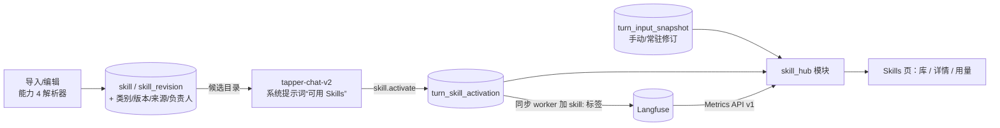

# Skill Hub 设计

日期：2026-11-01。归属[产品路线图](../plans/2026-10-01-product-roadmap.md) V2。前置：V1 能力 4（[自定义与导入 Skills/Agents 设计](2026-10-11-skills-agents-design.md)）、V2.1 Agent 团队视图（[设计](2026-10-22-agent-team-view-design.md)）与 `tapper-chat-v2` 工具循环已合入 `develop`。接手说明见 [Agents 名册与 Skills 名册交接](../../guides/2026-10-28-agents-skills-handoff.md)第 3 节。

## 背景

- 产品负责人 2026-10-28 否决了"Skill 名册／Skill 团队"方向：Skill 是独立、灵活调用的能力包，不是成员；要求参考 Skill Hub 类产品（SkillHub、skills-hub.ai、Agent Skills 标准）来做，取消 Skill 与 Agent 的绑定；功能大则分阶段。
- Skill Hub 类产品的共同形态：对象是包（`SKILL.md` + scripts/references/assets），元数据是类别、来源出处、版本、兼容客户端、更新时间、安全扫描结果、使用量；交互是库（搜索、按类别/来源浏览、详情页、一条命令安装、从来源同步）；调用是渐进式加载——启动时只给模型名称与描述，任务匹配时才读入全文。
- Tapper 现状：Skill 包解析、不可变修订、对象存储与详情页已有（能力 4）；Skill 通过"绑定到 Agent 修订 ∪ 对话里手选"进入提示词（`modules/chat/application/skill_selection.py`），每轮文本上限 96 KB；Skill 出新修订要逐个 Agent"升级"；没绑也没手选的 Skill 不会被用到；`tapper-chat-v2` 已有 `model ⇄ tools` 的有界工具循环，可以让模型按需读取 Skill 全文。

## 目标

- Skills 模块成为项目内的 Skill 库：找得到、看得清、装得上、用得上、看得到用量。
- Skill 不再绑定 Agent：项目内启用的 Skill 对 Tapper 默认与所有 Agent 可见，由模型按描述自动激活；用户仍可手动指定；Agent 可声明常驻与排除。
- 每轮冻结实际激活的 Skill 修订，追溯与治理不弱于现在。
- 分三阶段交付，每阶段可独立验收。

## 非目标

- 执行 Skill 包里的脚本（仍只存档）。
- 跨项目共享与组织级发布的权限模型（随 V4 身份；第 3 阶段只做项目内）。
- 把运行成本按 Skill 分摊。
- 对接外部公共 Hub 的账号体系或付费。

## 1. 概念

### 1.1 Skill 包与修订

沿用能力 4：一个 Skill 有若干不可变修订；修订来自导入、界面编辑或第 2 阶段的来源同步。新增元数据：

| 字段 | 来源 | 说明 |
| --- | --- | --- |
| 类别 | frontmatter `metadata.category`，缺省时导入/编辑表单选择 | 闭集：`test-design`、`automation`、`knowledge`、`analysis`、`writing`、`other`；可在表单改 |
| 版本号 | frontmatter `metadata.version`（SemVer）；缺省为修订序号 | 只展示与排序，不参与激活 |
| 来源出处 | 导入方式（文件/zip/粘贴/URL/Git）、原始文件名或 URL、导入时间、导入人 | 第 2 阶段补 URL/Git 的提交或 ETag |
| 兼容性 | frontmatter `compatibility` | 原样展示 |
| 适用任务 | 沿用 `applicable_tasks` | 用于库筛选与激活候选过滤 |
| 负责人 | 创建/导入人，可转交 | 只用于联系与治理，不做团队视图 |

### 1.2 激活（取代绑定）

- 候选：项目内所有状态为启用、适用任务匹配的 Skill 的最新修订。
- 三种激活方式，优先级从高到低：
  - 手动：用户在对话里勾选（现有交互），本轮必定加载；
  - 常驻：Agent 声明的 `pinned_skill_ids`（按 Skill 而非修订），选用该 Agent 时必定加载；
  - 自动：模型在工具循环里调用 `skill.activate` 读入全文。
- Agent 可声明 `excluded_skill_ids`，被排除的 Skill 不进入候选目录。
- 每轮上限：加载的 Skill 文本合计 ≤ 96 KB（沿用），自动激活 ≤ 5 个；超出时拒绝并给模型返回说明。
- 每轮冻结：`turn_input_snapshot` 继续记录手动与常驻的修订 id；自动激活在运行中发生，记入新表 `turn_skill_activation`（见第 4 节）。追溯时两者合并显示"本轮用到的 Skill"。
- 取消"有新版本／升级"流程：永远使用最新启用修订；旧修订保留供历史回看。

### 1.3 渐进式加载

- 目录：系统提示词追加"可用 Skills"段，每个候选一行 `name — description`（描述截断到 200 字符），最多 60 个；超过 60 个时按适用任务与类别裁剪，并在库页提示"候选已超上限，部分 Skill 只能手动选用"。
- 激活：新增工具 `skill.activate`，参数 `name`，返回该 Skill 的指令正文与已附加的参考文本；受 1.2 的上限约束；对模型说明"只在任务需要时调用"。`skill.activate` 只返回回执，Skill 正文作为受信 Skill 块进入下一次模型调用，因为工具结果属不受信内容，最终无工具轮会被压平为 `untrusted.toolActivity`。
- 工具权限：`skill.activate` 对所有 Agent 与 Tapper 默认默认开启，不进入 Agent 白名单表单（与 `knowledge.search` 同级的平台工具）。

## 2. 分阶段范围

| 阶段 | 交付 | 验收 |
| --- | --- | --- |
| 第 1 阶段：库与自动激活 | 库页（搜索、筛选、卡片、详情）、类别与版本号元数据、负责人与转交、`skill.activate` 与常驻/排除、绑定迁移、用量统计（激活次数、使用者、满意度、最近使用）、CSV 导出 | 本 spec 第 7 节 |
| 第 2 阶段：来源与版本 | 从 URL/Git 导入（主机白名单）、来源记录、"检查更新"与同步为新修订、版本对比、导出包 | 另立 spec 的增量节 |
| 第 3 阶段：信任与共享 | 导入时静态扫描（提示注入、外发指令、脚本存在）给出 PASS/WARNING/FAIL 与信任等级，FAIL 不能启用；项目内评价与推荐；跨项目共享随 V4 | 另立 spec |

以下各节只定义第 1 阶段。

## 3. 指标口径

- 周期、粒度、时区、缓存与降级沿用 Agent 团队视图 2.1 与 3 节的实现。
- 主指标（演示库，精确）：
  - 激活次数：周期内用到该 Skill 的运行次数，按方式拆分（手动、常驻、自动）；一次运行用到多个 Skill 时每个 Skill 各计 1 次，页面注明"不可相加"。
  - 使用者数：周期内用到它的不同 `actor_id`。
  - 满意度：用到它的轮次的赞 ÷（赞 + 踩），按 Turn 创建时间落入周期，样本 < 10 显示"样本不足"。
  - 最近使用：最后一次用到它的时间，不限周期。
  - 常驻它的 Agent 数：当前值。
- 次要指标（Langfuse，带缓存与降级）：用到它的运行的成本、耗时合计与失败数，按同步 worker 新增的 `skill:<skill_id>` 标签统计（一条 trace 可带多个）。
- 库汇总：Skill 总数、启用数、周期内被用到的数、无人使用的数、自动激活占比。

## 4. 架构与数据

- 新后端模块 `skill_hub`：库查询、详情、用量、导出；复用 `agent_team` 的周期、缓存、期限与降级工具（抽成共享模块，不改行为）。
- 对话链路：`skill_selection.merge_skill_selection` 改为"手动 ∪ 常驻"（不再读 Agent 绑定）；工具注册表新增 `skill.activate`；工具执行器把激活写入 `turn_skill_activation` 并记一个 `tool.skill.activate` span。
- 迁移（编号接 0037）：
  - `skill` 增加 `category`、`owner_actor_id`、`owner_assigned_at`；`skill_revision` 增加 `version_label`、`origin_kind`、`origin_ref`、`origin_imported_at`（回填自现有导入记录）。
  - `ai_agent_revision` 的 `skill_revision_ids` 保留只读；新增 `pinned_skill_ids`、`excluded_skill_ids`，迁移时把现有绑定的修订映射为其 Skill id 写入 `pinned_skill_ids`，行为与迁移前一致（绑定的 Skill 仍必定加载），只是改用最新修订。
  - 新表 `turn_skill_activation(activation_id, turn_id, project_id, skill_id, skill_revision_id, mode, activated_at, bytes)`，`mode` ∈ `manual`、`pinned`、`auto`；手动与常驻在冻结时写入，自动在工具执行时写入；从历史 `turn_input_snapshot.skill_revision_ids` 回填（方式按 `requested_skill_revision_ids` 判定手动，其余记常驻）。
  - 新表 `skill_maintenance_event`（`revised`、`enabled`、`disabled`、`owner_transferred`、`synced`），与写操作同一事务。
- Langfuse 同步：`turn.request` trace 追加 `skill:<skill_id>` 标签（每个用到的 Skill 一个）；上线时重置游标补推历史。

## 5. API 与契约

前缀 `/api/v1/projects/{project_id}/ai/`。查询参数 `from`、`to`、`preset` 与 Agent 团队视图一致。

| 方法与路径 | 作用 |
| --- | --- |
| `GET skill-hub/catalog` | 库列表：支持 `q`、`category`、`task`、`source`、`status`、排序（名称、最近使用、激活次数、更新时间）；每项含最新修订摘要与周期内用量 |
| `GET skill-hub/catalog/{skillId}` | 详情：元数据、来源、负责人、修订历史、文件清单、用量、常驻它的 Agent、最近用到它的 Agent 与调用者 |
| `GET skill-hub/catalog/{skillId}/usage` | 用量趋势（按周期粒度）与按方式拆分 |
| `GET skill-hub/summary` | 库汇总（第 3 节） |
| `GET skill-hub/export` | CSV zip：库清单与用量明细，规则同 Agent 导出 |
| `PUT skills/{skillId}/profile` | 修改类别、负责人之外的展示元数据 |
| `POST skills/{skillId}/owner` | 转交负责人 |
| `PUT agents/{agentId}/skills` | 设置 `pinnedSkillIds`、`excludedSkillIds`（生成 Agent 新修订） |

- 现有 `GET /ai/skills*`、导入与修订接口不变；`POST /ai/agents*` 的 `skillRevisionIds` 字段废弃但继续接受（映射为常驻），契约标注 deprecated。
- 查询接口返回 `runtimeStatus` 与 `computedAt`；错误码沿用 Agent 团队视图 5.1（`period_invalid`、`filter_invalid`、`sort_invalid`、`cursor_invalid`、`actor_not_found`、`skill_not_found`、`skill_read_only`）。
- 权限：新增 `ai.skill_hub.read`；写沿用 `ai.skills.write`、`ai.agents.write`。

## 6. 前端

- Skills 页改为库：顶部搜索与筛选（类别、适用任务、来源、状态）、排序；卡片显示名称、描述、类别、版本号、来源、更新时间、周期内激活次数、状态；周期选择器与"数据更新于"沿用团队页组件。
- 详情页（右侧滑出）：基本信息（描述、类别、版本、来源出处、负责人、兼容性）、SKILL.md 渲染（沿用 `skillMarkdown`）、文件清单、修订历史（可对比正文）、用量（指标卡 + 趋势 + 按方式拆分 + 用到它的 Agent/调用者排行）、设置（类别、转交负责人、启用/停用、新建修订）。
- Agent 配置表单：Skill 区改为"常驻 Skills"与"排除 Skills"两个多选；去掉"有新版本/升级"提示。
- 对话：输入框的 Skill 选择保留（手动激活）；回答的"来源与设置"展开里显示本轮用到的 Skill 与方式（手动/常驻/自动）。
- 空态：引导"导入 Skill"；库超 60 个候选时在页面顶部提示。中英文案齐全，默认英文，不出现实现术语。

## 7. 测试与验收（第 1 阶段）

- 后端单元：候选目录裁剪（≤ 60、任务与排除过滤、描述截断）、激活上限（96 KB、5 个）、三种方式的优先级与去重、绑定迁移映射、指标口径（方式拆分、满意度阈值）、降级为 null。
- 契约：新接口与错误码；`skillRevisionIds` 兼容路径。
- 集成（隔离 MySQL）：迁移回填（`turn_skill_activation`、`pinned_skill_ids`）、转交与事件同事务、导出编码。
- 对话链路：`tapper-chat-v2` 单元测试覆盖 `skill.activate` 的调用、记录与预算拒绝；真实模型 smoke（`TAP_RUN_TAPPER_REAL_MODEL_SMOKE=1`）验证一次自动激活。
- 质量门禁：新增小型激活精度夹具（10 个问题 × 候选 Skill 集合），统计应激活/不应激活的命中率，门槛 ≥ 80%，作为 `make check` 之外的 opt-in 评估。
- 前端 Vitest：库筛选排序、详情各页、Agent 表单常驻/排除、对话中"本轮用到的 Skill"。
- `make demo-e2e`：导入 Skill → 库中出现 → 不手选直接对话，模型自动激活 → 回答展开显示该 Skill（自动）→ 详情用量 +1 → 导出 CSV。
- 截图：库、详情、Agent 表单、对话展开。
- 业务验证：名册里的 Agent 去掉常驻后用真实模型复跑第 2 节名册的验证问题，自动激活命中与回答质量不低于绑定时。

## 8. 风险

- 模型不激活或过度激活：用激活精度夹具度量；常驻与手动作为兜底。
- 候选目录占用上下文：上限 60 个、描述截断 200 字符，约 12 KB；更大规模留给第 2 阶段的检索式目录。
- 迁移：现有 Agent 行为靠 `pinned_skill_ids` 保持；回滚时 `skill_revision_ids` 仍在。
- 第 3 阶段的扫描只是静态规则，不能替代审批；在 spec 中明示。
