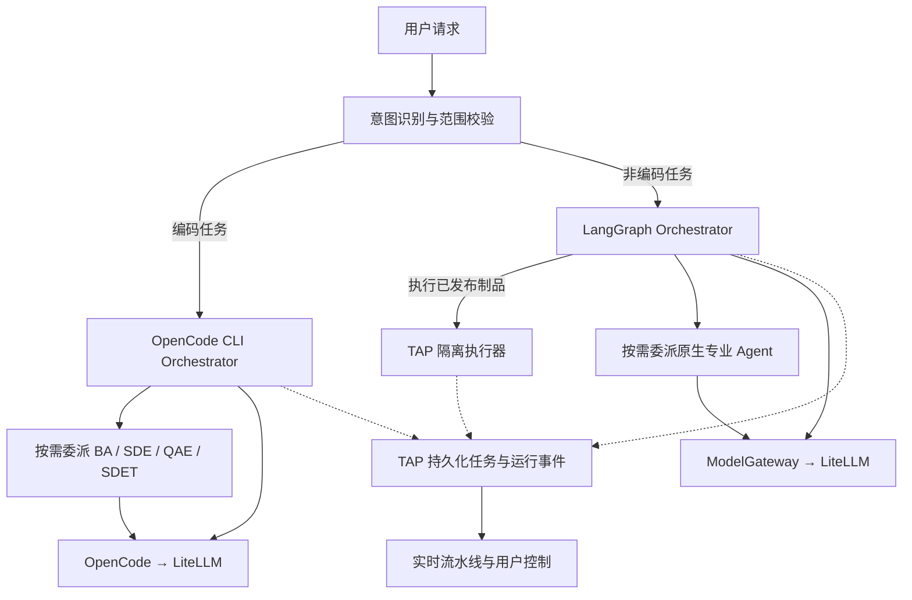
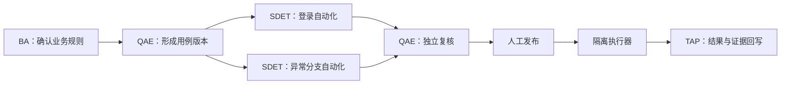

# Tapper 双路径 Agent 工作流与测试闭环设计

日期：2026-11-06。本文汇总产品负责人在 2026-11-05 至 2026-11-06 确认的整体设计；用户已同意进入实施规划，见[实施总计划](../plans/2026-11-06-agent-workflows-and-test-loop.md)。2026-11-06 provider 修订：用户取消 Copilot 订阅后，最终明确使用 OpenCode 并继续接入 LiteLLM；先前 Codex 替换提议不再执行。本文不是已交付能力或实施完成记录。归属[产品路线图](../plans/2026-10-01-product-roadmap.md)的通用任务底座与测试闭环增量。现状以[现状架构](../../architecture.md)为准。

2026-11-08 浏览器职责调整：用户确认 browser-use 完成实时网页任务、OpenCode 默认将成功动作整理成脚本、TAP 负责独立浏览器、人工接管和证据。浏览器任务的新执行与交接边界以[后续设计](2026-11-08-tapper-browser-agent-and-replay-design.md)及 [ADR-038](../../decisions/2026-11-08-adr-038-browser-agent-and-script-ownership.md)为准；一般编码、知识任务及正式测试资产规则沿用本文。该方向尚未实现，不覆盖下文旧路径的历史验证记录。

## 1. 已确认的产品决定

| 决定 | 约束 |
| --- | --- |
| 通用任务底座，测试闭环先验收 | 底座支持测试、软件开发及财务、项目管理等业务自动化；首版验收集中于测试闭环，其他领域后续交付 |
| 意图识别后分两条执行路径 | 编码任务整体交给 OpenCode CLI 内的 Orchestrator 与专业 Agent；非编码任务由原生 LangGraph Orchestrator 编排 |
| 模型接入 | OpenCode CLI 使用 BYOK，首版接现有 LiteLLM；非编码路径通过现有 ModelGateway / LiteLLM 调用模型 |
| Coding provider | OpenCode CLI 为首个实现；保留 Claude Code、Codex 适配接口，不把它们当首版运行依赖 |
| 对外身份与岗位名称 | 默认助手统一称为 Tapper；Orchestrator 仅为内部技术角色。专业 Agent 使用 BA、SDE、QAE、SDET 等亚马逊风格岗位名称，并显示中文 |
| 调用机制 | 参考 Claude Code 的主 Agent loop 与按需子 Agent 委派；Orchestrator 可直接回答、使用工具或按职责描述选择 Agent，也支持用户显式指定；不固定岗位流水线 |
| 统一入口与名册 | Tapper 是默认智能助手，发送消息即由它处理和调度；Agents 目录与选择 / @ 只提供可委派的专业 Agent，不单列 Tapper 或系统 Orchestrator。全部实际运行仍可追溯，统筹记录归任务详情 |
| 首版代码管理 | 由 TAP 创建并管理代码及版本；后续允许用户选择 Azure DevOps Repos、GitLab 等外部 Git 仓库 |
| 测试资产管理 | 测试计划、测试用例始终由 TAP 管理，两者均有版本管理 |
| 首个执行器 | TAP 管理的本机隔离容器，执行 Playwright + TypeScript；Jenkins、Azure DevOps Pipelines 后续通过适配器扩展 |
| 实时交互 | 覆盖两条路径和 Tapper 所有实际运行的 Agent；用户可指定 Agent 补充要求，由 Orchestrator 协调并记录影响 |
| 展示形式 | 执行详情统一在右侧栏，默认收起，由用户点击打开；中间对话不嵌入流水线或展开的运行卡。侧栏内呈现任务统筹进度、专业 Agent 节点、流水线与活动时间线，共用运行记录 |
| 易懂术语 | 用户界面与新设计使用“自动化测试步骤”，包含操作、测试数据与预期结果；原 Test IR 仅在解释旧文档和兼容标识时出现 |

## 2. 首版范围与设计默认值

2026-11-07 用户澄清：产品目标是根据自然语言描述完成不同网站的 Web 自动化流程，FWD 询价只是举例，不是专用功能或完整能力边界。用户提供目标、网站和必要输入，Tapper 检查真实页面、生成脚本、执行并核对结果，返回证据及可复用制品；缺少必要信息时询问，执行失败时在既定预算内诊断并修复。测试场景仍完成可复现链路：需求与项目知识 → 测试计划/用例版本 → 自动化测试步骤与代码 → 调试与审查 → 发布 → 隔离执行 → 结果和证据回写。用户能在此过程中观察单个或多个 Agent，定向补充要求、暂停与恢复。

以下为整体设计采用的默认值，实施时须持续满足：

- 发布继续沿用人工确认；生成、检查和隔离调试可在已授权任务范围内自动推进。发布确认绑定具体版本，改动后原确认不自动生效。
- 确定性回归使用项目自有、无真实租户数据的隔离 Web 示例系统。2026-11-07 用户明确：必须由 Tapper 完成自然语言驱动的真实浏览器自动化，不能用独立 OpenCode/Python 探针或 Tapper 自身界面测试替代；FWD 示例见 §11.1，通用性验收见 §11.2。客户系统账号和真实个人资料不属于本次合成询价验收。
- 首版工作在当前本机、单项目上下文，保持 Demo 回环绑定；容器之间按所需服务连通，宿主机入口不扩展为局域网服务。
- 桌面 RPA、移动端、多人身份、外部 Git 实现、外部 CI 执行器、通用软件开发的完整验收均不计入首版。
- 首版提供运行详情和通过指令调整计划；可拖拽编辑任意工作流的设计器不计入首版。
- 导入 Skill 包内的任意脚本继续只存档。给编码 Agent 提供文本指引，不把 Skill 导入自动变成代码执行授权。

## 3. 岗位与运行实例

| 岗位 | 中文名称 | 单次委派的职责与产物 |
| --- | --- | --- |
| Orchestrator（Tapper 内部角色） | 任务统筹 | 理解用户、维持对话、直接处理简单问答与查询；复杂任务按需分解目标、安排依赖、委派专业 Agent、协调用户补充要求并汇总交付 |
| BA — Business Analyst | 业务分析师 | 从需求与证据梳理业务规则、流程分支和验收条件，产出带来源的业务说明 |
| SDE — Software Development Engineer | 软件开发工程师 | 实现应用、接口与业务自动化代码，产出代码变更和验证证据；首版不验收通用产品开发闭环 |
| QAE — Quality Assurance Engineer | 质量保证工程师 | 设计测试计划、用例、覆盖范围与预期结果，或执行一次独立质量评审 |
| SDET — Software Development Engineer in Test | 测试开发工程师 | 实现自动化测试代码、定位器及测试辅助能力，或诊断并修复脚本问题 |

Tapper 是面向用户的默认助手，Orchestrator 是它在两条运行路径中的内部统筹角色，不是另一个可选择的助手。 对外统一使用 Tapper：对话、进度、通知、错误提示和面向用户的帮助说明均不以 Orchestrator 称呼助手，也不呈现“Tapper 再调用 Orchestrator”的额外层级。运行路径切换不改变助手身份；专业 Agent 保留各自岗位名称。Orchestrator 名称仅保留在内部架构、代码、配置及工程诊断标识中。Agents 档案列表、搜索、选择器与 @ 候选均不单列系统 Tapper/Orchestrator；无需也不提供 `@Tapper`、`@Orchestrator` 来启动任务。系统统筹配置仍按内部身份版本化并在运行中冻结，不能因 UI 不列出而丢失审计记录。

专业岗位是配置模板，不是固定顺序或固定人数。每次委派限定一个明确目标、输入范围、工具权限和验收条件。审查使用独立工作实例；不以同一实例对自身产出的评价代替检查与人工发布。

Agent 定义与 Agent 工作实例分开：前者具有提示词、模型和 Skill 修订；后者属于具体任务，冻结所用配置和输入。一个 SDET 可产生多个独立实例。现有用户 Agent 保留其名字和配置，不强制改成内置岗位；停用、修订不改写历史实例。

两条路径使用同一份 TAP 管理的岗位与 Agent 修订。OpenCode 适配器将获准指令映射成任务专属 custom agent profiles，并显式传递任务范围与权限；不依赖子 Agent 自动继承本地仓库指令，不加载用户机器中无关的个人 Agent 配置。

### 3.1 按需调用与 Agent loop

采用 Claude Code 风格的按需委派机制，而非要求所有任务按 BA → QAE → SDET 固定流转。主 Agent loop 在获取上下文后决定直接回答、调用工具、委派子任务或等待输入；工具或子任务结果返回后，主 Agent 校验结果并决定继续或结束。简单问答可以一次模型响应完成，不强制生成计划或启动子 Agent。

委派是主循环的一种动作；每个实际启动的子 Agent 拥有自己的上下文、指令、工具范围和执行循环。它可能经历多次模型请求和工具调用，不等同于一次模型调用，也不是所有 Agent 共用一个循环。运行时负责实例创建、消息、等待、取消与结果交付；暂停恢复、权限、预算及事件持久化由平台约束落实，不能只依靠提示词。

Orchestrator 根据可用 Agent 的简短职责描述与任务目标选择执行者，启动时再加载完整配置。短小或强共享上下文的任务留在主循环；明确专业产物、独立复核或大量中间材料可委派一个专业 Agent；输入完备且互不依赖的子任务可在并发和预算范围内并行，有前置依赖则顺序执行。调用不要求用户逐次指定或确认，但沿用现有任务授权；专业 Agent 如需进一步拆分，通过 Orchestrator 申请委派，保持统一统筹。

用户直接向 Tapper 描述需求即可执行；选择器与 @ 仅用于指定可委派的专业 Agent，例如 `@SDET`。显式选择保留为目标执行者，由 Orchestrator 传递上下文并收集结果；不适合或不可用时解释原因，不静默换人。用户查询进度时读取当前运行状态，补充需求则关联已有任务，不能把每条消息都重新创建成一个任务。新增能力或编码交接按第 4 节处理。

### 3.2 首版在启动前生成配置

每个编码任务启动前，在隔离工作区生成 OpenCode 配置快照。内部统筹配置为 `.opencode/agents/orchestrator.md`（`mode: primary`），专业配置为 `.opencode/agents/<agent_id>.md`（`mode: subagent`），不加 `tap-` 前缀。只导出已启用且任务获准使用的配置；稳定 ID 与显示名称分开，禁止路径逃逸与同名覆盖。根配置是内部启动入口，不加入 TAP 用户目录、@ 候选或可委派专业名册。

Agent 文件采用 OpenCode Markdown frontmatter 与正文，使用其 `permission` 配置，不复制 Copilot 的 `strict-tools-list` 或 Codex TOML。primary/subagent 模式、工具限制、task 委派规则和内置 Agent 的禁用/覆盖在阶段 0 实测。仅隐藏 UI 名称不能证明不可调用；TAP 服务端仍校验显式 Agent 选择，不能依赖 OpenCode 自身 @ 菜单提供授权边界。

任务冻结 Agent/Skill 修订、provider 配置及权限。配置存在不代表实例启动；非编码路径直接读取结构化配置。新修订默认用于新任务，长任务新增能力需在安全边界进入新运行阶段，不依赖热加载。配置发现和全局配置合并须在隔离环境核验，不加载无关个人历史、插件或凭据。

### 3.3 LiteLLM 路由与接口选择

编码路径固定为 OpenCode → LiteLLM，非编码路径继续为 ModelGateway → LiteLLM。OpenCode 自定义 provider 指向现有网关，冻结模型别名和协议；主模型、子 Agent 模型以及 small_model/标题/摘要/压缩等辅助调用均须核对实际路由。不默默使用内置云服务或订阅 provider，也不把配置文件存在当作全调用覆盖证据。按实际模型协议选择 Chat Completions 或 Responses 的适配方式，不假设所有 LiteLLM 模型行为一致。

最小批处理候选为 `opencode run --format json`；实时控制候选为 `opencode serve` 的本地 HTTP/SSE 接口。后者只绑定回环，使用任务专属认证与受控网络，不暴露到局域网。阶段 0 在安装固定版本后核对帮助、OpenAPI 和真实会话行为，再决定生产适配接口。事件、输入应用、取消后停止及恢复语义都需实测，不能从 API 名称推断。

## 4. 两条执行路径

### 4.1 意图与交接

意图识别使用现有模型网关，不以启动 OpenCode 作为分类前提，可融入入口处理而不强制增加独立模型调用。分类依据任务目标和所需能力：生成或修改可执行代码、定位器、测试脚本及代码调试走编码路径；问答、需求分析、测试用例设计和报告归纳走非编码路径。运行已发布制品由 Orchestrator 调用确定性执行服务处理，不启动新的编码过程。解释一段代码不自动触发编码环境。

现有 planner 的 `agent_intent` 主要用于问答观测与范围拒答，不能直接视为新的任务路由器。新增路由决定必须记录原因、所需能力和输入版本，经服务端校验后生效；低置信度且会改变执行权限的分类进入澄清。

编码路径启动后，参与该任务的 Orchestrator 与专业 Agent 均由 OpenCode runtime 承载并通过 BYOK 调用 LiteLLM。外层 LangGraph 负责父任务生命周期、交接、等待与产物接收，不同时调度 OpenCode 内部同一批子任务。

同一任务的后续问答由当前 Orchestrator 结合已有上下文处理，不因一句简单问题在两条路径之间来回迁移。非编码路径实现上述按需 agent loop；编码路径使用 OpenCode 提供的循环与委派能力，通过 profile 和适配边界落实统一产品策略。参考 Claude Code 的执行循环和委派机制不代表改用 Claude Code 运行，也不代表 OpenCode 已通过相应能力验证。

非编码任务后来需要编码时，Orchestrator 提交交接计划：保持父任务身份，冻结已确认资产与证据，终止原分支的调度所有权，再建立编码子运行。已确认需要编码的完整任务可直接进入 OpenCode，由其中的 BA/QAE/SDET 协作。交接不能隐式扩大工具权限或覆盖已有资产。

### 4.2 适配与能力验证

Coding provider 适配接口覆盖启动、事件读取、输入提交、中断、恢复、状态核对和产物导出，报告实际支持的能力及版本。OpenCode、Claude Code、Codex 可以有不同恢复粒度；公共接口不承诺它们支持完全相同的行为。

阶段 0 已在隔离工具目录安装并固定 OpenCode 1.19.5，不修改用户全局配置；本机真实 LiteLLM 组合的[能力记录](../../guides/2026-11-06-opencode-capability-validation.md)有四项 supported、四项 unverified。阶段 2 编码运行仍阻塞，原生阶段 1 的进度另计。

实现前必须验证：OpenCode → LiteLLM 的工具调用/流式兼容与主/子/辅助调用覆盖；专业 Agent 与工具权限；可关联的子实例事件；并行；定向输入接收和应用；停止、恢复及失联核对；执行端调用/时间/费用预算。八项 required 门禁以新 OpenCode 计划为准。旧 Copilot 探针不能转记为 OpenCode 通过；失败时保留具体阻塞，不静默换 provider。

LiteLLM 仍是模型网关，但编码调用由 OpenCode 发起，不经过 Python ModelGateway 的提示词与响应校验。范围、事件、产物及费用关联在 TAP 适配边界补齐。未知用量不能写零，父子不重复计费；无法获得可信调用计数或执行端限额时不解锁阶段 2。

## 5. 通用任务、状态与恢复

### 5.1 事实来源

MySQL 保存任务、节点、依赖、控制指令、版本引用、事件序列和运行终态；Redis 用于唤醒与推送，不能成为唯一状态源。MinIO 保存不可变产物、工作区快照、日志及执行证据，数据库保存摘要与关联。Langfuse 用于追踪和周期统计，不作为实时控制事实源。

任务与聊天 Turn 分离，保存入口会话关联。关闭页面不取消任务；页面重开恢复运行详情。每次运行冻结工作流版本、Agent/Skill 修订、模型选择与输入资产版本。接口与数据采用项目范围，保持现有权限检查。

### 5.2 状态语义

| 状态 | 用户可见含义 |
| --- | --- |
| queued | 已进入队列，尚未执行 |
| running | 已确认开始执行 |
| waiting_dependency | 等待前置节点或产物 |
| awaiting_input | 等待用户回答或审核 |
| pausing / paused | 已请求暂停 / 已确认停止推进并保存可恢复状态 |
| recovering | 正在核对进程、会话、工作区或外部作业 |
| succeeded / failed | 验收通过 / 本次尝试失败 |
| canceling / canceled | 已请求取消 / 已确认终止 |
| skipped | 因条件或明确计划变更未执行 |

恢复为同一逻辑运行增加 attempt，保留过去错误与证据；重新运行完成任务则建立新运行并记录来源。已发布版本和既有执行结果保持不可变。预算按整个任务累计，子 Agent 分配、重试和恢复不重置预算。

### 5.3 暂停、崩溃与不确定结果

- 原生 LangGraph 在可持久化节点边界或等待用户处保存 checkpoint 并释放租约；恢复重新校验授权和任务版本。
- OpenCode 路径同时保存 provider session 引用、适配器/CLI 版本、工作区快照和已确认产物。会话恢复与工作区恢复共同完成后才能继续；会话记录本身不能证明文件和进程已恢复。
- 暂停请求停止新委派；正在执行的动作在可中断处停止，或完成当前不可安全打断的步骤。界面在收到执行端确认前保持“暂停中”。
- worker 崩溃后，租约和 fencing 防止两个 worker 同时推进同一任务；恢复先核对仍存活的 OpenCode 进程及执行容器，不能盲目重新启动。
- 浏览器退出后，不承诺从某次点击原地续跑。保存已有证据，在环境与数据恢复到可复现前置条件后，为当前用例建立新 attempt；无法保证前置条件时等待人工处理。
- 发布、执行提交和结果写入使用幂等键与状态核对。响应丢失进入 recovering，先查既有作业；重复事件与重复回调不产生第二次发布或重复运行记录。
- 用户取消后不自动续跑。运行失联与已停止分开呈现；在确认进程终止前不报告已暂停或已取消。

## 6. 定向补充要求

用户可在某个 Agent 节点提交要求，保存目标实例、任务计划版本、输入内容与幂等 command ID。所有补充由该执行路径的 Orchestrator 协调，而不是直接绕过依赖修改子 Agent 状态。

指令状态为“已接收 → 等待应用 → 已应用”，或带理由的“拒绝/已失效”。Orchestrator 的自然语言答复不代替执行端确认。支持即时输入时在安全边界交付；不支持时在暂停或下一委派边界应用，并在界面说明何时生效。

范围变化生成新的计划版本，显示继续、暂缓、取消和需重做的节点；已完成但受影响的产物标记需重新评审，通过新版本修订。已结束的 Agent 不被假装重新激活，后续工作创建新实例并关联原产物。并发补充按服务端序列处理；过期计划上的指令在重新核对后才能应用。

暂停整个任务会协调所有活跃后代；暂停单节点时由 Orchestrator 判断哪些后继必须等待，独立分支可继续。重试节点需固定输入版本、确认副作用状态并检查预算。发布/执行等权限由服务端执行，Agent 不能通过修改计划授予自身权限。

## 7. Azure Pipelines 风格的实时运行界面

GUI 参考 Claude App 的 Chat/Cowork 与 Codex App，关注对话、任务进度、执行中补充要求及结果查看；Claude Code 仅作为 agent loop 和委派机制的参考，不作为 GUI 设计依据。右侧栏默认收起、全部 Agent 实例可见和依赖流水线是 Tapper 已确认的产品要求，不声称参考产品已有完全相同的布局或节点交互。Azure Pipelines 用于参考执行依赖、步骤日志和产物呈现。

### 7.1 信息结构

采用“运行 → 阶段 → Agent 工作节点 → 工具步骤”的层级。节点是一次工作实例，连线表示实际依赖，不把岗位组织关系混作执行关系。

用户打开右侧执行侧栏后，顶部“任务进度”区域显示 Tapper 当前活动、等待原因和统筹记录；底层仍关联 Orchestrator 根运行，但不展示可调用的 Tapper/Orchestrator Agent 卡片。简单问答只有根运行及其活动，不制造专业 Agent 节点；委派一个专业 Agent 时，任务下显示一个工作节点。多 Agent 按实际阶段显示串行、分叉、并行和汇合，侧栏较窄时使用纵向布局。工具、审批及确定性执行器使用明确的步骤/服务类型，不伪装成 AI Agent。

上图是示例任务分解，不是要求所有任务固定经过这些节点。计划改变生成新版本；重试展开 attempt，保留原失败节点记录，不通过绘制循环掩盖重复执行。

### 7.2 页面与交互

| 位置 | 内容与操作 |
| --- | --- |
| Agents 模块 | 档案目录提供内置专业 Agent 与自定义 Agent，不单列系统 Tapper/Orchestrator；从档案查看当前与历史工作，同一 Agent 的并行实例分别列出。系统统筹记录在任务详情追溯，临时实例关联来源配置 |
| 运行总览 | Agents 模块内查看当前项目所有实际任务；按运行、等待输入、暂停、失败筛选，显示参与 Agent、最近事件和待处理事项 |
| 右侧执行侧栏顶部 | “任务进度”：目标、总体状态、Tapper 当前活动与等待原因、运行标识、耗时、暂停/恢复/取消及审核入口；统筹记录关联内部根运行，可关闭侧栏 |
| 侧栏内流水线 | 阶段分组、Agent 节点、依赖连线、并行分支、attempt 和状态；支持展开折叠和定位当前节点，不插入中间对话区 |
| 侧栏内节点详情 | 点击节点后在同一侧栏查看摘要、输入版本、工具步骤、脱敏日志、文件差异、用例/代码产物、截图与 trace；可返回工作流概览、定向补充要求并查看回执，不叠加第二层侧栏 |
| 侧栏内活动时间线 | 真实委派、工具动作、交接、计划调整、用户补充要求的应用与产物事件；与运行图共用事件来源 |
| Tapper 入口与聊天 | 直接输入即由 Tapper 处理；选择 / @ 只指定专业 Agent，不提供 @Tapper 或 @Orchestrator；只保留对话、简短进度及“查看执行详情”入口。无论任务复杂度，默认不展开执行侧栏，用户点击后打开右侧；Agents 运行列表也可打开同一侧栏 |

状态标记结合文字和图标；执行中使用轻量动画，完成、交接和新产物有可识别变化。动画由真实事件驱动。无明确总量时显示阶段和已完成数量，不计算虚假的完成百分比。连接中断显示“正在重连”和最后更新时间，不保持无法证实的实时活动状态。

关闭侧栏不停止任务；新进度、失败或等待输入可以更新简短提示，但不能强制打开侧栏或抢焦点。再次打开读取快照和增量事件，保留用户选中的节点和滚动位置，不自动把正在阅读的日志拉走。小屏由用户点击打开覆盖式详情面板，不把流水线塞回对话区。键盘、焦点、非颜色状态表达及 reduced-motion 保持可用。视觉沿用现有浅色、克制橙色设计；无需增加地图、办公室或角色闲聊等展示层。

### 7.3 全量覆盖与事件

运行观测覆盖 Tapper 默认统筹、内置专业 Agent、自定义及后续接入的系统 Agent，包括两条路径里的子 Agent。观测覆盖不等于可调用目录：Tapper 根运行归任务，不能据此生成独立助手档案或 @ 候选。现有轻量问答也建立对应的实际运行投影，已有 `task.step` 映射为节点内步骤；推荐问题或后台任务如有 Agent 参与，应从其真实调用点登记。没有 Agent 的摄取/解析作业仍标记为服务任务。

统一事件至少携带项目、任务、节点、attempt、事件 ID、服务端序号、事件时间、来源 runtime、父节点/委派关系、状态与可公开摘要。按任务有序持久化，重复 provider 事件去重。快照和事件游标协调，刷新及 SSE 重连不丢失历史、不重复生成节点。不同任务之间不强求全局事件顺序。

显示可公开的工作摘要、动作、证据与产物；不把模型内部推理当成可验证执行日志。日志按需分页读取并脱敏。运行模型的身份与统计 Agent 的身份分别关联，避免同一父子运行重复计入团队工作量。实时运行视图读取 TAP 权威记录，现有周期报表保留独立统计语义。

OpenCode 子节点身份、开始/结束、委派和工具归属需要可关联的真实事件。仅有一段“已调用子 Agent”的文本不足以验收完整实时工作流；能力验证必须覆盖单 Agent、并行多 Agent、重试与断线恢复。

## 8. 版本化测试资产与代码

测试计划和测试用例拥有各自稳定 ID 和不可变修订，草稿可编辑，发布产生冻结版本。计划版本固定引用具体用例版本，自动化版本固定引用用例版本与自动化测试步骤，运行固定这些版本、代码制品摘要、执行环境版本及测试数据版本。

“自动化测试步骤”保留既有结构化执行定义的语义：操作、目标、数据、预期结果及与用例步骤的映射。普通动作使用确定性生成器输出 Playwright。SDET 负责提出结构化变更、定位器和辅助代码；辅助代码必须通过显式、版本化的扩展绑定进入制品，不能偷偷修改生成文件并造成界面步骤与实际代码分叉。首版仅交付验收场景必要的动作与辅助能力。

代码存入 TAP 管理的工作区与不可变制品存储。每次编码任务使用任务专属工作区；并行写入的子任务分配独立工作副本或互斥文件范围，通过集成步骤合并，不允许无协调覆盖同一文件。工作区可使用内部 Git 跟踪补丁，但 Git 不成为测试计划/用例的第二事实源。

未来用户选择外部仓库管理代码时，TAP 绑定选定仓库及不可变提交，执行仍使用固定制品；测试计划与用例继续存于 TAP。Azure DevOps Repos、GitLab 等共享代码仓库适配边界；双向冲突和回写策略留在未来子项目设计，不在首版实现。

## 9. 执行与回写

Agent 生成的代码首先是候选。编译、静态检查、测试结果和断言由确定性工具给出，Agent 不能自行宣布正式运行成功。

调试运行可使用草稿，但清楚标记，不写成正式测试计划的执行通过记录。人工发布后，正式执行固定已发布版本和制品摘要。TAP worker 通过执行器端口启动本机隔离容器，设置超时和资源边界，使用任务所需的网络与测试环境；编码运行环境与正式测试执行环境分开，测试容器不继承模型密钥或无关宿主机凭据。

执行器回传用例、步骤、attempt、退出码及证据清单。TAP 校验证据完整性与版本关联后归一化入库，投影到关联的测试用例、测试计划及自动化历史。运行仍在继续、证据收集中、测试失败、环境失败必须区分；取消请求和结束事件的竞态按状态机处理。

失败分析可交给 QAE/SDET，但原始失败证据保持不变。脚本修复形成新代码/自动化版本，经验证与发布后重跑；不得通过删除断言、无依据放宽预期或跳过失败用例把原失败改成通过。首版修复循环有明确预算与次数上限，达到上限等待用户决定。

## 10. 模块边界与交付拆分

通用 Agent 任务、两条 runtime 适配、事件和控制由 TAP AI 承载；测试计划/用例、自动化资产、执行记录按现有产品边界分配领域归属。现有测试方案生成路径已有部分资产能力，实施前先完成归属及迁移 ADR，不能同时在两个后端建立同一资产的主写入口。跨应用通过版本化 API/事件契约协作，保持禁止跨应用 import 的规则。

按四个子项目推进，分阶段计划已从[实施总计划](../plans/2026-11-06-agent-workflows-and-test-loop.md)链接；每阶段在编码前固化详细接口设计与实测结论：

| 子项目 | 交付重点 | 退出条件 |
| --- | --- | --- |
| 0. OpenCode 能力验证 | 固定 CLI / 模型组合、BYOK、专业 Agent、多 Agent 事件、指令、中断恢复和工作区恢复 | 有真实验证记录与能力矩阵；任何核心缺口先反馈，不用模拟结果代替 |
| 1. 通用任务与原生运行流水线 | 任务/节点/事件/指令、原生 Orchestrator、现有 Agent 运行登记、快照与实时 UI、暂停恢复 | 单 Agent 与并行工作均能真实展示、定向补充、断线恢复和审计 |
| 2. 编码路径接入 | OpenCode 内 Orchestrator 与专业 Agent、LiteLLM BYOK、隔离工作区、跨路径交接、统一运行视图 | 编码任务完成并产生可验证产物，用户指令有执行确认，崩溃恢复不重复副作用 |
| 3. 版本化测试闭环 | 测试计划/用例版本、自动化步骤与制品、发布、本机执行和证据回写 | 完成下面的首版端到端验收 |

Jenkins 首个执行器的旧方向由本次本机执行器决定替代；既有 LangGraph 文档分析长任务纳入通用任务底座的兼容设计；可信知识校验、主动发现问题及企业生产化仍分别保留其验收项，不以本次测试闭环宣布它们完成。跨模块 ADR 在相关子项目定稿时更新，现状架构随实现更新。

## 11. 首版验收

1. 同一项目中，需求分析走原生路径，生成自动化代码走 OpenCode 路径；编码路径的 Orchestrator 和子 Agent 实际经 LiteLLM BYOK 调用模型，路由与产物可核对。
2. 一份可复现的 Web 示例需求产生带独立版本的测试计划和用例；计划固定用例版本，修改最新用例不改变旧计划和旧执行记录。
3. 运行详情呈现单 Agent 及至少两个有真实重叠执行时段的 Agent 分支；节点、依赖、日志和产物与持久化事件一致，服务步骤与 Agent 有明确区分。
   简单问答仅运行 Orchestrator，工具查询不强制委派；专业任务可按描述自动委派，也可显式指定 Agent。专业 Agent 实例可在 Agents 模块追溯，Tapper 的统筹记录可在任务详情追溯；目录、搜索和 @ 候选无系统 Tapper/Orchestrator，直接发送无需选 Agent；有依赖的任务不提前并行，角色不会因预设图而无条件启动。
   中间对话不显示展开的工作流；点击入口才打开右侧执行侧栏，关闭后任务继续，新事件不强制重开；节点详情在同一侧栏内查看。
4. 用户对指定 SDET 补充“只处理登录场景”，Orchestrator 记录接收、影响和应用结果；受影响的未执行分支暂停或调整，既有产物保持可追溯。
5. 两条路径均能暂停后恢复；关闭页面、SSE 断线和 worker 重启后恢复正确状态。OpenCode 失联、已执行但回执丢失、恢复旧工作区均有明确核对流程。
6. 隔离调试后发布，固定制品在独立容器实际执行，测试结果、失败步骤、日志、截图和 trace 回写到正确的计划/用例/代码版本。
7. 重复事件、重复结果、重复控制指令不会重复发布或创建第二个正式 Run；取消、失败和未知状态不被显示为成功。
8. 一个脚本问题经分析、修复、新版本发布和重跑形成完整链路，原失败记录仍可查看；产品缺陷或证据不足不会自动改成脚本修复成功。
9. 确定性测试验证状态机、契约、版本和幂等；真实 OpenCode/BYOK 与真实浏览器执行分别留下证据。前者不能替代后者，真实模型测试使用显式 opt-in 与脱敏样本。

### 11.1 FWD HK 真实询价验收（2026-11-07 用户补充）

本节是用户举例后的具体测试样例，不是唯一验收目标；产品通用性以 §11.2 为准，不在产品中硬编码 FWD 专用路由、产品选择逻辑或报价解析器；任务生成的脚本可以包含该站点的具体操作。用户从 Tapper 发起“访问 FWD HK、选择产品、填写询价资料并获取报价”的任务。Tapper 经 OpenCode 生成可复用的 Playwright + TypeScript 自动化代码，经 TAP 管理的隔离执行器运行，将报价、步骤结果、截图和 trace 回写同一任务与相应版本；用户可从产品入口再次执行。独立终端脚本成功、控制器代操作网页、硬编码报价或模型声称成功均不计本项通过。

首个场景选用 [FWD HK 官方线上投保入口](https://www.fwd.com.hk/online-insurance/en/) 中的 [MyTerm Plus](https://www.fwd.com.hk/online-insurance/term-life/en/)。官网页面已公开年龄、性别、吸烟状态、续保周期、保额、付款周期和 Standard/Superior 报价区域（2026-11-07 只读核对，尚无浏览器执行证据）。使用版本化合成资料：30 岁、男性、不吸烟、为本人询价、10 年续保、保额 HKD 2,000,000、Standard、按月；这些值只代表测试输入，不代表用户个人信息或保险建议。定位器必须来自实际页面检查，不能凭示例文本猜测。

验收步骤：从官网选择产品，填写并回读输入值，等待页面实际报价，提取大于零的保费、HKD 币种与月付周期，保存有时间与页面来源的证据；报价不得来自抓取页面的初始 `0.00` 占位符。独立新 Run 重放同一冻结制品和数据，保留两个 Run 的结果；不把价格随时间变化误判为脚本失败，除非另有冻结的预期价格依据。

本次止于公开报价，不创建投保申请、不提交联系方式/身份号码/真实健康资料、不付款。遇到验证码、必须登录、地区限制、需要真实资料或进入正式投保的步骤，保留已走步骤并准确报告阻塞，不能绕过或伪造通过。仅有文档读取、确定性模拟或自有测试站通过时，FWD 验收仍为未完成。

沿用已确认的人工发布、隔离执行与版本化资产边界；草稿调试必须标记为调试，不能冒充正式发布或正式通过。FWD 属于独立真实目标 opt-in 验收，默认回归不访问第三方网站。OpenCode 阶段 0 的门禁、阶段 2 接入与阶段 3 版本化执行仍按原计划推进；本节不授权跳过它们。

### 11.2 自然语言驱动的通用 Web 自动化（2026-11-07 用户澄清）

**同日交付顺序调整，用户已明确批准：** 先交付自然语言 → 实际页面检查 → 脚本生成与隔离执行 → 结果/截图回传 → 重跑的核心闭环。权限隔离、执行端费用/时间上限和取消仍为首版硬要求；复杂暂停恢复、跨进程故障恢复及完整测试资产管理随后补齐。完整阶段 0 的八项门禁及原阶段 2/3 验收保留，但不再全部作为这一受限核心首版的前置条件。首版必须单独列明并实测支持的能力，未交付的恢复/发布能力不能显示为可用，也不能将核心首版完成写成完整阶段 2/3 通过。

用户描述要达到的业务目标，Tapper 依据目标网站的实际页面生成并执行流程，不要求用户预写脚本或定位器。网站、业务输入和预期结果属于任务输入，实际定位器和站点适配属于该任务生成的版本化制品，不写死在产品代码中。FWD 询价是其中一个样例；网页查询、筛选提取、多页填表及结果核对均通过同一条产品链路实现。

- 通过 Tapper 入口，以至少两个目标站点的三类不同流程验证：查询筛选与结构化提取、表单填写与结果核对、多页面顺序操作；其中至少一个站点与任务组合在实现完成后才选定，不能依赖预先写好的业务脚本。默认回归仍使用自有隔离站点，第三方真实目标独立 opt-in。
- 新任务只改变自然语言目标、目标地址和获准输入，不修改 Tapper 产品代码即可生成新制品、实际执行并返回可核对结果；更换输入后可以重跑，保留每次 Run 与制品版本。
- 每次报告区分成功、失败、等待用户输入和外部阻塞；成功必须有本次浏览器结果及截图/trace 等执行证据。页面变化导致失败时可在预算内修复并产生新版本，保留原始失败。
- “通用”表示不绑定网站或业务模板，不承诺所有网站和所有任务均可无人介入成功。登录授权、验证码、缺失数据或需要用户确认的操作通过既有等待/控制机制处理，不能把阻塞记为完成。

沿用现有双路径、隔离执行、版本化资产和发布边界；本次澄清不新增桌面或移动 RPA，不把未通过的阶段 0 门禁改成通过，也不宣称完整阶段 2/3 已完成；核心首版按本节用户批准的顺序和独立必需门禁交付。通用 Web 业务任务如何复用测试资产接口，须在阶段 3 的领域设计中明确，不能要求用户为普通业务目标手动编写测试计划。

## 12. 设计依据与待验证边界

当前代码依据：`modules/ai/adapters/mysql_checkpointer.py` 已有 MySQL checkpoint、运行版本和租约；`chat_stream.py` / `TaskStepList` 已有工具步骤事件和展示；现有 Agent 团队页以周期报表为主，不是上述实时执行工作台。

现有约束与相邻设计：

- [LangGraph 编排](2026-10-14-tapper-langgraph-orchestration-design.md)：原长任务范围主要是文档分析与确认恢复。
- [Agent 团队视图](2026-10-22-agent-team-view-design.md)：Agent 资产、负责人、历史及周期指标。
- [Skill Hub](2026-11-01-skill-hub-design.md)：按任务激活 Skill 与版本管理。
- [ADR-024](../../decisions/2026-09-04-adr-024-tap-managed-automation-revisions.md)：TAP 权威版本、结构化步骤和执行制品的关联。
- [ADR-025](../../decisions/2026-09-04-adr-025-jenkins-first-execution-provider.md)：待调整的首个执行器选择；幂等、证据和 provider-neutral 边界继续适用。

官方能力依据（2026-11-05 至 2026-11-06 查阅，不代表本项目已实测）：

- [OpenCode provider](https://opencode.ai/docs/providers/)：自定义网关与模型协议配置。
- [OpenCode Agent](https://opencode.ai/docs/agents/)：primary/subagent、Markdown 配置与权限。
- [OpenCode Server](https://opencode.ai/docs/server/)与[CLI](https://opencode.ai/docs/cli/)：批处理和实时接入候选。

- [Azure Pipelines 运行详情](https://learn.microsoft.com/en-us/azure/devops/pipelines/create-first-pipeline?view=azure-devops)：阶段/作业概览、步骤日志、测试结果与产物的展示参考；首版不接入 Azure Pipelines 执行。
- [Claude App / Cowork 任务体验](https://support.claude.com/en/articles/13345190-get-started-with-claude-cowork)：任务计划、逐步进度、执行中补充要求与结果预览；GUI 参考，不推断其具有全部子 Agent 节点图。
- [Claude Code 执行循环](https://code.claude.com/docs/en/how-claude-code-works)：根据任务获取上下文、采取行动和验证结果，简单问题与复杂任务共用循环机制。
- [Claude Code 子 Agent](https://code.claude.com/docs/en/sub-agents)：按描述或显式要求委派，子 Agent 使用独立上下文；主会话与子任务根据职责和上下文需要分工。
- [Codex 子 Agent](https://learn.chatgpt.com/docs/agent-configuration/subagents)：主 Agent 创建、协调并汇总子任务；触发策略受产品与指令配置约束，不作为本项目默认调用策略。

实施前的核心证据缺口由子项目 0 验证：选定 BYOK 模型的编码质量、所有相关模型请求的路由、子 Agent 生命周期事件的完整性、输入交付确认及中断后恢复粒度。任何未满足项必须保留为真实阻塞或回到设计评审，不能用前端动画或伪造事件补齐。
